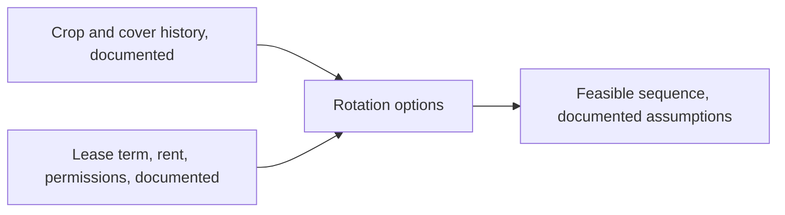
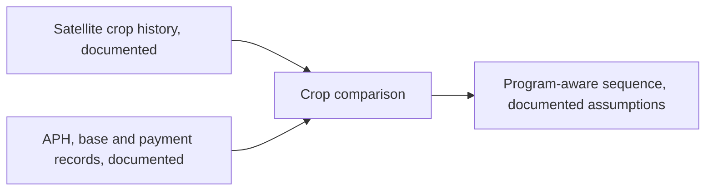
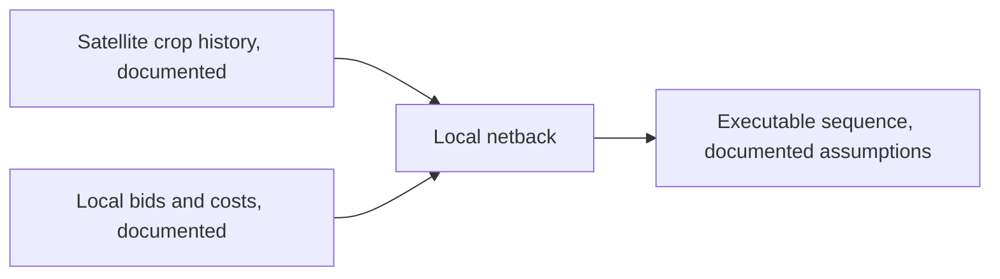
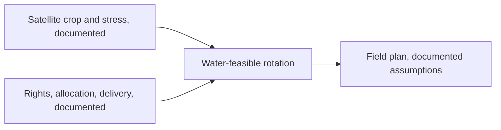
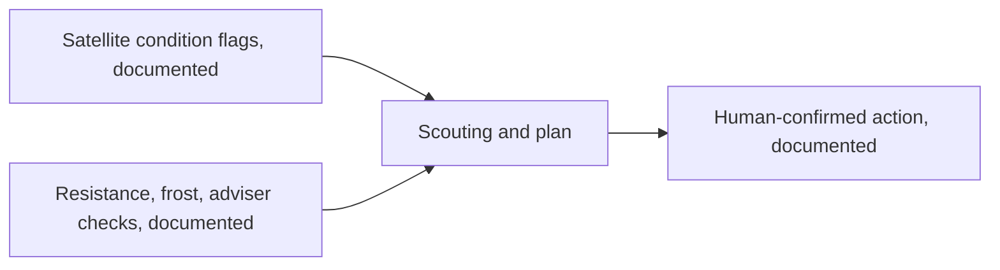
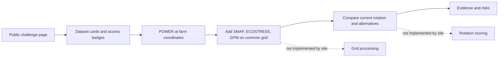
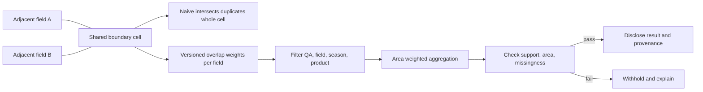
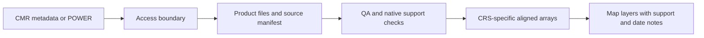

# Field Shift: what the data can carry, and what the farmer still decides

A research brief for the NASA Space Apps 2026 challenge *Adapting Farms with NASA Data*.

**Status.** Written 2026-11-10 by a six-agent evidence wave and nine section writers, then a six-fixer revision pass against a verifier and a reviewer. Assembled from 242 pack rows across 6 packs. Checks that ran: 150 distinct cited URLs registered in a citation ledger with the Sources block rendered mechanically from it, dash count zeroed by the cleanup script, aggregates computed by script over the packs, and verifier plus reviewer passes over this text. Checks that did not run, with the reason: no NASA granule was downloaded and no NASA raster was processed, because Earthdata Login was unavailable to the run, so ingestion is verified at endpoint and API level only; no field polygon, crop classifier or agronomic validation was executed, because the run has no farm data, so the comparison in section 9 is a worked example rather than a measured result; the 2026 judging weights were never published, so none are stated.


## 1. The challenge, read closely


### 1.1 What the Objectives section actually asks for, clause by clause

Basis legend: (documented) means a cited source or report states the claim; (computed) means the value is derived from stated inputs; (measured) means a direct field, instrument, or laboratory measurement reported by a source; (recalled) means a user-provided or otherwise unverified recollection; (read) means the cited source text was checked, not independently reproduced.

The challenge page ([Field Shift: Adapting Farms with NASA Data](https://www.spaceappschallenge.org/2026/challenges/adapting-farms-with-nasa-data/), read 2026-11-10) uses permissive verbs throughout its Objective:

> You may consider combining NASA Earth observations with local agricultural information to create an app, model, interactive map, or other decision‑support tool. The goal is to help farmers explore crop‑rotation options that may improve soil health and strengthen resilience to changing weather and water conditions.
>
> You may explore NASA datasets such as SMAP, ECOSTRESS, GPM, Landsat, MODIS, NASA POWER, GRACE and GRACE‑FO, and SRTM or other NASA elevation products. Using these datasets, you may analyze patterns in temperature, heat stress, rainfall, soil moisture, evaporation, frost risk, extreme precipitation, vegetation stress, and long‑term water trends. You may also consider local soil information, crop characteristics, and farmer priorities, such as water use, forage value, nitrogen-fixing potential, erosion reduction, organic matter improvement, or market suitability.
>
> Your tool may highlight times when fields are typically bare, seasons when current crops appear more vulnerable, or opportunities for rotations that could interrupt pest cycles, reduce water demand, improve infiltration, or add supplemental income. You may compare at least three rotation strategies, including the existing rotation. For each strategy, you may explain why it was suggested, what evidence supports it, what benefits it may offer, where information gaps exist, and any risks that would need local review by farmers or agricultural experts.
>
> The intended outcome is a “supportive tool” that “does not replace farmer judgment or local agricultural expertise.”

The passage names a goal and an intended outcome, but the specific ingredients and acts, including combining data, comparing strategies and explaining them, are introduced as “may.” The Potential Considerations section reinforces that status: “You may (but are not required to) consider the following.” The text itself therefore distinguishes purpose from a checklist of required implementations.

For a decision-support app, treat four outcomes (computed) as the practical floor: combine Earth observations with local soil, crop and farmer information; compare at least three strategies including the current one (documented); explain rationale, evidence, benefits, gaps and local-review risks for each; and support rather than replace farmer judgment. These are the minimum useful interpretation, not four literal “musts.” The permissive list is the ceiling to reach toward, not a reason to skip work. The team has an agent-heavy, advance build on the order of a semester of human work (recalled as the user's planning assumption); 14 to 15 November 2026 is the submission and demo window (documented), not the build ceiling. Pursue relevant data, analysis and interaction ideas where testing validates them, rather than maximizing dataset count.

| Text element | Build interpretation |
|---|---|
| Four outcomes (computed) | Floor: make a meaningful comparison |
| Named datasets and optional considerations | Ceiling: explore and test useful options |
| Supportive outcome | Boundary: expose where local review is needed |

The event page ([NASA Space Apps Challenge 2026](https://www.spaceappschallenge.org/2026/), read 2026-11-10) lists the event and submission dates and notes that resources may still be added before the event. That can change available inputs, but not the distinction between the practical floor and the optional ceiling.

### 1.2 How the challenge is judged, and what that rewards

A polished map is easy to notice, but the 2026 site publishes a judging process, not a scoring rubric. The [NASA Space Apps awards page](https://www.spaceappschallenge.org/awards/) says local and universal event judges select Global Nominees, then NASA and Space Agency Partner experts review nominees to choose Global Finalists and Honorable Mentions; it names ten Global Winners each year (documented; page read 2026-11-10). This describes selection stages, not criteria or point shares. The 2026 rubric weights are unpublished. No score prediction follows from the site.

Archived judging pages offer a vocabulary, not a 2026 guarantee. The [2013 judging page](https://2013.spaceappschallenge.org/about/judging), [2014 global judging page](https://2014.spaceappschallenge.org/about/judging/) and [2019 Northeastern event page](https://2019.spaceappschallenge.org/locations/northeastern-university/) include impact, creativity, validity or product, sustainability and presentation. The 2014 global page defines impact in terms of quality and quantity; the 2019 local page asks whether a project addresses a big or small problem and helps or inspires many or few people. These archive URLs were verified, not read in full, so they do not establish what the 2026 judges will score. Local events may add prizes or differ from global judging.

The 14 to 15 November 2026 event is a submission and demo window, not the team's build ceiling (documented). The MVP is a design commitment, not a semester-sized full build: one synthetic field boundary in Santa Carmem, Mato Grosso, Brazil; one POWER climate context layer; one indicator family, farmer-entered seasonal crop identities; three scenario rows; and three panels for field and season setup, evidence and provenance, and comparison and risk (computed design counts, not measured outputs). Choose Santa Carmem because T4 reports an Embrapa/UFMT trial there on soybean-to-safrinha timing, with a 2.33 Mg/ha maize-yield difference between 19 January and 27 February sowing in 2018 (documented; [Lange et al.](https://rbms.sede.embrapa.br/ojs/article/download/1345/1615/11443)); this supports a locally salient demonstration question, not a field-level rotation effect. Use the 2025/26 crop year from 1 July 2025 through 30 June 2026 as the demo season boundary (computed from T4's documented July to June crop-year convention). The United States is an explicitly scoped extension, not part of this MVP. The scenario rows compare the current sequence with two alternatives, but the MVP displays evidence and risks without ranking until local crop history and agronomic review support it. A bounded reach reference for impact is Brazil's 2025 subsidized rural-insurance cohort: 3.2 million hectares and just over 60,000 policies (documented; [Globo Rural](https://globorural.globo.com/credito-e-investimento/noticia/2026/06/governo-bloqueia-metade-do-orcamento-do-seguro-rural-em-2026.ghtml)); this counts hectares and policies, not unique farms, excludes unsubsidized and self-insured growers, and is not an app-adoption forecast. Cut in this order if capacity is short: first remove US support, second additional satellite layers, third weighted scoring, fourth text-to-SQL agent actions, and fifth voice interaction. Keep creativity and sustainability inside the tested approach, and present evidence so judges can inspect each claim.

**(documented; 2026 weights unpublished)**
| Build evidence | Dimension it can make judgeable |
|---|---|
| Tested comparison with field, season, source and uncertainty visible | Validity or product |
| Bounded farms-and-hectares reach estimate with assumptions | Impact |
| Distinctive method shown to work in its intended setting | Creativity |
| Plausible path to continued use, with stated dependencies | Sustainability |
| Clear interface connecting each claim to its evidence | Presentation |
| Polish without a tested comparison or evidence trail | Presentation only |

These are design interpretations of archived terms, not current score allocations. A clear demo matters because judges need to inspect the work, but visual polish cannot substitute for a valid comparison or a defensible reach claim. The limit is explicit: archived criteria guide what to evidence, while unpublished 2026 weights, criteria changes and local variations prevent a reliable prediction of which dimension will dominate.

### 1.3 Where the tool must defer to the farmer and the agronomist

The challenge describes its intended outcome as a supportive tool that “helps identify patterns and possibilities” and “does not replace farmer judgment or local agricultural expertise” ([Field Shift: Adapting Farms with NASA Data](https://www.spaceappschallenge.org/2026/challenges/adapting-farms-with-nasa-data/), read 2026-11-10). The datasets describe proxies, not management history or outcomes. The [SMAP L4 user guide](https://nsidc.org/sites/default/files/documents/user-guide/multi_spl4smau-v008-userguide.pdf) calls root-zone moisture a model state; the [HLS user guide](https://lpdaac.usgs.gov/documents/1698/HLS_User_Guide_V2.pdf) says surface reflectance alone does not establish crop identity or yield. The [ECOSTRESS JET algorithm guide](https://raw.githubusercontent.com/ECOSTRESS-Collection-3/ECOv003-L3T-L4T-JET/main/documentation/ECOv003_L3_L4_JET_ATBD.md) describes estimated evapotranspiration, not observed rotation water use. No product in the reviewed set supplies a counterfactual experiment establishing rotation-caused gains in yield, profit, soil carbon, soil health or input costs.

A satellite cannot establish which rotation a field can carry. It does not know lease terms, lender conditions, available equipment, local markets or co-op delivery terms. In the US, short leases can shorten the planning horizon; [Mississippi State Extension](https://extension.msstate.edu/sites/default/files/publications/P4091_web.pdf) contrasts typical one-year cash leases with recommended multi-year terms. In Brazil, co-op delivery, storage, input credit and advice can shape choice; [Coamo's member magazine](http://coamo.coop.br/revista/conteudo.php?ed=103&id=1810) describes these services. The farmer, lender, landlord, co-op or agronomist holds the case-specific facts. A map can flag a seasonal pattern, not establish field-level economics or agronomy without those inputs.

Put the boundary on each strategy card, beside its recommendation. Identify observed or modelled inputs and sources, separate them from soil-survey or farmer-supplied facts, and name unconfirmed field facts with who can verify them. For example, rank a cover-crop option based on observed seasonal cover and broad water context, but flag lease permission, planting and termination capacity, and a local buyer or forage outlet for farmer and agronomist review. The list must show what could change the ranking, not repeat a blanket warning.

Deference is not abstention. Each card still needs a ranked reason and a confidence level tied to evidence coverage: a ranking can be clear when inputs support it, qualified when field facts are missing, and withheld when those gaps could reverse it. The limit is a claim about authority, not a ban on useful analysis. A tool that disclaims everything offers no decision support; one that hides its blind spots turns proxy patterns into false certainty. The handoff belongs at the claim itself, where the farmer and agronomist can test the missing facts before acting.

## 2. What the satellite record can and cannot say


### 2.1 SMAP soil moisture: a 36 km footprint reading the top 5 cm

The [SMAP Enhanced L3 user guide (read, December 2023)](https://nsidc.org/sites/default/files/documents/user-guide/spl3smp_e-v006-userguide.pdf) describes a daily map of retrieved surface soil moisture, not a set of independent field probes. The L band radiometer measures naturally emitted microwave brightness temperature at 1.41 GHz (documented). A retrieval algorithm uses the signal's sensitivity to soil dielectric properties, with vegetation water content and soil temperature inputs, to estimate near surface moisture. The quantity represents roughly the top 0 to 5 cm of soil (documented). It can indicate wetting or drying at the surface, but does not directly observe the moisture available to deeper crop roots.

The map's grid is finer than the instrument's information support. SMAP Enhanced L3 posts values on a 9 km grid (documented), but the radiometer footprint is about 36 km (documented). Backus Gilbert interpolation distributes the footprint signal across the finer grid, using a contributing domain of about 33 km (documented). Neighboring 9 km cells therefore do not represent separate 9 km observations. A crisp-looking boundary between cells is not evidence that moisture changed at that boundary. The physical support remains broad, and a single footprint can include several farms, soil types, crops, and land covers.

Cadence also needs careful reading. SPL3SMP_E is a daily composite from half orbit retrievals. A granule contains separate descending and ascending fields, with nominal overpasses near 6 a.m. and 6 p.m. local solar time (documented). Global revisit is about 2 to 3 days (documented), with an 8 day exact repeat cycle (documented). These are related but not interchangeable statements: an L2 half orbit value describes one pass, while L3 composes the passes into a daily product. The L2 source can help place a wetting or drying event in time, but its posting remains derived from the same broad footprint. Neither the daily label nor the two daily pass opportunities create farm scale information.

The product is most useful as broad water context between rainfall events. A regional or block scale decline can prompt a team to check whether the surface is drying before a planting window, especially for a second crop, and then confirm locally with a probe, gauge, or farmer observation. A rising value can be a clue to recent recharge of the surface layer. It is not a direct measurement of the whole water supply for a crop. Soil texture, rooting depth, residue, canopy, and rainfall distribution can make the field differ from the footprint average.

Retrieval quality can fail for reasons that matter to an agronomic map. Frozen ground, snow, open water, steep terrain, urban fractions, dense vegetation, and residual radio frequency interference can impair or invalidate the estimate. The mission requirement excludes vegetation water content above 5 kg per square metre (documented). Some unsafe or unsuitable conditions are flagged rather than repaired into trustworthy field values. A missing or low quality retrieval is not evidence of dry soil, and a spatially smooth map does not remove the footprint's mixed land cover.

Latency is product specific. NSIDC's latency FAQ, last updated in October 2025 and checked on 2026-11-10 (documented), gives a required 2 days and 2 hours and a normal operating mean of about 1.2 days for L3 (documented). For L2 it gives a required 1 day and a mean of about half a day (documented). The latest L3 granule listed on 2026-11-10 ended on 2026-11-08 (documented). Those dated catalog facts describe availability at that check, not a service guarantee. Users should expose product version and observation date, rather than presenting a recent map as a real time field reading.

**Figure S2-F1. SMAP support and posting (documented).**

| Surface layer represented | Radiometer footprint | Posted grid | Interpretation |
|---|---:|---:|---|
| 0 to 5 cm (documented) | about 36 km (documented) | 9 km (documented) | Interpolated posting, not independent field observations |

**Decision it can inform.** Use SMAP as a broad surface wetness or drying flag to decide whether a local check of a planting window is warranted. The documented facts are a 9 km posting and an approximately 36 km footprint; treating these as a roughly 10 to 36 km decision scale is an inference. The SMAP grid is context for a decision, not its field evidence.

**Decision it only illustrates.** It cannot schedule irrigation at a farm gate, estimate root zone depletion, or distinguish moisture in a particular field. In particular, do not infer that a 9 km cell is a farm measurement or that the top 5 cm represents the crop's full rooting layer.

### 2.2 ECOSTRESS evapotranspiration, stress index and land surface temperature

A 70 m ECOSTRESS map (documented) can look like a field measurement, but its products do not all represent the same kind of evidence. The [ECOSTRESS LSTE catalog (read, checked 2026-11-10)](https://www.earthdata.nasa.gov/data/catalog/lpcloud-eco-l2t-lste-003) describes thermal infrared observations used to retrieve land surface temperature and emissivity. ECOSTRESS measures emitted thermal radiance, not soil water or crop water use. Its Tiled Land Surface Temperature and Emissivity product, LSTE, retrieves the radiometric temperature of the surface skin. The temperature and emissivity inversion is ill posed, so emissivity assumptions and cloud screening affect the result. Thin cirrus can leave a falsely cool signal. Surface skin temperature is not air temperature, canopy water use, or root zone temperature.

The [JET algorithm basis (read, 2025-10-08)](https://raw.githubusercontent.com/ECOSTRESS-Collection-3/ECOv003-L3T-L4T-JET/main/documentation/ECOv003_L3_L4_JET_ATBD.md) uses LST together with GEOS-5 meteorology, downscaled soil moisture and HLS vegetation inputs in an ensemble of evapotranspiration models. JET, or the tiled ET product, is therefore a modeled water and energy flux, not a direct measurement of water leaving a field. Its daytime estimate integrates from sunrise to sunset, not a continuous full day total. Input error, clouds, mixed pixels, and model assumptions can all affect the estimate. A modeled flux can be useful, but its 70 m output cells (documented) do not turn it into 70 m measured water use.

The Evaporative Stress Index, ESI, is also derived rather than directly observed. It expresses an actual to potential ET ratio from the model chain. The checked documentation does not establish a standardized multi week climatological window for the tiled ESI product. Thus a single ESI value is not automatically a seasonal drought anomaly or a comparable resilience score. A 2026 site comparison reported that ECO4ESIPTJPL underestimated ESI against in situ estimates from 59 AmeriFlux sites across the continental United States in 55.1 percent of all sites and time steps ([Thakur et al., 2026](https://api.openalex.org/works/https://doi.org/10.1080/07038992.2026.2645742); documented). That study did not directly validate this tiled V003 ESI data set, so its result is a caution, not a product specific error rate.

The 70 m output can help narrow a scouting question when a sufficiently large field or subfield has a distinct pattern during a clear overpass. A hot LSTE patch can prompt inspection for crop cover, soil exposure, or local water stress. A JET contrast can prompt an irrigation investigation or a check of residue and canopy differences. ESI may serve as a same overpass flag for scouting. None of these patterns establish the cause. A difference can reflect soil, crop development, management, cloud contamination, or model inputs, rather than rotation treatment.

Temporal coverage is irregular. ECOSTRESS rides the International Space Station, whose ground track and overpass time vary. Mission average revisit is described as 1 to 5 days (documented), not as a fixed schedule for a particular field. Cloud free scenes are necessary, and cloud gaps remove observations just when a decision may need them. JET additionally requires HLS ancillary inputs. The [ECOSTRESS catalog records (read, checked 2026-11-10)](https://www.earthdata.nasa.gov/data/catalog/lpcloud-eco-l3t-jet-003) list the latest JET and ESI granules on 2026-10-28 and latest LSTE granule on 2026-11-07 (documented). Those are catalog snapshots at the stated check, not evidence that all locations have recent data.

Latency must be stated by product and with its evidence status. The ECOSTRESS FAQ, last updated 2024-04 and checked on 2026-11-10, gives nominal LSTE latency of about 1 day (documented), while the newest catalog granule at the 2026-11-10 check was about 3 days old (documented). The same FAQ gives nominal JET latency of about 3 to 5 days (documented, FAQ last updated 2024-04 and checked 2026-11-10), yet the latest listed JET granule was at least 13 days behind on the check date (documented). Its algorithm basis supplies no numeric latency. ESI inherits JET acquisition and processing, and its basis also supplies no numeric latency. Treat the nominal FAQ timings as historical expectations, not guarantees of availability during a planting decision.

**Figure S2-F2. ECOSTRESS signal to product chain (documented).**

| Input or product | Evidence type and meaning |
|---|---|
| Thermal infrared radiance | Measured signal (documented) |
| LSTE temperature | Retrieved surface skin temperature, 70 m grid (documented) |
| JET ET | Modeled daytime flux, 70 m grid (documented) |
| ESI | Modeled actual to potential ET ratio, irregular overpasses (documented) |
| Clear scene gaps | Missing opportunities for observation (documented) |

**Decision it can inform.** Use a clear pass to decide which sufficiently large field or subfield merits scouting or a local irrigation check. Keep the observation date, product name, quality flags, and comparison scale visible.

**Decision it only illustrates.** An irregular pass cannot establish continuous daily or seasonal ET, root zone status, crop yield, water savings, or that one rotation outperforms another. The record is a scouting signal, not a causal comparison or a substitute for local water measurements.

### 2.3 GPM IMERG rainfall, and the halt in the Final product

The [IMERG V07 ATBD (read, 2023-07-12)](https://arthurhou.pps.eosdis.nasa.gov/Documents/IMERG_V07_ATBD_final.pdf) describes a gridded satellite precipitation estimate, not a rain gauge at the farm. The GPM constellation combines microwave precipitation estimates, interpolates them with motion vectors, and fills time between microwave overpasses with infrared estimates. IMERG Daily aggregates 48 half hourly estimates (documented). The grid is 0.1 degree, approximately 11 km at the equator (documented), so a cell averages conditions across land covers and farms. Daily totals provide regional context, not field rainfall.

Final and Late differ in the timing and adjustment of the estimates. V07 Final applies a later monthly adjustment using GPCC gauge data (documented), making it suited to retrospective regional seasonal totals. It is not an in season product. The V07 Final record ended on 2025-09-30 (documented). NASA's April 28, 2026 transition notice initially projected V08 Final for summer 2026, and its August 6, 2026 update moved that projection to fall 2026 (documented); status checked 2026-11-10, release not verified.

Late is the faster, less adjusted alternative. It is available the next day (documented), before Final's monthly gauge adjustment. The official latency numbers conflict: the ATBD says 12 hours and the [GES DISC Late product page](https://www.earthdata.nasa.gov/data/catalog/ges-disc-gpm-3imergdl-07) says 14 hours (documented). In use, describe this as next day context and preserve the discrepancy rather than choosing one number as a guarantee. NASA's checked catalog calls Late a hybrid that ingests GPROF V08 while holding CORRA calibration to a prior year climatology (documented). It is not equivalent to the later gauge adjusted Final series, especially in an anomalous year.

A credible use is to show completed season regional rainfall with V07 Final through its explicit cutoff, or to use Late as a next day indication that a planting window may have had rain. The latter should be checked against a local gauge or a farmer's report before an action depends on the amount. The question it can help frame is whether the broader area appears wet enough to warrant checking a second crop window. A gridded estimate can help prioritize that check. It cannot decide whether an individual field was planted, received enough rain, or can be worked.

Skill weakens over frozen surfaces, complex terrain, coasts, and warm rain regimes (documented). Grid averaging and changing constellation inputs can obscure local storms or introduce record discontinuities. T1 has no target farm gauge validation, and rainfall alone does not describe soil storage, runoff, drainage, or irrigation.

**Figure S2-F3. IMERG product timing and role (documented, status checked 2026-11-10).**

| Product status | Period or latency | Appropriate role |
|---|---|---|
| V07 Final halted | Through 2025-09-30 (documented) | Retrospective regional seasonal totals |
| V07 Late | Next day; official latency 12 or 14 hours (documented) | Faster regional clue, locally checked |
| V08 Final | Fall 2026 projected, not verified as launched (documented) | Do not claim current availability |

**Decision it can inform.** Choose whether an area wide planting window merits local rainfall verification, or compare regional completed season totals with V07 Final through 2025-09-30. Show the product version, valid period, and source freshness.

**Decision it only illustrates.** IMERG cannot trigger irrigation for a particular field or establish field precipitation truth. V07 Final cannot support post 2025-09-30 values, and Late cannot be presented as gauge adjusted Final quality. The product is a regional estimate to check locally, not a farm rain gauge.

### 2.4 HLS, Landsat and MODIS optical: revisit, cloud, and what a vegetation index omits

The [HLS Version 2 guide (read, updated 2026-04)](https://lpdaac.usgs.gov/documents/1698/HLS_User_Guide_V2.pdf) describes harmonized Landsat and Sentinel 2 surface reflectance on a 30 m output grid (documented). The sensors measure reflected visible, near infrared, and shortwave infrared radiation. The HLS processing harmonizes Landsat OLI and Sentinel 2 MSI observations, applies atmospheric correction, and supplies cloud, shadow, and snow quality information. Sentinel 2's native bands have 10, 20, and 60 m resolution (documented), resampled to the common 30 m grid. Therefore 30 m is the product posting, not the native resolution of every input band, and it does not guarantee a pure field pixel.

Reflected light responds to chlorophyll absorption, canopy structure, soil, and residue. The Normalized Difference Vegetation Index, or NDVI, is a contrast between red and near infrared reflectance. It can track greenness, but it does not identify a crop species, prove a management choice, or measure yield. A bare soil patch, residue, weeds, and a cover crop can create different mixtures within a pixel. Aerosols, bright targets, cloud and shadow masks, tile seams, and geolocation errors can also alter reflectance. An apparently plausible value is not automatically a valid observation; the quality layer and scene date must travel with it.

The nominal HLS acquisition cycle is 8 days for Landsat 8 and 9 together, and 5 days for two Sentinel 2 satellites (documented). Those periods describe opportunities, not a guarantee of clear views. Clouds and shadows can erase observations over planting or termination windows. A nominal revisit sequence can thus leave a long usable data gap. Processing cadence and acquisition cadence also differ: a catalog's daily production field is not a daily satellite view. On the T1 check dated 2026-11-10, the latest acquisitions for both HLS streams were 2026-11-04 and ingestion was 2026-11-07 (documented), a dated example rather than a latency commitment. Historical comparisons also need collection vintage and the known issues appropriate to the processing version.

Where clear and quality screened HLS scenes exist, comparing seasonal cover patterns can suggest candidate fallow periods, cover establishment, or double cropping. A team can present an observation sequence and ask a grower to confirm crop identity and dates. That confirmation is important because reflectance does not distinguish all crops or practices without locally validated classification and ground truth. The satellites show the visible canopy and surface mixture during usable scenes, not the full crop sequence between observations. A missed clouded date can hide a short event such as emergence or termination.

MODIS can add longer and broader phenology context, but not field detail. MOD13Q1 selects a best quality observation for each 16 day composite at 250 m (documented). NDVI can saturate at high leaf area (documented), so increasing canopy density may not produce a proportional index increase. A composite can suppress short events, and a 250 m pixel can mix multiple fields. The product is useful for regional timing and long term greenness patterns, not small field compliance. MOD11A1 provides daily 1 km land surface temperature (documented), a radiometric skin temperature rather than air temperature or a field thermometer. Its mixed pixel and cloud limitations make it broad heat or frost context only. Terra's end-of-science date remains unresolved: [NASA's March 20, 2026 update](https://science.nasa.gov/science-research/earth-science/terra-the-end-of-an-era) gives February 2027, while the [March 11, 2026 MODIS operations deck](https://modis.gsfc.nasa.gov/sci_team/meetings/202603/presentations/Session%201/Jones%20and%20Chiang%20-%20MODISInstOps_2026.pdf) gives March 1, 2027, with decommissioning planned for April 2027 (documented); status checked 2026-11-10.

Neither a vegetation index nor its color ramp records the decision that caused a crop pattern. A sustained green signal can be consistent with several species or management histories. Even a correctly classified cover sequence would not by itself establish a rotation's yield, soil health, soil carbon, or causal benefit. It would show an observation based candidate pattern, which should be paired with field boundaries, local records, crop labels, and farmer confirmation before it informs advice.

**Figure S2-F4. Optical pixel, revisit opportunity, and gaps (documented).**

| Product | Output support and nominal timing | Reading limit |
|---|---|---|
| HLS | 30 m grid; Landsat 8 and 9 combined 8 day cycle, Sentinel 2 pair 5 day cycle (documented) | Cloud and quality screening remove usable dates |
| MOD13Q1 | 250 m; 16 day composite (documented) | Mixed fields and short events can disappear |
| MOD11A1 | 1 km; daily overpass product (documented) | Mixed radiometric skin temperature, not a field thermometer |

**Decision it can inform.** Use quality screened HLS observations to identify candidate seasonal cover, fallow, or second crop patterns worth confirming with the user. Use MODIS only to add broad regional phenology or heat context, while retaining dates, QA, collection vintage, and spatial support.

**Decision it only illustrates.** These products alone cannot identify crop species or full rotation history, establish compliance, estimate yield, or prove soil health gains. No 30 m index or MODIS composite is ground truth, and nominal revisit cannot promise a clear view when a farm decision needs one.

### 2.5 GRACE, SRTM, GEDI and POWER: trend, terrain, biomass and climate envelope

A map that aligns GRACE, SRTM, GEDI, and POWER layers does not make them equivalent measurements. The [GRACE and GRACE Follow On mascon handbook (read, handbook dated 2021-05-10)](https://earthdata.nasa.gov/s3fs-public/2025-12/GRACE-FO_L3_Handbook_JPL.pdf) explains that satellite ranging senses gravity changes used to infer broad mass change. Native 3 degree equal area mascons span roughly 300 to 330 km (documented), while the 0.5 degree cells are oversampled posting (documented). Monthly anomalies combine soil water, snow, surface water, groundwater, and ice relative to the 2004.0 to 2009.999 mean (documented), not absolute storage. Leakage and groundwater separation assumptions limit attribution. GRACE can inform a multi year basin or aquifer trend, but cannot show whether a farm or municipality gained water because of a rotation.

SRTM contributes a different kind of context: elevation derived from a single C band radar mission in February 2000 (documented). The [SRTM user guide (read, revised 2015-10)](https://lpdaac.usgs.gov/documents/179/SRTM_User_Guide_V3.pdf) gives about 30 m posting (documented). Radar phase reflects a scattering phase center, which can lie within a forest canopy rather than at bare ground. SRTM can help screen slope, terrain, and potential drainage pathways. It has no repeat record, so it cannot describe erosion, terracing, drainage changes, or land leveling after 2000. A static elevation layer is a terrain covariate, not current field condition.

GEDI samples canopy and ground structure with lidar along tracks. The [GEDI L4B guide (read, revision 2023-10-29)](https://data.ornldaac.earthdata.nasa.gov/public/gedi/GEDI_L4B_Gridded_Biomass_V2_1/comp/GEDI_L4B_Gridded_Biomass_V2_1.pdf) describes its 1 km aboveground biomass grid as modeled from sparse lidar sampling (documented), not wall to wall observation. The record spans 2019-04-18 to 2023-03-16 (documented). Track gaps can leave cells inadequately sampled, and the forest trained biomass model does not transfer automatically to annual crops. GEDI can flag historical forest or clearing context, not annual crop biomass or soil carbon change.

NASA POWER supplies broad daily climate context, not a direct instrument observation at a farm. The [POWER daily API documentation (read, checked 2026-11-10)](https://power.larc.nasa.gov/docs/services/api/temporal/daily/) describes daily gridded values based on model and reanalysis meteorology and satellite related solar inputs. The daily API uses a grid of about 0.5 degree (documented); documentation conflicts about hydrology dimensions, giving 0.5 by 0.5 degree in one place and one half by five eighths degree in another (documented). Do not silently resolve that discrepancy. POWER can help characterize a broad climate envelope, growing degree days, frost free period, and long term water deficit context. It cannot supply a farm's observed rainfall, soil water, or complete water balance for a specific day.

SMAP L4 root-zone moisture is a model state, not an observation. The [SMAP L4 guide (read, 2025-04)](https://nsidc.org/sites/default/files/documents/user-guide/multi_spl4smau-v008-userguide.pdf) defines a 0 to 100 cm average on a 9 km grid (documented). A Catchment land model uses assimilated brightness temperatures and precipitation forcing; SMAP does not sense root zone moisture. During SMAP outages, L4 continues as model only output. ECOSTRESS LST, by contrast, is retrieved radiometric surface temperature, while its JET ET and ESI are modeled products. Label these outputs by evidence type, not just by grid.

**Figure S2-F5. Evidence and scale ladder (documented).**

| Layer | Support and evidence type |
|---|---|
| GRACE | Native mascon about 300 to 330 km (documented), monthly total mass anomaly |
| POWER | About 0.5 degree daily context grid (documented), model and reanalysis |
| GEDI L4B | 1 km (documented), modeled biomass from sampled lidar |
| SRTM | About 30 m posting (documented), static 2000 radar derived elevation |
| SMAP L4 | 9 km posting, modeled 0 to 100 cm state, not a root zone observation (documented) |

**Decision it can inform.** Use GRACE only as large basin or aquifer trend context; SRTM for terrain screening; GEDI for historical forest safeguards; POWER for broad climate feasibility; and SMAP L4, if shown, as an explicitly modeled root zone state. Choose each only for its scale and evidence type.

**Decision it only illustrates.** These layers cannot establish a field's root zone water, current drainage, annual crop biomass, soil carbon gain, yield, or rotation caused basin change. Pixel alignment cannot harmonize physical support, dates, or uncertainty. Pair the layers with local measurements and management records before making farm level recommendations.

## 3. The non-NASA half of the data problem


### 3.1 US soil survey: gSSURGO and gNATSGO at map-unit scale

USDA NRCS soil products provide a useful mapped prior, not a soil test for a particular field. The distinction matters when a display grid resembles satellite pixels: a 10 m or 30 m cell can be a raster encoding of a mapped soil unit rather than an independent observation at that location.

The Gridded Soil Survey Geographic Database ([gSSURGO](https://www.nrcs.usda.gov/resources/data-and-reports/gridded-soil-survey-geographic-gssurgo-database) (read)) links map-unit keys to component, horizon and interpretation tables. NRCS surveyors delineate map units from field observations, transects, sampling and laboratory analysis. A map unit can contain several soil components and inclusions, so one key does not mean one homogeneous soil. State gSSURGO rasters are posted at 10 m, while the CONUS raster is 30 m to limit file size in the 2026 data cycle. Many neighboring cells repeat the same map-unit key. The cell count therefore is not a sample count, and the displayed spacing does not establish the precision of a field boundary or of a soil property estimate.

An app can use gSSURGO to construct an explainable soil prior for areas with detailed survey coverage. It should retain the map-unit key, survey area, component identity and proportion, selected horizon or depth, and interpretation used. If the app reduces components to one value, it needs to state the aggregation rule. A component-proportion-weighted estimate is more defensible than selecting the dominant component without disclosure, but it still summarizes a map unit rather than measuring the field. A root-zone or water-holding interpretation also depends on depth and the chosen component aggregation, so the displayed answer should expose those choices.

[gNATSGO](https://www.nrcs.usda.gov/resources/data-and-reports/gridded-national-soil-survey-geographic-database-gnatsgo) (read) offers national continuity, but its raster does not have uniform source detail. It combines detailed SSURGO where available with generalized [STATSGO2](https://www.nrcs.usda.gov/resources/data-and-reports/description-of-statsgo2-database) (read) and Raster Soil Surveys in gaps. The 30 m national grid is thus a convenient common display, not evidence that every cell has detailed survey support. The source class should travel with each value. Where the underlying source is generalized, an app should visibly lower the confidence of field-level interpretation rather than silently presenting the national layer as equivalent to detailed survey mapping.

[Web Soil Survey](https://websoilsurvey.nrcs.usda.gov/app/) (read) gives a person a way to inspect map units, interpretations and reports for an area of interest. NRCS reports coverage in more than 95% of US counties, but county coverage does not mean that every field has an onsite diagnosis. It is best used for human review of survey evidence and its depth and interpretation choices, not treated as a stable bulk ingest API or substitute for sampling.

**Figure S3-F1. US soil survey provenance stack (documented).**

| Layer | Native support | Interpretation |
|---|---|---|
| gSSURGO | 10 m state or 30 m CONUS map-unit raster | Repeated keys, survey components and proportions |
| gNATSGO | 30 m national raster, mixed source detail | Source class governs confidence |

The design rule is to show the survey evidence behind a soil claim, not the apparent fineness of its rendered grid. Neither gSSURGO nor gNATSGO guarantees an onsite profile, and repeated cells cannot be counted as independent soil observations. Decisions that depend on actual field conditions still need local review or sampling. These US products and their survey quality claims must not be projected onto Brazilian coverage.

### 3.2 Brazilian soil and land cover: PronaSolos, IBGE, SICAR, MapBiomas

Brazilian soil and land-cover sources are useful for screening and regional context, but they do not form a nationwide soil survey equivalent to US SSURGO. The country has heterogeneous mapped surveys, modeled attributes, sampled profiles and classified land-cover histories. A national portal or a small raster cell does not establish uniform field-level evidence.

[IBGE Pedologia](https://www.ibge.gov.br/geociencias/informacoes-ambientais/pedologia/10871-pedologia.html) (read) provides soil polygons and sheet products at 1:250,000 map scale. Map units can associate multiple soil classes, and map-sheet coverage and survey vintages vary. That scale is a regional map product, not a 250 m pixel size and not a 10 m or 30 m soil observation. [Embrapa GeoInfo](https://geoinfo.dados.embrapa.br/geoserver/ows?service=WFS&version=2.0.0&request=GetCapabilities) (read) provides a national compilation at 1:5,000,000, comprising 2,852 polygons and SiBCS classes to the third level. Its layer name containing “5m” refers to five million map scale, not five-metre resolution. Both sources can supply broad regional soil priors, but assigning their polygons to a field does not make a field soil diagnosis.

[BDsolos and its Redape repository](https://www.bdsolos.cnptia.embrapa.br/consulta_publica.html) (read) collect profile and horizon records from projects and laboratories. These point observations are spatially uneven, and their depth, methods and analytical metadata vary. A profile can help calibrate or validate a local model only after its location, depth and method are shown to fit the target. Sparse points are not a probability sample of Brazil, and they should not be interpolated as a uniform national survey.

[PronaSolos](https://geoportal.sgb.gov.br/server/rest/services/pronasolos?f=pjson) (read) is an ongoing programme and a heterogeneous catalogue, not a completed national map at its target scale. State and regional survey layers have different footprints, vintages and scales. A separate [SGB service](https://geoportal.sgb.gov.br/server/rest/services/pronasolos/solos_90m/MapServer) (read) exposes 90 m modeled soil attributes, including carbon stock by depth. These values draw on legacy observations and digital soil mapping. They are not measured in every cell. A 90 m posting spans three nominal 30 m pixels on each side, but that alignment does not add observations or field-scale detail. The [2022 federal programme summary](https://www.gov.br/en/government-of-brazil/latest-news/2022/pronasolos-platform-allow-access-to-all-who-produce-soil-data-in-brazil) reported that less than 5% of Brazil had been mapped at 1:100,000 or finer at that time. That reported figure reinforces the gap; it does not describe a current, uniform inventory of every regional project. No verified nationwide 10 m Brazilian soil map-unit product or SSURGO equivalent is available in this source set.

[MapBiomas Collection 11](https://brasil.mapbiomas.org/iniciativas-e-produtos/cobertura-e-uso-da-terra/cobertura-30m/cobertura/) (read) supplies annual 30 m land-cover and land-use classifications for 1985 to 2025. It can show broad changes among mapped classes, including agricultural and pasture context, but a class is not certain crop identity for every field-year. Different classes have different limitations, and a reprocessed collection can revise historical labels. A comparison must retain the collection and year rather than treating every changed label as physical land change. [MapBiomas Soil Collection 3](https://brasil.mapbiomas.org/iniciativas-e-produtos/solo/) (read) estimates soil attributes from samples and predictive methods; its 30 m cells are modeled estimates, not soil samples. Its carbon series runs through 2024 and contains a documented 2021 to 2022 artifact, so that interval must not be narrated as a field soil-carbon event.

[SICAR](https://consultapublica.car.gov.br/publico/imoveis/index) (read) and the Cadastro Ambiental Rural (CAR, Rural Environmental Registry) contain registrant-declared rural property polygons and environmental information. State agencies validate submissions over time. A registration is an administrative claim, not a surveyed cadastral line, and overlaps or pending validation matter. The public consultation portal is not proof of a complete, readily downloadable national boundary layer.

**Figure S3-F2. Brazilian soil evidence and coverage ladder (documented).**

| Product | Support | Use |
|---|---|---|
| IBGE Pedologia | 1:250,000 map sheets | Regional mapped soil prior |
| Embrapa GeoInfo | 1:5,000,000 compilation | Broad national context |
| PronaSolos attributes | 90 m modeled grid | Screening, not cell measurements |
| BDsolos/Redape | Uneven profile points | Local calibration if methods fit |
| MapBiomas Collection 11 | Annual 30 m land-cover classes | Broad change context |

Use IBGE and Embrapa maps as regional priors, modeled PronaSolos attributes as screening with source and uncertainty attached, and suitable Redape profiles for local calibration. Use MapBiomas for broad land-cover history, not guaranteed crop identity, and treat CAR geometry as unverified registration. Brazilian state coverage, methods and dates need layer-by-layer checking. None of these products licenses importing US SSURGO map-unit or accuracy assumptions into Brazil.

### 3.3 Crop and management layers: CDL, CroplandCROS, ZARC, NASS

Crop-history products can narrow a candidate rotation, but they do not record all operations a farm performed. A classified crop, an administrative planting-risk recommendation and a county statistic are different evidence types. Combining them without their year, geography and method can turn a useful screen into a false claim about an individual field.

The USDA [Cropland Data Layer (CDL)](https://www.nass.usda.gov/Research_and_Science/Cropland/sarsfaqs2.php) (read) is an annual satellite-based crop classification with full CONUS coverage from 2008. The 2008 to 2023 crop-year layers are 30 m; layers from crop year 2024 are 10 m. The 2025 layer was released on 27 February 2026. Preserve each crop year and its native resolution. Annual class errors, mixed pixels and a changed 2024 workflow complicate cross-year comparisons. Double-cropped areas may be represented by a combined class, and pixel counts do not necessarily match official acreage. A single crop class cannot establish the full management sequence, yield, or a farmer's reason for planting it.

[CroplandCROS](https://croplandcros.scinet.usda.gov/) (read) is a viewer and export front end for CDL, not an independent survey or field-boundary authority. It can help inspect an area and compare candidate crop history, but its results inherit CDL limitations. The displayed time series spans years with different native resolutions. For reproducible application analysis, use the source CDL products directly, preserve the class and year, and ask a farmer to confirm uncertain history. USDA [Crop Sequence Boundaries](https://nass.usda.gov/Research_and_Science/Crop-Sequence-Boundaries/metadata_Crop-Sequence-Boundaries-2022.htm) (read) provide algorithmically synthesized field-like polygons from CDL time series and ancillary information. These are not surveyed or legal field boundaries, and CDL classification errors also affect polygon placement and attached sequences. [Crop Frequency Layers](https://nass.usda.gov/Research_and_Science/Cropland/metadata/metadata_Crop-Frequency-Layers-2025_FGDC-STD-001-1998.htm) (read) summarize how often included crops appeared during a historical window, but frequency does not preserve order or a complete sequence.

Brazil's [ZARC](https://www.gov.br/agricultura/pt-br/assuntos/riscos-seguro/programa-nacional-de-zoneamento-agricola-de-risco-climatico/portarias) (read), the Agricultural Climate Risk Zoning programme, gives crop, municipality, planting decêndio, risk class, cultivar group and soil-class recommendations through season-specific portarias. It is an administrative risk screen, not a field observation. Soil grouping differs across rules: older portarias may use three texture classes, while newer methodology uses six water-availability classes. The applicable crop, state, cultivar and season must be checked before presenting a recommendation. The source set found no machine API, so the portaria or SISZARC query remains the route for verification. ZARC does not substitute for a field soil test or prove that a farm planted on the recommended date.

**Figure S3-F3. Crop-history and recommendation distinction (documented).**

| Source | Evidence unit | Safe interpretation |
|---|---|---|
| CDL | Annual classified pixel, 30 m through 2023 and 10 m from 2024 | Candidate US crop history |
| ZARC | Municipality, crop, season, cultivar and risk class | Brazilian planting-risk recommendation |
| NASS | County and statistical aggregates | US benchmark, not farm record |

[NASS Quick Stats](https://quickstats.nass.usda.gov/api) (read) and the [Census of Agriculture](https://www.nass.usda.gov/publications/agcensus/2022/) (read) can supply US county and other statistical-geography benchmarks for crops, practices and economics. The current Census in this source set is the 2022 edition, which reports protected aggregates, not named farm records. Quick Stats combines survey estimates and Census results; some values can be modeled, withheld or unavailable. Joining a field to its county is technically simple but cannot establish that field's yield or management. Use CDL to propose US crop history, ZARC to screen Brazilian planting risk, and NASS for aggregate comparison. The countries' inputs are not interchangeable, and no source here proves a particular farm's full rotation outcome.

### 3.4 Licence, privacy and the join problem down to 30 m

Intersecting non-NASA layers with a 30 m satellite grid is often easy to compute. The harder work is preserving what each input actually supports and what its terms allow. Alignment is not evidence of equal resolution, validation or permission to redistribute a composite map.

A join should treat each value as a typed claim with its own source, geographic support, vintage, evidence class, aggregation and transformation history. Repeated [gSSURGO](https://www.nrcs.usda.gov/resources/data-and-reports/gridded-soil-survey-geographic-gssurgo-database) (read) cells carry map-unit keys, not separate soil measurements. A broad Brazilian polygon or a 90 m modeled attribute remains broad or modeled when sampled onto 30 m cells. Upsampling can be useful for display or spatial lookup, but it cannot create missing observations. The output should preserve the native support and label the resulting value accordingly. Map-unit summaries need an explicit component-weighted rule and relevant depth; county statistics should remain county context, not be copied into cells as field measurements.

The sources also carry different reuse terms. USDA describes much of its public information as public domain, and [CDL](https://www.nass.usda.gov/Research_and_Science/Cropland/sarsfaqs2.php) (read) permits free redistribution with an as-is warranty limitation. [Embrapa GeoInfo](https://geoinfo.dados.embrapa.br/geoserver/ows?service=WFS&version=2.0.0&request=GetCapabilities) (read) carries CC BY-NC 3.0 BR terms, while [BDsolos/Redape](https://www.bdsolos.cnptia.embrapa.br/consulta_publica.html) (read) carries CC BY-NC 4.0. Those non-commercial restrictions are a design constraint for a commercial app, including adapted layers, unless separate permission is obtained. [MapBiomas](https://brasil.mapbiomas.org/iniciativas-e-produtos/cobertura-e-uso-da-terra/cobertura-30m/cobertura/) (read) uses CC BY-SA, so adapting or redistributing a derivative can trigger share-alike obligations. [CONAB historical prices](https://portaldeinformacoes.conab.gov.br/precos-agropecuarios-serie-historica.html) (read) permit reproduction only for non-commercial purposes. The [SGB 90 m service](https://geoportal.sgb.gov.br/server/rest/services/pronasolos/solos_90m/MapServer) (read) exposes no licence field, and the checked [IBGE](https://www.ibge.gov.br/geociencias/informacoes-ambientais/pedologia/10871-pedologia.html) (read) and INPE pages did not state explicit dataset-level licences. Public visibility is not a blanket commercial reuse grant. Confirm unclear terms with the steward before embedding, exporting or selling derived layers.

[CAR geometry](https://consultapublica.car.gov.br/publico/imoveis/index) (read) adds privacy and validation risk beyond ordinary map attribution. It is self-declared property information subject to state review, not cadastral truth. No federal bulk API or blanket redistribution permission was verified, and automated access to the consultation portal was denied. Do not promise a complete national field-boundary layer or expose sensitive geometry merely because a portal allows public consultation. Use only where the purpose is justified, the provenance is visible and access and reuse conditions have been reviewed.

**Figure S3-F4. 30 m join provenance and rights matrix (documented).**

| Input | Native support | Join rule | Reuse or privacy flag |
|---|---|---|---|
| gSSURGO | Map-unit keys in 10/30 m grids | Preserve components and survey provenance | Public-domain policy, cite source |
| PronaSolos | 90 m modeled attributes | Retain model support and uncertainty | Licence not confirmed |
| MapBiomas | 30 m classified land cover | Preserve collection and class | CC BY-SA obligations |
| CAR | Self-declared property polygons | Validate, restrict sensitive geometry | Bulk rights unverified |

A practical ingest priority keeps the no-account path small and honest.

| Priority | Inputs | Rule |
|---|---|---|
| Keep, minimum public path | Farmer-selected field boundary with version and provenance; field-season crop history with explicit unknown state; field-scoped constraints with provenance and unknown states; public no-login NASA POWER context for a stated period. | These inputs support a transparent, user-correctable demo. POWER is broad context only. Missing or unconfirmed field facts remain unknown; do not claim a data-backed rotation ranking from this set. |
| Optional | HLS after local crop or cover classifier validation; SMAP, IMERG, ECOSTRESS, soil survey, and other product layers when access, temporal fit, QA, support, and licence checks pass. | Add only for a defined comparison question and retain source support and limits. Earthdata Login products remain credential-gated. |
| Drop from the minimum path | GRACE, GEDI, SRTM, MODIS, county aggregates, CAR geometry, and unverified commercial or private contract records. | Do not ingest merely to increase layer count. Reconsider only if a scoped use case, permissions, and validation justify them. |

This is the minimum input set for a public no-account path, not a claim that the set can establish field-level agronomic benefit. Keep field and season identity, farmer-entered constraints, source provenance, and unknown states as first-class records. NASA layers are optional context until their product-specific support and validation fit the decision. For privacy and reuse, store or expose a sensitive local record only when its purpose, provenance, access, and licence are reviewed.

A 30 m product can overlay original-resolution layers for navigation while avoiding false precision. The map, SQL agent, voice response and export should carry the same source, vintage, scale or native resolution, uncertainty, licence and privacy flags. For unclear or non-commercial terms, block commercial reuse pending confirmation; for share-alike data, preserve obligations through derivatives. T2 is not legal advice and does not determine permission for a particular product. It also does not establish a complete national field-boundary layer. Treat the grid as a common display target, never as a license or a source of finer evidence.

## 4. What US farmers weigh


### 4.1 Cash rent, tenure and the landlord veto

A tenant planning a rotation is deciding not only which crop fits the field, but whether the lease lasts long enough to earn back a soil, forage, or cover-crop investment. Cash rent, tenure, written clauses, and renewal risk set that horizon. They do not establish that the landowner selects the crop, and a high rent does not prove corn is the best choice.

USDA’s [2025 Land Values and Cash Rents, read](https://www.nass.usda.gov/Publications/Highlights/2025/2025LandValuesCashRents_FINAL.pdf) reports average US cropland rent of &#36;161/ac (documented) for 2025 (documented), with irrigated land at &#36;244/ac (documented) and non-irrigated land at &#36;147/ac (documented). The national mean gives context, not a field budget. In the farmdoc [2026 Illinois return comparison, read](https://farmdocdaily.illinois.edu/2026/01/projected-incomes-on-owned-vs-rented-farmland-for-2026.html), a central Illinois high-productivity example uses &#36;327/ac cash rent (documented) and projects a negative &#36;15/ac farmer return (documented) for its stated corn and soybean mix. The same modeled mix under 50/50 crop share projects a positive &#36;18/ac return (documented). Those figures are a local budget projection, not observed national results; the comparison illustrates how a fixed obligation transfers more downside to a tenant than a share arrangement.

The distinction between rented land and rented cropland matters. USDA ERS reports that 39% of all US farmland was rented in 2022 (documented), while more than half of contiguous-US cropland is rented (documented). These are different denominators, not competing estimates. Illinois commercial grain farms in farmdoc’s [tenure analysis, read](https://farmdocdaily.illinois.edu/2026/01/tenure-characteristics-of-illinois-farmland-6.html) had 50% cash-rented acres in 2024 (documented), a sample description rather than a national farm statistic. Cash rent leaves the operator with the crop upside and most yield and price exposure while rent remains due. Crop share divides output and often specified costs, but the agreement determines the split.

Lease length changes what a tenant can rationally undertake. Extension guidance from [Mississippi State, read](https://extension.msstate.edu/sites/default/files/publications/P4091_web.pdf) describes one-year cash leases as common and recommends longer terms for practices whose benefits arrive across seasons. A short renewal horizon can make forage, a small grain, or soil-building sequence risky if the tenant may lose the field before returns accrue. A written lease can restrict crops or practices, permit them, or define compensation. The [Practical Farmers of Iowa account, read](https://practicalfarmers.org/resources/articles/finding-common-ground) describes landowners Paul Thompson and Elena Meyer selecting tenant Josh Nelson to add no-till, cover crops, and a third crop. The account says they offered a significant discount on up to 30 small-grain acres (documented) because of financial risk, while its correction clarifies that the flex lease itself did not include that discount. This case shows negotiated cooperation, not a general landlord veto or a representative estimate of how often owners block rotations.

The app can map observed crop and cover patterns over time, flag likely gaps in the crop sequence, and let the operator compare that history with an intended multiyear plan. It cannot see rent, taxes, renewal promises, written restrictions, who pays for fertility or cover crops, or whether a landlord has consented. It also cannot infer authority from a crop map or a regional rental share. These are private contractual facts, so the app should ask the tenant or owner for lease type, term, renewal date, crop restrictions, compensation, and the relevant decision-maker. It should preserve “unknown” until someone with authority confirms the answer.

Landowners are not necessarily farm managers. USDA-NASS’s [2024 TOTAL survey, read](https://nass.usda.gov/Publications/Highlights/2026/TOTAL24.pdf) found 87% of landlords were non-operating (documented), but that population statistic says nothing about authority in a particular lease. Cash-rent operators may have substantial operating freedom, while crop-share terms can require joint decisions. The tool should present the practical choice as a field-specific agreement, not presume either unilateral landlord control or tenant freedom. A longer contract, explicit soil or crop provisions, or a negotiated payment can change feasibility; only the parties and their written agreement settle which applies.

**Decision boundary (documented)**


|Measure|Value and basis|
|---|---|
|All US farmland rented, 2022|39% (documented)|
|Contiguous-US cropland rented|More than half (documented)|
|Central Illinois modeled farmer return, cash rent / crop share|negative &#36;15/ac / positive &#36;18/ac (documented)|

### 4.2 Crop insurance, base acres and programme payments

A grower comparing crop sequences faces three distinct kinds of public support: crop insurance, legacy commodity-program base, and temporary planted-acre aid. Keep them separate. Insurance can change downside risk for one crop; historical base generally does not dictate planting; a one-time transfer is not recurring margin.

For 2026, farmdoc’s [projected-price report, read](https://farmdocdaily.illinois.edu/2026/03/projected-prices-and-volatility-factors-for-2026.html) gives crop-insurance projected prices of &#36;4.62/bu for corn (documented) and &#36;11.09/bu for soybeans (documented). These are insurance price inputs, distinct from the later USDA WASDE season-average price estimates; neither is a farm’s guarantee or a comparison of crop profit. Under the [USDA Risk Management Agency’s 2026 Common Crop Insurance Basic Provisions, read](https://rma.usda.gov/sites/default/files/2026-06/Common%20Crop%20Insurance%20Policy%20Basic%20Provisions%2027.1-BR.pdf), Actual Production History, or APH, uses a consecutive crop-year history with a minimum of 4 years and maximum of 10 years when available (documented). The policy’s crop-specific yield history, coverage level, projected and harvest prices, premium, insured unit, and qualifying loss all matter. A corn APH is not a soybean APH, and the projected price by itself is not a per-acre indemnity.

The app can show satellite-observed crop history and field conditions, but cannot see private APH, insured acres, unit structure, coverage, premium, loss adjustment, or indemnity. Imagery cannot establish a policy-qualified loss. The farmer, lender, and insurance agent must confirm contract terms. Display each crop’s guarantee assumptions separately, dated and labeled, and never present a projected price as a guaranteed payment.

Commodity-program base is another distinct record. The [eCFR rule for additional base acres, read](https://www.ecfr.gov/current/title-7/subtitle-B/chapter-XIV/subchapter-B/part-1412/subpart-B/section-1412.27) describes the 2026 base-acre change, and USDA Farm Service Agency’s [allocation announcement, read](https://fsa.usda.gov/news-events/news/09-15-2026/usda-announces-2026-2027-enrollment-key-price-revenue-safety-net) reported completing a national expansion capped at 30 million acres (documented). Eligible acres exceeded the cap, so allocation was reduced pro rata by 3.69% (documented). The additional base calculation used 2019 to 2023 planting and prevented-plant history (documented). This one-time allocation creates a partial link to prior crop history, but it does not impose an ongoing planting mandate. Legacy ARC and PLC payments were generally tied to base rather than current planted crops. Base acres and this year’s planting therefore need not match.

The app can show public rules and accept confirmed base and payment details, but cannot see a farm’s award, crop-specific base, ownership share, or entitlement. Imagery and public allocation figures cannot certify FSA history. Require confirmation from the farmer and FSA before including a payment in a field comparison.

Farmer Bridge Assistance, or FBA, illustrates why year labels matter. USDA’s [2025 FBA payment announcement, read](https://usda.gov/about-usda/news/press-releases/2025/12/31/usda-announces-commodity-payment-rates-farmer-bridge-assistance-program) set rates of &#36;44.36/ac for 2025-planted corn (documented) and &#36;30.88/ac for 2025-planted soybeans (documented). Payment depended on reported planted acres and eligibility. Under share rent, the lease governs how income is divided. This is a crop-year transfer, not a continuing margin advantage for corn or evidence that a farmer should choose corn in a later year. Do not carry it into a future sequence model unless a successor payment is documented and its eligibility confirmed.

The app can present insurance, base, and one-time assistance as separate, dated, user-confirmed fields alongside an agronomic plan. It cannot see farm-level APH, policy choices, FSA enrollment, landlord shares, or entitlement. A public price, allocation rate, or payment schedule is not a guaranteed farm payment. The farmer and relevant lender, FSA office, or insurance agent must settle the private amounts and who receives them. Keep expected crop revenue and insurance protection separate: an insurance floor may cushion a loss, but it does not establish that a crop is profitable.

**Decision boundary (documented)**


|Item|What the public figure establishes|
|---|---|
|2026 projected price, corn|&#36;4.62/bu (documented), price input only|
|2026 projected price, soybeans|&#36;11.09/bu (documented), price input only|
|2026 additional base expansion|30 million acres (documented), national cap|
|2026 pro rata reduction|3.69% (documented), not a farm award|
|2025 FBA corn / soybean rate|&#36;44.36/ac / &#36;30.88/ac (documented), 2025 planted acres|

### 4.3 Price, basis and where a rotation stops paying

Crop choice is a local netback question across years, not a futures-price comparison. Netback means expected crop revenue after the farm’s available price, delivery costs, input exposure, and sequence effects. A field decision needs the grower’s yield history, current buyer bids, avoidable and sunk costs, and harvest capacity.

A dated basis snapshot shows why. DTN’s [daily basis comments, read](https://dtnpf.com/agriculture/web/ag/news/article/2026/11/04/corn-soybean-basis-stronger) on November 4, 2026 reported corn at Decatur, Illinois, at 10 cents/bu over December futures (documented), versus 40 cents/bu under at Fort Dodge, Iowa (documented). Soybeans were 6 cents/bu over January futures at Decatur (documented) and &#36;1.00/bu under at Grand Island, Nebraska (documented). Those location spreads demonstrate that the local cash bid can depart sharply from a national futures signal. They do not establish a durable ranking: buyer, delivery month, freight, storage, drying, quality, and contract terms can reverse which field option pays. A one-day basis observation is not a forward bid.

The relevant comparison starts with expected yield and delivery bids, then subtracts variable costs and delivery expense. Separate sunk inputs from costs still avoidable. Nitrogen can expose corn to a large bill, and a late switch may strand purchased or applied fertilizer; soybeans still need nutrient management. A grower’s own break-even beats a generic corn-soy price ratio, but depends on yield, price, and cost assumptions.

Indiana farmer Ryan Facemire told [Farm Progress, October 2026](https://www.farmprogress.com/management/tale-of-two-farmers-nitrogen-prices-force-strategy-rewrite) that his late-March 2026 local fall-delivery bids were &#36;4.52/bu for corn and &#36;11/bu for soybeans (documented). He said marginal corn needed 190 bu/ac to break even (documented), compared with 40 bu/ac for soybeans (documented), and he switched all acres to soybeans. Those are Facemire’s operation-specific thresholds and decision, not national break-even yields or a forecast for other farms. His account also describes a large input commitment and a combine purchase to manage harvest after the switch. Do not convert the case into a universal response to high fertilizer prices.

Rotation changes both the current crop’s expected yield and costs in later years. An [Agronomy Journal analysis, read](https://acsess.onlinelibrary.wiley.com/doi/full/10.2134/agronj2016.03.0134) of 748,374 Midwest field records from 2007 to 2012 estimated observational associations (not causal effects) between continuous cropping and rainfed continuous-corn yield penalties of 4.3% (documented), continuous-soybean penalties of 10.3% (documented), and an irrigated continuous-corn penalty of 1.7% (documented). The observational estimates can be confounded by field selection, soil, moisture, weather, irrigation, pest pressure, and management; they are not field forecasts or causal rotation benefits. The app can organize a farmer’s observed field crop and yield history, subject to record quality, and show a multi-year budget under explicit assumptions. Satellite observations can help identify crop and vegetation patterns, but they cannot provide a forward cash bid, invoice, prepaid fertilizer balance, delivered input price, contract premium, or an elevator settlement.

Equipment and harvest logistics can determine whether a profitable sequence is executable. [Iowa State’s 2025 field-day analysis, read](https://extension.iastate.edu/agdm/crops/html/a3-25.html) gives a northwest Iowa example of 12.6 suitable spring field days between April 30 and May 20 (documented); its example says 1,600 corn acres would require 127 acres/day (documented), or 9.1 acres/hour across a 14-hour workday (documented). This is a capacity example, not a prescription for wider equipment; outsourcing and fewer passes are alternatives. Iowa farmer Mike Brelsford, in a [December 2025 Wallace Farmer profile](https://www.qgdigitalpublishing.com/article/Should+you+skinny+down+your+line%3F/5079686/857804/article.html), said a second combine would require eight workers (documented) and hiring that many at harvest was “virtually impossible.” That is one farm account, not a regional labor estimate. Calendars can be mapped, but the app cannot see machine condition, crew availability, storage space, trucking turns, or custom-hire commitments.

For each field, the tool should request the operator’s current bids by delivery point and date, yield assumptions, input invoices and commitments, haul and drying costs, storage and contract terms, and equipment or labor constraints. It can show sensitivity to those entries and keep sequence effects visible. It cannot settle the buyer’s price, a lender’s operating credit, or whether the operator can execute the plan. The comparison stops being reliable when those private inputs are missing or when a dated average is treated as a guaranteed farmgate return.

**Decision boundary (documented)**


|Example|Value and basis|
|---|---|
|Corn basis, Decatur / Fort Dodge, Nov. 4, 2026|+10¢/bu / −40¢/bu (documented)|
|Soy basis, Decatur / Grand Island, Nov. 4, 2026|+6¢/bu / −&#36;1.00/bu (documented)|
|Rainfed continuous-corn / continuous-soy observational association, not causal|4.3% / 10.3% (documented)|
|Iowa spring field-day example|12.6 days (documented)|

### 4.4 Water: the Ogallala, Kansas LEMAs and SGMA fallowing

For an irrigator, water may decide which crop sequence is feasible before prices do. A regional aquifer trend or satellite-derived vegetation stress can indicate exposure, but neither tells an operator how much water a specific well can pump, what a district will deliver, or what a legal allocation allows. Those constraints are local, dated, and sometimes still proposed rather than binding.

In Kansas, the High Plains aquifer’s overall water level rose a provisional 0.2 ft in 2025 (measured), the first overall rise since 2019, according to the Kansas Geological Survey’s [2025 levels report, read](https://kgs.ku.edu/news/article/groundwater-levels-in-the-kansas-high-plains-aquifer-see-first-overall-increase-since-2019). The 1996 to 2025 mean was a decline of 0.57 ft/year (measured), and Groundwater Management District 3 fell 0.62 ft in 2025 (measured). Local rainfall contributed to the overall rise, so it does not establish recovery at an individual well. A long-run regional trend helps frame risk, but an aquifer-wide average is not the grower’s water supply, pumping cost, or right.

Kansas's Sheridan County 6 LEMA in northwestern Kansas applied a total allocation of 55 acre-inches per eligible acre over each five-year term: 2013-2017, renewed 2018-2022, and approved 2023-2027 (documented). Those enacted Sheridan 6 terms are separate from the pending Greater GMD 4 renewal proposal described below. The [2016 K-State study](https://accc.k-state.edu/research/factsheets/FS7_LEMA.pdf) examined Sheridan 6 in northwestern Kansas, a 99-square-mile LEMA with 185 irrigation wells, comparing reported irrigation and crop-acreage outcomes in 2013 with 2009-2012 averages for the five-mile surrounding comparison area. It estimated irrigated corn area fell 23%, sorghum area rose 68%, soybean area rose 8%, and all irrigated crop acreage fell 5% (documented observational estimates). A separate [2026 Journal of Agricultural and Resource Economics study](https://ageconsearch.umn.edu/record/358997/files/JARE358997.pdf) analyzed 2003-2023 well-meter panel data in Sheridan 6, northwestern Kansas, and comparison points of diversion in a three-mile buffer; its cleaned sample contained 7,222 observations from 169 treatment and 199 control points of diversion. It estimated water-use intensity declined 16% and pumping costs fell &#36;5.48 per acre, with no statistically significant change in irrigated acreage (documented observational estimates). The results are not directly comparable: the K-State study compares 2013 crop-area outcomes with 2009-2012 averages for a five-mile surrounding area, while the 2026 study models 2003-2023 meter records against a three-mile buffer. Samples and methods differ, and the later study's comparison points also adopted a less restrictive allocation beginning in 2018. These observational results do not establish a universal crop response. A cap changes a rotation only if it binds below desired use, and growers respond through crop mix, applied water, or other adjustments.

California has a different mix of groundwater sustainability plans, district surface-water deliveries, pumping charges, and trading. The [Public Policy Institute of California’s San Joaquin Valley analysis, read](https://www.ppic.org/publication/policy-brief-the-future-of-agriculture-in-the-san-joaquin-valley/) estimates that 500,000 to 900,000 acres could need to be fallowed by 2040 (computed), depending on water supplies and trading. That is a scenario, not observed acres caused by the Sustainable Groundwater Management Act, or SGMA. PPIC’s [2026 overdraft update, read](https://ppic.org/blog/california-is-finally-addressing-groundwater-overdraft-how-is-it-going) estimates Central Valley overdraft at about 1.1 million acre-feet/year in 2021 to 2025 (documented), compared with 1.9 million acre-feet/year in 2003 to 2010 (documented). A water district’s surface allocation may ease or intensify a field’s groundwater constraint. A perennial orchard’s sunk investment and removal costs also differ fundamentally from an annual grain crop; a simple fallow-versus-crop layer would miss that difference.

The app can map crop type, canopy condition, vegetation stress, and season-to-season land-cover change at the product’s resolution, then attach dates and uncertainty to those observations. It cannot identify a parcel’s legal water right, actual meter readings, pumping charge, groundwater allocation, district delivery promise, water trade, or a farmer’s reason for fallowing. Regional satellite or aquifer signals cannot settle those private or jurisdiction-specific facts. The tool should ask for the water right or applicable LEMA/GSA rule, allocation period, measured pumping, district delivery, fee, crop water need, and intended acreage. The grower or water authority must confirm the terms before an app treats them as a binding constraint.

By November 10, 2026, the pending Kansas Greater GMD 4 LEMA renewal proposal for 2028-2032 called for a 15% reduction to existing five-year allocations, according to the [October 13, 2026 GMD 4 hearing testimony](https://agriculture.ks.gov/home/showpublisheddocument/17804/639268979873281769) (documented); the Chief Engineer had not issued a final order. The Greater GMD 4 proposal should therefore be displayed as pending, not an enacted field limit. In California, PPIC’s future fallowing scenario must likewise remain distinct from measured fallow. Water layers can help identify where to ask harder questions; only local rights, delivery and pumping records establish the water available to this operation.

**Decision boundary (documented)**


|Evidence|Value and basis|What it does not settle|
|---|---|---|
|Kansas High Plains, 2025|+0.2 ft overall level (measured)|A specific well’s supply|
|Sheridan County 6 LEMA|55 acre-inches per eligible acre over each five-year term: 2013-2017, 2018-2022, and approved 2023-2027 (documented)|A right outside this LEMA|
|San Joaquin Valley, by 2040|500,000 to 900,000 acres fallowing (computed)|Observed SGMA-caused fallow|

### 4.5 Resistance, frost risk and the agronomist channel

A crop or herbicide sequence can look viable on a map and still fail because of field-specific weed resistance, freeze injury, or unavailable help at the right time. Satellite observations are useful as prompts to scout and review, not as biological diagnoses or automatic prescriptions. The grower and agronomist must check the field evidence before changing a plan.

Resistance varies by field. A [2026 Weed Science study, read](https://doi.org/10.1017/wsc.2026.10111) examined four suspected glufosinate-resistant waterhemp populations in Illinois (documented); 20% survived the labeled rate at one field site (documented). This is not a map of resistance across Illinois. Local weed history, control failures, herbicide mode-of-action history, and, where available, an assay matter more for a field. Rotation can alter weed emergence and control windows, but it cannot replace multi-mode control or prevent seed set by itself.

The app can flag crop-cover anomalies and combine farmer-entered weed history with field boundaries. It cannot identify resistant species, distinguish resistance from application or weather failure, assay a population, or verify the seedbank. Satellite patterns should prompt scouting, not a resistance label or product prescription. The operator and agronomist must confirm species, stage, control history, and tactics.

Kansas State’s [March 2026 wheat freeze assessment, read](https://eupdate.agronomy.ksu.edu/article/wheat-status-injury-symptoms-from-freeze-damage-687-4) reported March 15 to 16 minima from −1°F in northwest Kansas to 17°F in south-central Kansas (documented). Its reference estimates injurious exposure near two hours at 12°F for tillering wheat and 24°F for jointing wheat (documented). It advises waiting 10 to 14 warm days before assessing injury (documented), since stage, variety, moisture, residue, wind, stand density, and field position matter. A regional minimum is not a yield-loss estimate.

The app can combine dated weather with satellite condition anomalies and user-entered crop stage to flag a freeze-risk window. It cannot establish temperature duration at the plant, variety response, stand viability, loss cause, or insurance eligibility from imagery. A grower or agronomist must inspect and document the field; the insurer confirms coverage and procedures before replant or abandonment decisions.

An adviser can connect field diagnosis to scouting, chemical choice, timing, custom application, and available service, but the adviser channel is neither uniform nor always the first source of a new idea. Purdue’s [2025 Large Commercial Producer Survey, read](https://agribusiness.purdue.edu/2025-large-commercial-producer-survey-results/) was based on 1,151 large commercial producers (documented). In the results [reported by AGDAILY](https://www.agdaily.com/news/farmers-trust-ag-media-peers-exploring-new-practices/), agricultural media was the leading source of new ideas for 25.6% of respondents (documented), other farmers for 21% (documented), and dealer or retailer resources for 13.6% (documented). The survey concerns large commercial operations and information sources, not the cause of a particular rotation change or the quality of a recommendation. An adviser’s service availability and commercial relationship should be recorded rather than inferred from a directory listing.

Operational capacity can be just as binding as advice. Iowa farmer Mike Brelsford, described in Wallace Farmer in December 2025, said a second combine would require eight workers and hiring that many at harvest was “virtually impossible.” His farm was described as 6,000 acres (documented), making this one farmer’s experience, not a national labor estimate. It illustrates that a crop’s calendar, combine capacity, labor, storage, and delivery rhythm have to fit the operation. The app can show crop calendars and ask about planting and harvest windows. It cannot see a crew roster, custom applicator schedule, retailer inventory, equipment breakdown, storage capacity, or service agreement. The grower or adviser must confirm those constraints before the map’s suggested timing becomes an operational plan.

The tool should keep a record of who confirmed a biological or service constraint and what evidence they used. It can surface anomalies, organize scouting notes, and compare sequences under human-confirmed assumptions. It cannot diagnose resistance, certify frost injury, guarantee an adviser or labor crew, or replace a grower’s field inspection. A named, dated observation is stronger than a generic risk layer, but the cited study, survey, and individual account each have their own scale and limit.

**Decision boundary (documented)**


|Driver|What the app can flag|What requires field or human confirmation|
|---|---|---|
|Weed resistance|Anomalous crop or cover pattern and entered control history|Species, resistance assay, herbicide failure cause|
|Frost|Dated weather and condition anomaly|Crop stage, injury, insurance cause of loss|
|Adviser and labor|Calendar conflicts and entered service needs|Adviser availability, crew, equipment, storage|

## 5. What Brazilian farmers weigh


### 5.1 The safrinha window sets the whole rotation

In the Cerrado, the soybean harvest date is the hinge between the first crop and the second crop [safrinha]. The grower does not choose a crop list in the abstract. The grower chooses soybean sowing date and cultivar maturity group [grupo de maturação], then must get the soybean harvested and the next crop planted while rains can still support establishment and grain fill. A recommendation that proposes maize after a late soybean harvest without checking the local window can turn an apparent rotation into a high-risk calendar.

| Sequence step | Decision variable | Consequence |
|---|---|---|
| Soybean planting | Sowing date and cultivar cycle | Sets likely harvest timing |
| Soybean harvest | Machine and field availability | Sets when the next crop can be planted |
| Second crop | Crop and sowing date | Sets flowering and grain fill exposure to the dry season |

[An Embrapa and UFMT field experiment](https://rbms.sede.embrapa.br/ojs/article/download/1345/1615/11443) at Santa Carmem, Mato Grosso, makes the timing cost concrete. In the 2018 trial, maize planted on 19 January yielded 2.33 Mg/ha more than maize planted on 27 February. The 2024 paper describes about 20 February as a practical upper limit for high-potential second-crop maize in that Cerrado-Amazon transition setting. The date is not a national deadline. It should not be copied to every municipality in Mato Grosso, Goiás, Mato Grosso do Sul or Bahia, where rainfall, soil, elevation and crop systems vary.

Cultivar cycle matters because a later soybean harvest consumes days from the next crop's establishment window. [RESR study in Dois Vizinhos, Paraná](https://www.scielo.br/j/resr/a/Cp5dGMsPtgBh4G3Mz48SzFs?lang=en), over 2016/17 and 2017/18 found that soybean maturity group 6.0 sown in mid-September allowed maize planting in mid-February. Soybean sown on 15 October made the second maize crop uneconomic there regardless of maturity group. That southern result demonstrates the mechanism, not a Cerrado cultivar prescription. A tool that imports the Paraná maturity group as a default for Mato Grosso would mistake one local experiment for another region's agronomy.

The decision is also about operational capacity. Harvesters, planters, labor and input delivery must be available in sequence. A weather delay can compress the gap further. The planting date then affects when maize flowers and fills grain relative to declining rainfall. Farmers may respond by leaving maize out rather than forcing a crop into a poor window. The [2024 Aprosoja-MT alternative-crop guide](https://siteapi.aprosoja.com.br/storage/arquivos/4/240724142657.pdf) names sorghum, millet, sesame, sunflower, brachiaria and crotalaria as options when late maize becomes uncertain. These choices do not have interchangeable outcomes. Grain markets, biomass, water use, pest breaks and harvest requirements differ, so the fallback should be tied to local buyers and field conditions.

The timing issue is one place a US-centric annual rotation planner fails. A crop label such as “maize after soy” hides the narrow sequence linking soybean maturity, harvest operations, next sowing, and the dry-season boundary. In Brazil, the app should represent each crop as a dated field event and show the uncertainty around estimated planting and harvest dates. It should offer alternatives when the window narrows rather than score a late maize crop as if calendar position were irrelevant.

Agricultural risk zoning [Zoneamento Agrícola de Risco Climático, ZARC](https://normativos.bcb.gov.br/Votos/CMN/202535/Voto_do_CMN_35_2025.pdf) links the local municipality, soil class and cultivar cycle to a sowing-risk window. Since 1 July 2025, observance of ZARC has also applied more broadly to agricultural operating credit [crédito de custeio]. The calendar therefore may affect both agronomic risk and finance. Satellite time series can help estimate vegetation emergence or crop timing, but a satellite estimate does not confirm cultivar, intended harvest plan, machine availability, loan terms, insurance status or the grower's choice to plant a second crop. The app should present a dated local estimate as a planning aid, not as proof of eligibility or a guarantee of yield.

### 5.2 Credit, ZARC and PROAGRO as rotation constraints

A crop can be agronomically possible and still fall outside a Brazilian farm's feasible choices if working capital, the sowing-risk window or protection does not line up. The app must distinguish the public credit envelope from a loan actually contracted, the agricultural risk zoning [Zoneamento Agrícola de Risco Climático, ZARC](https://normativos.bcb.gov.br/Votos/CMN/202535/Voto_do_CMN_35_2025.pdf) from a general forecast, and a protection programme from full revenue insurance. A map or national programme total cannot establish an individual grower's eligibility.

The 2026/27 [Plano Safra](https://www.gov.br/agricultura/pt-br/assuntos/politica-agricola/plano-safra/2026-2027/filipeta-plano-safra-2026-2027-defeso.pdf), Brazil's annual agricultural credit plan, announced R&#36;525.1 billion in commercial credit, including R&#36;384.9 billion for operating costs and commercialization and R&#36;140.2 billion for investment. Published annual rates include 9 percent for Pronamp, the medium-producer line, and 12.5 percent for commercial operating credit. These are programme terms, not an offer available to every farm. The borrower, line, lender appraisal, collateral, paperwork and the timing of bank disbursement still determine access. Growers who cannot secure a controlled-rate loan may use own funds, a cooperative, a trader or an input supplier, each with different price and delivery conditions.

The separation between headline and access matters in the 2026 season. From July to October 2026, rural-credit disbursement was R&#36;107.6 billion, down 25.7 percent year on year, and the reported total included nearly R&#36;20 billion in debt renegotiations rather than new working capital. This national flow is not an individual approval or disbursement, and the source pack does not provide a public panel of credit denials by municipality, crop and soil class. The app should ask the grower or lender to confirm the line, amount, terms, date and any linked crop requirement before ranking a rotation as financed.

ZARC makes timing more than agronomic advice. From 1 July 2025, observance of ZARC became a condition across agricultural operating credit, not only the prior set of small operations tied to the federal loan-protection programme [Programa de Garantia da Atividade Agropecuária, PROAGRO]. The applicable window depends on municipality, soil class and cultivar cycle. A recommendation to plant later can therefore put a crop outside a finance condition even where the field still appears plantable. [PROAGRO instructions](https://www.bcb.gov.br/content/estabilidadefinanceira/proagro_docs/resumo_instrucoes_Proagro.pdf) also say agents verify sowing dates using satellite images. That supports a monitoring role for remote sensing, but a satellite-derived date does not itself establish which crop and cultivar were financed, whether a permitted exception applies, or whether an indemnity will be paid.

PROAGRO is protection for eligible operating-credit obligations after covered losses, not a promise to replace the farm's full expected revenue. [CMN Resolution 5.224](https://www.bcb.gov.br/estabilidadefinanceira/exibenormativo?numero=5224&tipo=Resolu%C3%A7%C3%A3o%20CMN) requires mandatory PROAGRO enrolment for eligible controlled-resource operating-credit operations up to R&#36;200,000 per beneficiary per crop year, effective 1 July 2025; this is an enrolment threshold, not a coverage maximum. The rules also allow loss history to affect eligibility. A farmer can still have production costs or revenue exposure beyond the enrolled amount. A grower with sufficient capital may self-insure, while a borrower dependent on financed inputs may need the programme and still retain uncovered risk.

The Rural Insurance Premium Subsidy [Programa de Subvenção ao Prêmio do Seguro Rural, PSR] reduces part of an insurance premium rather than paying a loss. On 9 June 2026, [reporting said R&#36;461.6 million](https://globorural.globo.com/credito-e-investimento/noticia/2026/06/governo-bloqueia-metade-do-orcamento-do-seguro-rural-em-2026.ghtml) of a revised R&#36;991.1 million budget was blocked, or 46.5 percent. The 2025 programme had supported 3.2 million hectares and just over 60,000 policies. A budget blockage creates a timing and availability risk, but it does not prove every farmer was uninsured or that private cover was unavailable.

A US-centric crop planner that treats weather suitability as the only gate misses the Brazilian connection between crop timing, ZARC, credit appraisal and protection. Show those as distinct fields with dates and source status. Require lender or insurer confirmation before labelling an option funded or covered. Neither satellite weather and crop signals nor national programme totals resolve a private credit decision, ZARC exception or claim.

### 5.3 Freight, barter and the Mato Grosso netback

An export-market price is not the price a Mato Grosso farm receives. A useful crop comparison starts at the farm and subtracts the costs and obligations needed to turn grain into a settled sale: origin-specific freight, delivery route, local basis, any input-finance commitment and the buyer's settlement terms. A national benchmark or a port quote can make a crop look attractive while the actual farmgate netback is weak.

[Conab's September 2026 freight survey, published in the October 2026 Logistics Bulletin](https://www.gov.br/conab/pt-br/atuacao/logistica/boletim-logistico/boletim-logistico-outubro-2026.pdf) illustrates why route and origin belong in the calculation. From Sorriso, the survey listed R&#36;500 per tonne to Santos over 1,961 km, R&#36;280 per tonne to Miritituba over 1,076 km, and R&#36;490 per tonne to Paranaguá over 2,128 km. Even a single state does not have one freight price: the same survey listed Querência to Santos at R&#36;450 per tonne and Primavera do Leste to Santos at R&#36;410 per tonne. The nearer Miritituba route had a lower quoted charge than the two southern ports in that survey, but route selection is not determined by distance alone. Grain, available capacity, modal connection, terminal access and a farm's delivery contract all matter.

A farm-level comparison should calculate a dated netback from its own origin, route, freight charge, grain basis and settlement terms, then compare the result across soybean, second-crop maize and local alternatives. Conab's figures are route-survey values, not invoices for an individual farm or current contract offers. No uniform Mato Grosso freight deduction exists, and the pack did not find current farm-level freight contracts or realized port basis. The app should label route figures as examples and request the farmer's actual offer before recommending a crop on price grounds.

Input financing can change the decision before grain is sold. Conab recorded fertilizer imports of 28.46 million tonnes in January to September 2026, compared with 33.75 million tonnes in the same months of 2025. Its October 2026 bulletin associated high input prices and lower Mato Grosso import flow with expected investment cutbacks or optimized application. That is a market signal, not evidence that a particular field received fewer nutrients. Farm-level delivered input prices and application rates were not available in the source pack.

Barter [troca por grãos] lets a producer obtain seed, fertilizer or crop protection before planting and repay in grain after harvest. It can bridge a working-capital gap, but the same contract may tie the input source to a grain buyer or originator and reduce the farmer's ability to choose another supplier or outlet. [CropLife and CropData figures reported in 2025](https://valorinternational.globo.com/agribusiness/news/2025/10/27/input-suppliers-gain-ground-in-brazils-farm-credit-market.ghtml) put 2024 barter credit at R&#36;12.6 billion and input-supplier lending at R&#36;80.8 billion, about one-third of farm operating credit. CropLife represents the crop-input industry and has a direct commercial interest in this market. These aggregate figures are not an individual loan quote or a causal estimate of crop choice.

[Embrapa's two-municipality Mato Grosso study](https://rpa.sede.embrapa.br/RPA/article/download/1852/pdf_1/3859) found bank-financed farmers had more input and sales options than barter-financed farmers. That is local, older evidence, not a national comparison. Co-ops may also provide storage, inputs, technical advice and grain delivery, but their recommendations can reflect handling, processing or input-sales interests. The app should identify the channel and its stake rather than treat every buyer or adviser as neutral.

This is where a US-centric tool built around a nearby elevator basis breaks. In the Cerrado, freight routes to distant export ports, barter delivery obligations and tied input credit can jointly shape which crop pays and which buyer remains available. Satellite data can estimate crop cover or map roads and origins; it cannot read a freight invoice, price lock, barter ratio or a cooperative's settlement. Show the market geography, then leave the farm's realized netback to verified contract and offer data.

### 5.4 No-till tradition, frost and the southern system

Paraná and Rio Grande do Sul should not be modeled as a cooler version of the Cerrado. No-till [plantio direto] is an established base in the South, but that label does not decide what follows the summer crop. A producer still weighs wheat, canola, barley, maize, a cover crop or fallow against local sowing dates, frost exposure, harvest rain, quality discounts, insurance and access to a mill or cooperative. Southern soy-wheat and competing winter sequences have different constraints from Cerrado soy followed by safrinha maize or cotton.

The conservation label also hides important differences. [Embrapa Solos](https://www.embrapa.br/en/busca-de-noticias/-/noticia/149291203/embrapa-solos-celebra-o-dia-nacional-do-plantio-direto) reported 45.8 million hectares under no-till in 2026, while 6.4 million hectares, or 14 percent, met all three pillars of the system: minimal soil disturbance, permanent cover and crop diversification. A farm can use no-till yet lack continuous cover or a diversified sequence. The three-pillar figure is a practice-completeness measure, not a yield ranking. It should prompt the app to ask about actual residue, cover and rotation rather than award a conservation score from a single tillage label.

Winter crop areas show a shifting opportunity cost, not an individual farmer's motive. In Paraná, [Valor International reported](https://valorinternational.globo.com/agribusiness/news/2026/07/06/el-nino-and-rising-costs-discourage-wheat-sowing-in-brazil.ghtml) wheat area in 2026 was 722,000 hectares, down from 820,000 in 2025. [Revista Cultivar, reporting Deral](https://revistacultivar.com.br/noticias/pr-safra-2025-26-milho-avanca-com-boas-condicoes), put second-crop maize area at 2.84 million hectares for the 2025/26 season. In Rio Grande do Sul, [Globo Rural reported](https://globorural.globo.com/agricultura/noticia/2026/10/previsao-para-a-produtividade-do-trigo-cresce-no-rs-mas-colheita-deve-cair-quase-40percent-em-2026.ghtml) wheat area was 763,121 hectares in 2026, compared with 1,166,163 hectares in 2025, while canola expanded to 379,887 hectares. State totals do not identify which farms switched or whether price, weather, machinery, contract or rotation need drove a choice.

The wheat margin can be narrow. The [Deral report mirrored by Tridge](https://tridge.com/news/pr-202526-harvest-prices-slow-wheat-price-ad-vlploh) gave a January 2026 reference price of R&#36;62.19 per 60-kg sack, near an estimated cost of 56 sacks per hectare and a 2025 mean yield of 57 sacks per hectare. That is a reference comparison, not a farm budget. Frost at flowering and rain around harvest can damage yield or grain quality at different points in the calendar. [Valor International's report on Paraná's 2025 crop](https://valorinternational.globo.com/agribusiness/news/2025/07/08/adverse-weather-hampers-wheat-crop-in-southern-brazil.ghtml) reported a decline in fields rated good from 99 percent to 84 percent, with 7 percent rated poor and more than 50,000 hectares below forecast. In October 2026, [Portal do Agronegócio reported](https://portaldoagronegocio.com.br/agricultura/aveia-trigo-e-cevada/noticias/trigo-no-parana-colheita-chega-a-82-mas-perdas-ameacam-cobertura-dos-custos) that, with 82 percent harvested, 13 percent of Paraná fields were rated poor. A frost-only tool would miss harvest rain and quality loss, which can dominate in some locations.

Risk protection is part of this choice. Reporting by [Valor and FGV-Agro](https://valorinternational.globo.com/agribusiness/news/2026/03/31/proagro-changes-cut-access-to-credit-and-crop-protection.ghtml) said about 58,000 farmers were excluded from PROAGRO in 2024/25 and about 55,000 had no other risk instrument. This is a reported national count, not a farm-level measure of southern wheat cover. ZARC, the financed crop and the relevant policy still need confirmation with lender or insurer. Satellite data can indicate vegetation timing and weather context, but not a field's grain quality, insurance enrolment or buyer's acceptance.

Co-operatives and mills can make a winter crop more feasible through storage, delivery, technical advice and member returns. [Coamo](https://istoedinheiro.com.br/coamo-teve-em-2025-receita-global-de-r-287-bi-e-sobra-liquida-de-r-2-bi) reported a R&#36;1.30 rebate per 60-kg sack of wheat for 2025. Coamo is an interested cooperative source: it earns from grain handling, inputs and other member business, so its result is an example of one channel, not a universal benefit or a farmer quotation. Extension and peer networks also shape practice. Their value lies in local interpretation, but agribusiness sponsors and service providers can have product interests that should be disclosed.

A US-centric tool that treats no-till as a complete rotation or ranks crops by a national yield model misses the southern decision. It should separate conservation pillars from crop choice, then evaluate local calendar, weather stage, quality market, insurance and buyer channel. Neither a state acreage change nor a satellite signal proves that a particular grower should replace wheat with canola or maize.

### 5.5 EUDR, the CAR and the legal reserve

A Brazilian field sits inside a rural property with its own biome, environmental obligations, registry record, credit checks and buyer chain. Those are related but separate questions. The legal reserve [Reserva Legal] is a property-level requirement for native vegetation. The Rural Environmental Registry [Cadastro Ambiental Rural, CAR] records property information and boundaries. Export traceability asks where a covered commodity came from and whether the chain meets destination-market rules. A satellite map can support evidence for these tasks, but it cannot decide legal status or verify a particular lot by itself.

[The Forest Code](https://www.planalto.gov.br/ccivil_03/_ato2011-2014/2012/lei/l12651.htm) sets different minimum legal-reserve shares by biome and location. The minimum is 80 percent on forest properties in the Legal Amazon, 35 percent on Cerrado properties there, 20 percent on campos gerais properties in the Legal Amazon, and 20 percent elsewhere. These figures are not a uniform Brazil-wide acreage deduction. As a simple illustration, a 1,000-hectare Cerrado property inside the Legal Amazon starts with a 350-hectare reserve minimum before other statutory provisions and Permanent Preservation Areas are considered. The rule has exceptions and property-history provisions, and some reserve deficits may be addressed through legal compensation. A map should not turn the illustration into a compliance finding or a recommendation.

CAR registration is not the same as validation, title or proof that every field polygon is accurate. [CMN Resolution 5.193/2024](https://fiepr.org.br/relacoes-governamentais/uploadAddress/RESOLUCAO-CMN-N-5.193.2024%5B112038%5D.pdf) makes registration and environmental screening relevant to rural credit. The resolution says credit may not be granted for an undertaking on a property that is not registered in CAR or whose registration is cancelled or suspended; it also includes embargo screening. [Portal DBO's reporting of end-2025 registry data](https://portaldbo.com.br/select_post/conclusoes-do-cadastro-ambiental-rural-car-enfim-decolam) counted 8,154,567 registrations, but only 480,700 completed analyses, or 5.9 percent. Those are registry totals and analysis status, not a count of properties validated as compliant. A pending record and a cancelled record are not interchangeable, and a registered polygon may still conflict with field boundaries or land history.

The [EU Deforestation Regulation (EUDR)](https://environment.ec.europa.eu/topics/forests/deforestation/eu-deforestation-regulation-eudr_en) adds a destination-specific traceability layer. Soy is covered, the deforestation cutoff is 31 December 2020, and the EU-bound due-diligence process requires plot geolocation and a due-diligence statement. As listed on the European Commission page accessed 10 November 2026, application dates were scheduled for 30 December 2026 for medium and large operators and 30 June 2027 for micro and small operators. Those dates were upcoming at the time, not proof that the rules were already being applied. The operator placing a covered product on the EU market carries the direct legal duty. Exporters and traders may pass geolocation and documentation requirements through contracts to co-ops and farms.

A CAR identifier can help locate a property, but it does not prove that a shipment came from a compliant plot or that the farm's lots were kept distinct through collection, storage and export. A buyer may request polygons and land-use evidence beyond the registry. Lenders may run their own screening, and buyers decide whether supplied records meet their chain controls. These private decisions are not interchangeable with a legal determination. The app should keep property boundary, reserve status, CAR status, embargo checks, field crop evidence and shipment destination as separate records, with a named confirmation source for each.

This is a further break from a US-centric field tool that treats a field boundary and satellite land-cover history as sufficient eligibility data. Brazilian environmental obligations can attach to the whole property, vary with biome, and interact with credit and buyer screening. Satellite imagery can flag a change or help compare a mapped boundary; it cannot validate CAR, establish title, resolve statutory exceptions, certify a lot's origin or issue an EU due-diligence statement. The private Soy Moratorium question is not settled by the available source pack and should not be presented as a change in law. Domestic or China-bound soy is not automatically subject to EUDR simply because the same farm also sells into Europe.

## 6. The 2026 conditions a recommendation lands in


### 6.1 Policy and credit: glyphosate, the farm bill, Plano Safra

A rotation tool should distinguish an announced policy, an enacted rule, a scheduled deadline and a farmer's approved financing. Each status changes a different part of a crop decision.

| Month | Status at the November 2026 cutoff | Rotation relevance |
|---|---|---|
| November 2025 | [2018 US farm bill](https://congress.gov/crs_external_products/R/PDF/R45210/R45210.26.pdf) extended through FY2026 | Existing support only |
| February 2026 | [EO 14387](https://www.federalregister.gov/documents/full_text/html/2026/02/23/2026-03628.html) signed and published | Supply priority, not label change |
| April 2026; September advancement date is discovery-only, not verified by linked page | House passed a bill; committee proposal page does not state its advancement date | Neither proposal is enacted law |
| June and July 2026 | [Plano Safra](https://www.gov.br/agricultura/pt-br/assuntos/politica-agricola/plano-safra/2026-2027) announced and became effective | Program terms, not an approved loan |
| November 2026 | EPA review remained open; no replacement farm bill found | Keep present label and law distinct from future changes |

In February 2026, Executive Order 14387 delegated Defense Production Act priority and allocation authority to USDA for elemental phosphorus and glyphosate-based herbicides. It was signed on February 18 and published on February 23. It does not change EPA's pesticide label or impose a glyphosate use restriction. For no-till or cover-crop termination, the order concerns supply security, not permission to use an herbicide outside its current label.

Glyphosate's registration review remained open in November 2026. EPA published an [open-literature search](https://www.epa.gov/pesticides/epa-releases-glyphosate-human-health-open-literature-search-document-public-feedback) on August 25, 2026, and scheduled its human-health risk assessment for late 2026. HHS and EPA announced a [memorandum of understanding](https://www.hhs.gov/press-room/hhs-epa-partnership-strengthen-glyphosate-review.html) on September 22, 2026, while EPA retained sole registration authority. No final registration-review decision was found by November 10, 2026, and current labels remained operative. A future decision could change burndown or cover-crop termination options, but a recommendation must not turn that possibility into a present restriction. The grower should confirm the active label and local weed-control plan.

The United States had no replacement farm bill by November 10, 2026. Congress extended the 2018 law through fiscal year 2026, ending September 30, 2026, in November 2025; the documented coverage boundary ends with FY2026, and FY2027 coverage is unknown in this evidence snapshot. The House passed [H.R. 7567](https://congress.gov/crs_external_products/R/PDF/R48918/R48918.5.pdf) in April 2026. The [Senate Agriculture Committee page](https://www.agriculture.senate.gov/agricultural-act-of-2026-farm-bill-20) presents its proposal but does not state the date of committee advancement; that date is not verified here. The procedural timeline remains uncertain, so do not imply that the proposal reached a floor vote. A proposed reference-price or conservation change is not current support. For FY2027, the applicable farm-bill coverage and any continuation of ARC/PLC or conservation terms are unknown in this evidence snapshot; do not assume FY2026 terms carry forward. Confirm the enacted authority and contract before comparing later-season support.

Brazil's Plano Safra 2026/27 was announced on June 30, 2026, and took effect on July 1, 2026. The commercial plan announced R&#36;525.1 billion, with controlled examples of 9 percent for Pronamp and 12.5 percent for commercial cost credit. Those rates are program terms, not an individual loan offer. A [November 9, 2026 report](https://globorural.globo.com/economia/noticia/2026/11/desembolso-de-credito-rural-cai-26percent-no-1o-quadrimestre-da-safra.ghtml) put July to October rural-credit disbursement at R&#36;107.6 billion, down 25.7 percent year on year, including nearly R&#36;20 billion in renegotiations. A planned envelope does not establish working capital for a high-input safrinha, irrigation or a slower-payback cover crop. Use the borrower's approved amount, rate, timing and repayment terms. Since July 2025, ZARC sowing-window compliance has also applied to agricultural operating credit more broadly, linking municipality, soil and cultivar to both planting feasibility and credit eligibility.

Other legal constraints bind only in defined places or on future dates. In Kansas, the October 2026 [Greater GMD 4 hearing](https://agriculture.ks.gov/divisions-programs/division-of-water-resources/managing-kansas-water-resources/local-enhanced-management-areas/gmd4-lema) considered a proposed 15 percent cut to five-year water allocations, as stated in the [October 13 GMD 4 hearing testimony](https://agriculture.ks.gov/home/showpublisheddocument/17804/639268979873281769); no final order existed on November 10, 2026. If granted for 2028 to 2032, the proposal could favor limited-irrigation corn, sorghum or wheat-fallow over continuous irrigated corn, but only inside its boundary. In California, [Tulare Lake groundwater probation](https://waterboards.ca.gov/sgma/groundwater_basins/tulare_lake_subbasin.html) continued outside two enjoined areas in August 2026. Fees of &#36;300 per well plus &#36;20 per acre-foot and reports due February 1, 2027 can weaken low-margin field-crop sequences for affected pumpers. The enacted [EUDR schedule](https://eur-lex.europa.eu/eli/reg/2025/2650/oj/eng) sets December 30, 2026, for large and medium operators. On November 10, 2026, that deadline was still scheduled, not yet reached. EU-bound soy or cattle rotations may need auditable field histories, but the rule does not prescribe a crop. Satellite observations can describe fields; they cannot determine a pesticide label, legal order, contract eligibility or loan approval.

### 6.2 Input prices and the second-crop arithmetic

A national price signal can identify which crop deserves a closer budget, but it cannot calculate a farm's margin. Compare the whole sequence: sale price and basis, fertilizer already bought or applied, remaining nutrients, fuel and field passes, harvest and hauling, credit, and the planting window. Show each input's date and geography; let the grower supply local bids, yields and finance terms.

| Evidence date | Indicator | What it can change, and what it cannot establish |
|---|---|---|
| AMS PDF file dated September 28, 2026; data for week ending October 2 | [Illinois AMS input and diesel observations](https://mymarketnews.ams.usda.gov/filerepo/sites/default/files/3195/2026-09-28/1355575/ams_3195_00175.pdf) | Compare nitrogen-intensive corn with soy or a legume cover, then substitute local bids |
| November 10, 2026 | [USDA November WASDE season-average estimates, reported by DTN](https://www.dtnpf.com/agriculture/web/ag/news/article/2026/11/10/usda-releases-november-crop-wasde) | Season-average estimate, not a settled harvest price |
| July to October 2026 | [Brazil rural-credit disbursement](https://globorural.globo.com/economia/noticia/2026/11/desembolso-de-credito-rural-cai-26percent-no-1o-quadrimestre-da-safra.ghtml) | Flag working-capital pressure, not a particular grower's available loan |
| Santa Carmem trial, 2018, published 2024 | Local corn sowing-date yield difference | Test timing risk, not a region-wide margin or cutoff |

The AMS Illinois Production Cost Report PDF is dated September 28, 2026; the observations are for the week ending October 2, 2026. It quotes anhydrous ammonia at &#36;945 per ton and farm diesel at &#36;5.63 per gallon. It also listed DAP at &#36;929.29 per ton, MAP at &#36;936, urea at &#36;770, potash at &#36;516.36 and UAN28 at &#36;466.67. These are dated Illinois observations, not a quote for every Corn Belt farm or for Brazil. [A November 2026 secondary report](https://dtnpf.com/agriculture/web/AG/crops/article/2026/11/04/uan28-continues-lead-fertilizer-week) put anhydrous at &#36;1,007 per ton, but it is less firmly supported and should not be folded into the observed series as equally verified. Test whether nitrogen-intensive corn, especially corn after corn, covers its incremental nutrient and financing cost against soy or a legume cover. The grower must enter delivered bids, application rates, sunk preplant costs and expected yields before ranking those choices.

Expensive fuel need not force a crop switch. An October 2026 farmer account described reducing tillage under higher fuel prices, while cautioning that cutting fertilizer could cost more in lost yield. Compare fewer passes, reduced tillage and custom work alongside a crop change. A regional diesel quote cannot reveal a farm's pass count, machinery availability or weed pressure. Those local facts determine whether changing sequence is actually cheaper.

Revenue inputs also differ in status. On November 10, 2026, [DTN's report on USDA's November WASDE](https://www.dtnpf.com/agriculture/web/ag/news/article/2026/11/10/usda-releases-november-crop-wasde) gave the 2026/27 season-average price estimates as &#36;4.60 per bushel for US corn and &#36;12.10 per bushel for soybeans (documented). Crop size, yield and stocks remained estimates, not final outcomes. The forecast ratio can flag soy for comparison with corn, but it is not a settled harvest price or a farm's elevator bid. [June 2026 NASS acreage and stocks](https://nass.usda.gov/Newsroom/2026/06-30-2026.php) are observations from an earlier vintage, not a reconciliation of the November estimates. Preserve each vintage and allow users to replace national figures with local bids and basis.

From July through October 2026, reported Brazilian rural-credit disbursement was R&#36;107.6 billion, down 25.7 percent year on year, and included nearly R&#36;20 billion in renegotiations. It was not all new working capital. This is a reason to use actual loan availability in a high-cost safrinha budget, not to assume a planned public envelope was drawn down. A lower-cash-cost crop or cover may be attractive when credit is scarce, subject to local buyers, costs and repayment dates.

Calendar can dominate a favorable spreadsheet. An Embrapa/UFMT experiment published in 2024 for Santa Carmem, Mato Grosso, found that corn sown on January 19 in 2018 yielded 2.33 megagrams per hectare more than corn sown on February 27. This is location-specific timing evidence, not a universal February cutoff or a 2026 yield prediction. Soy maturity and harvest date, equipment, ZARC and local weather determine whether a second crop fits. If late harvest pushes corn beyond the feasible window, compare sorghum, millet, sesame, sunflower, brachiaria, crotalaria or no grain second crop against their actual markets and costs. Commodity prices alone do not identify a winning rotation.

### 6.3 Climate and pest pressure through 2026

Climate signals can change rotation risk, but they do not identify a field's future rainfall or diagnose its pest load. Keep observation dates, geography and forecast horizons visible, and require field records or scouting before changing a recommendation.

| Month or period | Evidence state at November 2026 cutoff | Rotation decision use |
|---|---|---|
| May and October 2026 | Transition to El Niño; October advisory is a forecast | Compare planting-window scenarios, not a predicted field outcome |
| July 2026 report; conditions through August 4 | US drought snapshot | Recheck local water and soil conditions before changing a dryland sequence |
| July and October 2026 | MS pest survey and next-season alert | Scout and compare earlier soy, non-host crop or no second grain crop |
| August and October 2026 | IMERG schedule and GRACE-FO product status | Label rainfall and water-storage analyses by release and uncertainty |

Weak La Niña conditions from late 2025 faded by February to April 2026, and conditions had transitioned toward El Niño by May 2026. In October 2026, the [Climate Prediction Center](https://cpc.ncep.noaa.gov/products/analysis_monitoring/enso_advisory/ensodisc.txt) issued an El Niño Advisory with Niño-3.4 at plus 2.1 degrees Celsius. It projected an 83 percent chance that October to December relative Niño-3.4 would reach at least plus 2.5 degrees Celsius, with strong to very strong conditions forecast through January to March 2027. These are probabilities and large-scale ocean conditions, not local seasonal observations. For Brazil's Centre-West, compare whether an earlier soybean sequence protects the safrinha window under plausible planting dates. For the US Corn Belt, test the possibility of lower summer heat exposure alongside a wet spring delay in 2027. Neither forecast determines a field's crop.

[NCEI's July 2026 Drought Report](https://www.ncei.noaa.gov/access/monitoring/monthly-report/drought/202607), covering the week ending August 4, 2026, reports U.S. Drought Monitor conditions: D1 to D4 drought covered 48.5 percent of the contiguous United States and D0 to D4 covered 71.0 percent. Severe drought area contracted while broader affected area expanded over the previous five weeks. This snapshot can prompt dryland growers to compare continuous corn with wheat, sorghum or fallow, and can raise the value of irrigation planning where water is capped. It does not establish November 2026 drought conditions. Check local rainfall, soil water and any binding water allocation before changing the sequence.

[A Campo Grande News report published October 22, 2026, on an Aprosoja-MS survey](https://campograndenews.com.br/lado-rural/incidencia-de-lagarta-da-espiga-salta-de-10-para-70-em-lavouras-de-ms) found medium or high corn leafhopper incidence on 14 percent of surveyed Mato Grosso do Sul properties in 2025/26, down from 41 percent the prior season. [An October 2026 alert](https://agrolink.com.br/noticias/cigarrinha-pode-elevar-perdas-no-milho-safrinha_520237.html) concerned risk for the coming safrinha, not a measured El Niño-caused loss. Late soy harvest can push corn into a less favorable window, so compare earlier soybean maturity, a non-host second crop or no second grain crop against local market options. The sample is not national prevalence or a yield-loss estimate. Scout locally before changing the sequence. [A March 2026 paper](https://doi.org/10.1017/wsc.2026.10102) found atrazine resistance in two of four tested Palmer amaranth populations from New York and New Jersey. [An August 2026 report](https://northernag.net/new-palmer-amaranth-detection-in-montana) confirmed a Palmer patch in Cascade County, Montana. These findings support diversified weed control and seed-set prevention in affected fields, not a region-wide crop rule. Use field history, species identification and, when needed, resistance testing.

Data continuity also limits climate and water interpretation. [NASA's August 2026 schedule](https://gpm.nasa.gov/data/news/update-imerg-v08-transition-schedule-aug-2026) projected IMERG V08 Final for fall 2026, but no release was confirmed by November 10, 2026. [NASA's schedule says V07 Final ended](https://earthdata.nasa.gov/data/alerts-outages/transition-gpm-imerg-products-v08) on September 30, 2025, so 2026 rainfall analyses from preliminary Early or Late products should remain provisional. Terra's end-of-science date remains unresolved: [NASA's March 20, 2026 update](https://science.nasa.gov/science-research/earth-science/terra-the-end-of-an-era) gives February 2027, while the [March 11, 2026 MODIS operations deck](https://modis.gsfc.nasa.gov/sci_team/meetings/202603/presentations/Session%201/Jones%20and%20Chiang%20-%20MODISInstOps_2026.pdf) gives March 1, 2027, with decommissioning planned for April 2027. Plan a MODIS substitute for vegetation or evapotranspiration without treating either end date as settled. [GRACE-FO's October 2025 presentation](https://cpaess.ucar.edu/sites/default/files/grace-fo-2025-presentation/landerer-felix.pdf) described wide-pointing mode and a diagnostic laser instrument, but no current 2026 mode confirmation was found; RL07 remained pending in October 2026. Tag aquifer trends to product release and date. Satellite context can show rainfall, vegetation or storage patterns, but it cannot diagnose pests or establish farmer-level crop damage.

## 7. The companion site and what is already built


### 7.1 What the companion site exposes to a stranger

The logged-out [Space Data Atlas home (read)](https://spacedata.swapniltamse.com/) organizes public material around challenges, datasets, starter code, preparation, prior winners, and an AI connection. The site map includes 22 public URLs (documented), including the home page, challenge index, 14 challenge pages, and six supporting pages. The pages in this map loaded without an account in the review. This is a challenge-first research and onboarding guide, not NASA's data catalogue or the event submission portal.

The [Field Shift challenge page (read)](https://spacedata.swapniltamse.com/challenges/field-shift-adapting-farms/) brings its paraphrased brief, suggested datasets, access badges, a first-hour recipe, starter examples, a live catalogue-search widget, and theme-matched prior projects into one route. The dataset cards rank six suggestions (documented): SMAP, ECOSTRESS, GPM IMERG, HLS, POWER, and GRACE/GRACE-FO. The page calls this order “likely useful,” not an official resource list. The site's [About page (read)](https://spacedata.swapniltamse.com/about/) describes the project as independent and says challenge summaries are paraphrased and dataset suggestions curated. Its recommendations are useful starting hypotheses; the team must check binding requirements against official challenge material. Reviewed on 2026-11-10 (documented), recheck the Atlas on 2026-11-13 (documented expected-resource date); if the official list appears or changes, revisit the dataset ranking and no-account demo path before build freeze.

The badges distinguish account access from a search that anyone can make. POWER has “No login” and “Works in browser” badges. The other five suggestions show Earthdata Login and browser access. Catalogue search for those products is open, but downloading requires a free Earthdata account. The [Get Ready guide (read)](https://spacedata.swapniltamse.com/get-ready/) covers account setup, authorization, test runs, and offline-demo preparation. These access notes describe setup friction, not paid subscriptions or proof that a download will work for a particular user.

The page's first-hour instructions start with POWER at farm coordinates for rainfall, temperature, and sunlight; next add SMAP moisture, ECOSTRESS heat stress, and GPM rainfall on a common grid; then compare at least three rotations (documented), including the current one, with evidence and risks. **Inference:** this sequence points toward a field-level decision comparison rather than a satellite viewer. It does not supply field boundaries, harmonization code, rotation histories, or a validated score. Its directions tell a builder what to try, not whether each product resolves the relevant crop, field, or local decision.

The Atlas also exposes copyable Python and JavaScript starters, setup instructions, a read-only AI/MCP page for challenge and dataset lookup, and a live CMR search. These routes make it possible to explore guidance and issue a public catalogue query without signing in. The CMR widget lists granule identifiers and dates; it is not a science-file reader. The site links theme-matched 2025 projects, but those matches are the author's judgment rather than NASA requirements.

A logged-out review found no scoring rubric, entry form, countdown, tracker, or scoreboard on the Atlas (read). That absence supports calling the site a research companion, not an event workflow. The limit is important: public inspection cannot rule out private event systems that appear after registration. Nor can a suggested dataset recipe establish agronomic suitability for a specific field, crop, or region. Treat the recipe as a reproducible starting hypothesis, preserve access and provenance warnings, and verify requirements and local fitness separately.

**Figure S7-F1. Companion route and first-hour flow (documented).**



### 7.2 What the starter code does and does not prove

A successful request demonstrates only the layer it exercised. The [Field Shift page (read)](https://spacedata.swapniltamse.com/challenges/field-shift-adapting-farms/) and [starter collection (read)](https://spacedata.swapniltamse.com/starters/) provide examples for product lookup and a small POWER query, not an end-to-end field analysis. The execution evidence below comes from T6, the evidence pack at `research/site-prior-art/T6.md` (documented), which records dated reproducibility checks and is not a fresh rerun for this report. T6 reports seven snippet checks (documented): six Python examples using `earthaccess 0.19.0` and `requests`, plus a JavaScript POWER example in Node 26.12.0. All seven completed in that tested environment.

Five of the Python examples searched NASA catalogues and returned records: 5, 5, 1, 5, and 5 records respectively (documented). The sixth Python POWER example used `parameters=T2M,PRECTOTCORR,ALLSKY_SFC_SW_DWN`, `community=AG`, latitude `42.03`, longitude `-93.63`, and dates `20250501` through `20250930`; it returned 153 daily values and summed nonnegative PRECTOTCORR values to 621.8 mm (documented T6 run result, not a fresh rerun). The JavaScript POWER example returned seven daily temperatures (documented). These results show that the demonstrated request paths ran in the recorded environment. They do not validate the meaning of a crop-season total, coverage at a chosen farm, or the downloaded contents of any Earth science product.

The live CMR widget has a narrower purpose. Its JavaScript request asks the public Common Metadata Repository for one SMAP collection, sorts by start date, and requests five granules. T6 reports the exact request returned HTTP 200, 4,159 catalogue hits, and five granule records dated 2026-11-08 through 2026-11-04 (documented). The page displays identifiers and dates. A catalogue response establishes that records were found; the widget neither downloads nor decodes HDF5 science data.

Search and download are distinct operations. The examples leave login and download calls commented out. T6 reports that the Earthdata download path was not attempted because credentials were unavailable. The [Get Ready guide (read)](https://spacedata.swapniltamse.com/get-ready/) says Earthdata products require a free login for downloads, and appropriate authorization may be needed from the relevant data center. The successful searches therefore do not prove download authorization, accessible files, or field coverage. The tested examples also needed dependencies installed locally; the pack lists `earthaccess`, `requests`, `xarray` for the noted GRACE/GPM inspection examples, and `rasterio` for ECOSTRESS raster reading.

The remaining work begins after catalogue lookup. A real field analysis needs a chosen polygon and time window, file retrieval and reading, reprojection and resampling, masking, missing-value and quality handling, and a defensible account of crop history. The starter snippets do not implement these steps, a shared grid, a rotation comparison, or a recommendation. Even the POWER rainfall total requires a season choice, treatment of missing-value conventions, and clear units and spatial coverage before interpretation.

T6 notes that the JavaScript snippet's top-level `await` ran in a browser console and tested Node `-e` context, but not as pasted into a classic script or default CommonJS file without module mode. That is a context constraint on execution, not evidence that the request logic failed. The useful verdict is bounded: all seven snippets completed in the recorded environment, and the live widget returned a catalogue response. No evidence here establishes that satellite files were downloaded, decoded, aligned, classified, or used to score rotations, much less that a resulting agronomic recommendation is correct.

### 7.3 What existing products already own, and the open gap

Rotation is not an empty product category. The public-page review documents farm records, satellite monitoring, program verification, rotation indexes, and whole-rotation scenario tools. These examples differ in what they claim and how evidence was obtained. Vendor-described functions are not independent performance tests, and a feature not found on a reviewed page is not proof that it does not exist.

[OneSoil's rotation help (read)](https://help.onesoil.ai/en/articles/5235420-how-to-plan-crop-rotation-with-onesoil) describes a rotation table using crops and dates entered by users, plus automatic allocation based on previous and planned crops. This is useful recordkeeping and planning, but the reviewed help does not describe an image-derived historical rotation score. Agreena advertises free farmer entry and satellite recognition/ML for field boundaries, crops, tillage, and cover crops ([AgreenaGro product page (read)](https://agreena.com/agreenagro/)); its [signup guide (read)](https://agreena.com/news/what-to-expect-when-you-sign-up-to-agreenagro/) names rotation and bare-soil indexes, while its [2025 Field Rotation Score coverage (read)](https://farming.co.uk/news/agreena-launches-agreenagro-to-boost-farmers-financial-and-climate-resilience) describes a five-year crop-diversity score (documented). The material reviewed does not publish the score formula or independent agronomic validation. Climate FieldView also offers a free Basic tier ([FieldView pricing page (read)](https://climate.com/en-us/pricing.html)), so free entry and season-by-season observation are not differentiators by themselves.

[ADAS Crop Planner (read)](https://adas.co.uk/news/free-planning-tool-for-crop-rotation-decisions/) compares whole-rotation scenarios using economic and environmental outputs; its described role is exploratory. [RotationARM (read)](https://www.armonline.com.au/ra) compares current and alternative rotations using APSIM and historical climate records. The reviewed descriptions document scenario comparison, not satellite-derived field histories or boundary ingestion. Their existence rules out a broad claim that rotation comparison itself is unserved. Neither reviewed description establishes the full field-history workflow proposed here.

Other products cover adjacent work. Climate FieldView documents field records, imagery, weather, yield analysis, and seed scripts, but reviewed pages did not document a rotation score. Regrow Ag and CIBO describe program or MRV workflows rather than farmer-facing rotation scenario planning. Aegro describes Brazilian farm management, while Solinftec ALICE describes broader monitoring and execution. Their pages did not document rotation scoring. This reflects pages read, not proof of product-wide absence.

**Inference:** the defensible gap is a farmer-correctable, provenance-transparent, multi-objective comparison of observed field history and alternative rotations against local soil, water, and farmer priorities, rather than open entry or satellite history alone. Agreena already describes satellite ML over boundaries, crops, tillage, and cover crops with free farmer entry, and FieldView Basic is free; OneSoil supplies user-entered rotation records and allocation, while ADAS and RotationARM offer modeled comparisons. The reviewed public descriptions do not establish whether any product offers this exact combination, so the gap is an evidence-bounded product hypothesis, not a claim of market absence.

The distinction between observation and model matters. An image-derived history can be wrong or incomplete, while an entered record may be correct but not independently verified. A scenario model can compare consequences without establishing what was previously planted in a particular field. A useful product would expose those separate evidence types rather than collapse them into one score. **Inference:** that presentation could make the comparison more auditable, but the pack contains no user test or performance evaluation demonstrating that it improves decisions.

**Figure S7-F2. Product capability and evidence matrix (documented).**

| Product | Documented rotation capability | Evidence described | Remaining distinction |
|---|---|---|---|
| OneSoil | Rotation table and crop allocation | User-entered crops and dates | Not described as image-derived scoring |
| AgreenaGro | Rotation and bare-soil indexes; five-year diversity score (documented) | Vendor descriptions | Formula and independent validation not found |
| ADAS Crop Planner | Whole-rotation comparisons | Economic and environmental estimates | Satellite field history not documented |
| RotationARM | Current versus alternative rotations | APSIM with historical climate | Satellite field history not documented |

The limit is the public-page scope and status recorded in T6. The review did not independently test product accounts, validate vendor scores, measure customer outcomes, or assess agronomic performance. Undocumented features may exist, and further product research could narrow the inferred opening. Describe each function with its evidence type, and retain the gap as an inference about a particular combination rather than a claim of an empty market.

## 8. Making the app usable: game UX, map, agent, voice, evidence and abstention


### 8.1 What transfers from game UX and what does not

A game interface offers design hypotheses, not evidence that an agricultural decision aid is usable or improves decisions. The [Wild Rift notes](../Game%20UX.md) are an AI-generated Gemini research transcript with linked sources, not a farmer study or independently verified usability evidence. They describe interface features but provide no farmer study or outcome evaluation. The [Space Data Atlas challenge pages](https://spacedata.swapniltamse.com/challenges/field-shift-adapting-farms/) and project screenshots establish that interfaces exist, not that their analysis is correct. [NASA product documentation](../research/nasa-data/T1.md) shows why this distinction matters: observations differ in footprint, cadence, quality, and whether values are measured, retrieved, or modelled. A game alert can be certain within game rules; a satellite anomaly may be a coarse or incomplete proxy.

Cognitive-load research offers a limited case for keeping related information together. [Ginns's 2006 (documented) meta-analysis](https://doi.org/10.1016/j.learninstruc.2006.10.001) reports 50 comparisons (documented) involving 2,375 students (documented) and an overall benefit for spatial or temporal contiguity. [Schroeder and Cenkci's 2018 (documented) meta-analysis](https://doi.org/10.1007/s10648-018-9435-9) reports 58 comparisons (documented) involving 2,426 students (documented), with an overall benefit for integrated instructional materials. Both concern learning materials, not farm decisions; their reported overall effects (documented) do not establish the conditions or mechanisms that transfer to a farm map. [Zhang, de Koning, and Paas's 2024 (documented) screen-based nephron lesson study](https://doi.org/10.1002/acp.4223) found no format effect on retention, comprehension, or reported extraneous load among 146 university students (documented). It covered one short biology lesson, not a map. [De Jong's 2010 (documented) conceptual review](https://doi.org/10.1007/s11251-009-9110-0) also cautions that cognitive-load categories and self-report measures are not cleanly separated or consistently measured. Keep a field, its comparison, and evidence location connected as a testable hypothesis, not as a proven load-reduction effect.

The Wild Rift analogy overreaches when it equates unlike tasks. Fields are not lanes, a vegetation or moisture anomaly is not an enemy, and farm interventions are not abilities whose value is settled by game rules. A satellite signal is neither a confirmed pest outbreak nor proof that a field needs irrigation. Combat alerts optimize fast competitive action; farm choices may depend on season history, cost, tenancy, equipment, weather, or expert advice. A one-tap fertilizer order is not a safe equivalent of a game quick-buy. Persistent spatial overview and navigation from a flagged area to its evidence are plausible candidates. Auto-snapping to a supposed problem, field-health colors, and urgent cues risk turning uncertain proxies into apparent facts.

**Figure S8-F1. Transfer evidence and counter-evidence (documented sources; not farm tests).**

| Candidate pattern | Farmer task and supporting evidence | Counter-evidence or boundary | Test |
|---|---|---|---|
| Stable spatial overview | Reorient among fields; integrated presentation benefits (documented) appear in Ginns (2006, documented) and Schroeder and Cenkci (2018, documented), in instructional contexts (documented). | Zhang et al. (2024, documented) found no split-attention effect (documented) in its screen-based lesson; no study tested farm maps (documented review scope). | Compare field identification time and wrong-field selections with and without a persistent overview. |
| Reachable frequent actions | Open comparison or evidence; [Salazar et al. (2016, documented)](https://doi.org/10.1145/2957265.2961864) found target width affected pointing accuracy on held tablets (documented). | Fixed grip, seated participants, and tablet use (documented study conditions) do not represent varied phones, gloves, walking, or sun. | Measure completion and errors by hand, device, and target size. |
| Optional detail | Reveal sources, season, and QA on request; some users in transparency studies wanted detail on demand (documented). | [Springer and Whittaker (2018, documented)](https://arxiv.org/abs/1811.02164) found incremental disclosure distracting for some (documented); [Anik and Bunt (2026, documented)](https://doi.org/10.1145/3742413.3789087) found detail improved perceived understanding (documented) but increased load (documented), while disclosure did not reduce load (documented). | Test whether farmers find, understand, and use evidence in summary and detail views. |
| Pings and alerts | Direct attention to a new observation. | Neither game examples nor product screenshots validate urgency cues (documented); [Joslyn and Savelli (2021, documented)](https://doi.org/10.3389/fcomp.2020.590232) review cases where uncertainty graphics were read as definite values. | Test if labels preserve proxy, date, and uncertainty instead of implying a confirmed threat. |
| Radial actions | Open contextual actions; [Zheng et al. (2018, documented)](https://doi.org/10.1145/3173574.3173823) found trained expert gestures could be faster (documented). | Novices were slower than with a linear menu (documented), workload was higher (documented), and 5 of 15 participants (documented) preferred linear selection. | Compare labelled buttons with an optional small wheel, including first-use errors and recall. |

Borrow a mechanism only as a configurable hypothesis, not as a finding. Test overview placement, target size, radial shortcuts, and evidence disclosure in `FIELD_UX_TEST_01` with farmers doing field-identification, comparison, and evidence-retrieval tasks on representative phones, hands, and outdoor conditions. Record task completion, wrong-field actions, evidence retrieval, and uncertainty interpretation. Revert a pattern to labelled direct controls and visible evidence if it fails to improve predeclared task outcomes or increases wrong-field actions or misinterpretation. The game analogy stops where a fast guess can be rewarded but an agricultural tool must show what supports a claim, what is missing, and when no recommendation is justified. None of this evidence establishes use while walking, with gloves, in glare or noise, on shared devices, or during consequential agronomic decisions.

### 8.2 A map that carries the answer: thumb zones, radial actions, progressive disclosure

The interaction patterns below are configurable hypotheses, not requirements established by instructional studies, seated tablet samples, or lab gesture tasks. Test them in `FIELD_UX_TEST_01` as specified in S8.1, and revert any pattern that fails to improve predeclared tasks or raises wrong-field actions or evidence misinterpretation.

Fitts' law relates pointing time to target size and movement distance. It supports avoiding tiny controls, but does not prescribe a universal thumb zone. [Salazar, Henze, and Wolf's 2016 (documented) experiments](https://doi.org/10.1145/2957265.2961864) involved two groups of 20 seated participants (documented) with fixed one-handed grips on a 13.3-inch tablet (documented). First-attempt errors were about 27 percent at 7 mm, 6.4 percent at 14 mm, and 1.7 percent at 28 mm (documented); the 14 mm provisional default is a design choice (computed), not a validated field minimum. Movement time increased with distance (documented). Use 14 mm only as a provisional default touch-target floor, configurable by device and not a validated field minimum. [Wu and colleagues' study, published online in 2022 (documented) and in a 2023 issue (documented)](https://pubmed.ncbi.nlm.nih.gov/36161546), tested 83 young adults (documented) using their own phones. Movement time improved with icon size, but not significantly between 110 and 140 relative pixels (documented); 110 to 140 relative pixels is the study-specific icon-size scale, not a physical target size. Fast regions differed by hand (documented), and the study did not measure errors (documented). Neither paper tested gloves, glare, vibration, or walking (documented study scope). Test target size, grip, hand, and device instead of prescribing a bottom-right cluster.

Menu speed also depends on experience and task. [Zheng and colleagues' 2018 (documented) M3 Gesture Menu phone experiments](https://doi.org/10.1145/3173574.3173823) used small lab samples and rehearsed grid gestures. In a two-level, 64-command comparison (documented), novices were fastest with the linear menu (documented), while experts were faster with M3 (documented). Marking menus had higher workload (documented), and 5 of 15 participants (documented) still preferred linear selection. The deliberate practice schedule limits transfer to first-use field tasks (documented study condition). A small radial shortcut may duplicate contextual, reversible actions, but should not be the only route.

Progressive disclosure should expose a specific level of detail without hiding evidence needed for a decision. [Springer and Whittaker's 2018 (documented) writing-tool study](https://arxiv.org/abs/1811.02164) analysed 74 crowd workers (documented) and interviewed 12 university participants (documented). Word-level transparency was sometimes described as distracting (documented); after use, preference split evenly (documented), with no trust or workload difference (documented). [Anik and Bunt's 2026 (documented) study](https://doi.org/10.1145/3742413.3789087) involved 32 participants (documented) critiquing training-data explanations for hiring and admissions. Detailed explanations improved perceived understanding and critique accuracy (documented), but also increased reported load (documented). Progressive disclosure improved perceived learning only (documented), not measured load, trust, or comprehension (documented). The systems and tasks differ (documented); neither shows that hiding satellite detail improves farm decisions.

Use a field-scoped constraint form before comparing sequences. Store each entry with `field_id`, boundary version, constraint type, value and unit, valid-from and valid-to dates, source (`farmer`, `agronomist`, `document`, or `unknown`), recorder, recorded time, and confirmation status. Offer explicit `unknown`, `not applicable`, and `disputed` states instead of blank or zero. Cover lease and crop permissions, crop or market commitments, bids and costs, finance and insurance, water rights and allocation, machinery and labor windows, soil or pest observations, and the farmer's priorities. Let the farmer or an authorized adviser correct an entry and retain its prior value and provenance. When a constraint conflicts with a satellite proxy or another record, display both sources and ask for confirmation. Feed unknown or disputed constraints into `PROVISIONAL_ABSTENTION_GATE` and the S8.5 reversal test; withhold a rank if a plausible value could change its order, and show the named local reviewer.

Use a stable overview, clear field selection, and a recenter control. Keep comparison, evidence, and record correction as labelled actions. Make frequent targets generous and test left- and right-handed use across phone sizes. A radial menu may duplicate contextual actions such as opening evidence, but persistent or destructive changes must remain visible buttons. A layer control should name the variable, unit, legend, and source date rather than cycle through unlabeled colors. A field card can summarize a result and offer season, QA, support, and missingness details while preserving the boundary and map view. The S8.2 Detail view must render the same versioned evidence-card object defined in S8.5 and used by the S8.3 query trace, including its ranked reason, confidence, benefit, gap, and risk/local-review fields.

**Figure S8-F2. Map control and evidence disclosure states (basis: proposed interaction states, planned and non-evidentiary, not observed farmer testing).**

| State | Visible map and action | Evidence retained |
|---|---|---|
| Overview | Fields, selected boundary, labelled layer selector, search or recenter. | Layer name, legend, date or period. |
| Selected field | Boundary highlight, comparison and evidence buttons, optional radial shortcut. | Field identity stays fixed. |
| Detail | Season rows, source, QA, support, exclusions beside or above the map. | Return path preserves selection and view. |

Test task success, wrong-field taps, time to find evidence, gesture discovery, and recall. Remove a radial shortcut if it does not improve the task without raising errors. Expose evidence directly if users miss it in summary. Fitts' law alone does not predict one-thumb comfort, radial findings do not automatically transfer to changing maps, and disclosure may add retrieval cost without reducing measured load. These studies provide test variables, not field validation.

### 8.3 Text-to-SQL over a geospatial schema without lying

Natural-language SQL can execute and still attach evidence to the wrong field or season. A non-empty result and fluent explanation do not establish correctness. The schema must represent boundaries, crop periods, grid membership, product support, observation time, and quality status. Deterministic constraints and result checks must establish that evidence belongs to the requested field and period.

A proposed schema uses `field(field_id, jurisdiction)` as a stable identity; `field_boundary(field_id, boundary_version, geom, valid_from, valid_to, source, confirmed_by, confirmed_at)` as an immutable, versioned geometry record with a composite key on `(field_id, boundary_version)`; `field_season(season_id, field_id, start_date, end_date, crop_id, history_status)` for crop periods and unknown or unconfirmed history; `grid_cell(cell_id, grid_id, geom, support_geom)` for posted cells and effective product support; `field_cell(field_id, boundary_version, cell_id, grid_id, overlap_area_m2, field_weight)` for versioned membership; `product(product_id, variable, native_support_m, units, processing_version)` for product semantics; and `observation(observation_id, product_id, cell_id, period_start, period_end, temporal_support, value, qa_status, source_uri)` for provenance and the observation's supported time interval. `valid_to` may be null for the current boundary, but no geometry is overwritten. A point observation uses equal `period_start` and `period_end` and declares its temporal support. Foreign keys connect observations to products and cells, memberships to boundary versions and cells, and seasons to fields. Enforce uniqueness for field-season periods and product-cell-period-processing-version records. Define `field_weight` per requested field, boundary version, indicator, and period as that row's valid `overlap_area_m2` divided by the sum of valid overlap area for the same aggregation; then `SUM(value * field_weight) / SUM(field_weight)` is equivalent to the area-weighted mean and uses the defined weight, not a parallel field. Define an `indicator_slot` as one allowlisted variable and unit paired with product/version, QA policy, temporal support, spatial support, and aggregation rule. Resolve the current field only from the selected field ID and explicit boundary version; ask if the selection is absent or ambiguous, never infer the nearest field.

Use a declared equal-area coordinate system or documented geodesic method, explicit units, and distinct null meanings for not observed, failed QA, unknown, or not applicable. Never coerce nulls to zero. Define season boundaries as start-inclusive and end-exclusive in a stated timezone. Keep effective support distinct from posting: a 9 km posting (documented) is not independent at 9 km when the instrument footprint is wider (documented).

A plausible wrong join is:

```sql
SELECT f.field_id, AVG(o.value)
FROM field f JOIN grid_cell c ON ST_Intersects(f.geom, c.geom)
JOIN observation o ON o.cell_id = c.cell_id
WHERE f.field_id = :field AND o.product_id = :product
GROUP BY f.field_id;
```

`ST_Intersects` includes a boundary touch. A cell that touches adjacent fields can join to both; a cell spanning both can be counted as a whole observation for each. This query equally averages matched cells, ignores overlap area, season, and QA, and can assign a neighbor's signal to the requested field. It returns plausible SQL output, but the field attribution is unjustified.

Build a versioned `field_cell` table with polygon-cell overlap area calculated using the declared area method. Select the exact field, boundary version, season set, product, indicator, and processing version, then filter observations through product-specific QA rules. After those filters, normalize valid `overlap_area_m2` within the same field, boundary version, indicator, and period to produce `field_weight`, and aggregate as `SUM(value * field_weight) / SUM(field_weight)`. If product support is broader than a cell, apply a declared method to effective support rather than treating the posting as independent. Report valid covered area and denominator. Apply `PROVISIONAL_ABSTENTION_GATE` to this QA-valid coverage and the requested season set; if it fails, return insufficient coverage as missing, not as a filled estimate.

**Figure S8-F3. A plausible wrong spatial join and its guardrail (basis: proposed schema and join logic, planned and non-evidentiary, not a deployed system).**



Constrain the assistant to SELECT-only tools on an allowlisted schema, explicit join paths, approved spatial functions, and parameterized IDs and dates. Reject writes, DDL, arbitrary functions, unrecognized identifiers, ambiguous fields, and uncontrolled cross joins. Resolve a field name only when unique; ask about multiple matches rather than choosing the nearest. A parser or abstract syntax tree validator should check tables, columns, joins, predicates, spatial operations, and aggregations. A semantic validator should require a field, season set, source, variable, QA policy, and aggregation. Record resolved parameters and schema version.

Try to falsify results with adjacent fields sharing a border cell, a straddling cell, outside cells, duplicate observations, failed QA, missing seasons, overlapping or reversed dates, changed boundaries, and support wider than posting. Assert valid overlap weights, exclusions from numerator and denominator, and persistent missingness. Compare SQL and output with analyst-authored gold queries. Check rows, area totals, units, season membership, allowed tables, and meaning, not execution alone. Withhold results that violate an invariant.

Show the interpreted question, resolved field and boundary version, seasons and crop-history status, product, source, acquisition dates, support, QA exclusions, missingness, weighting rule, covered area, and SQL or a readable query summary. The trace and S8.2 Detail view render the same versioned evidence-card object defined in S8.5, including the ranked reason, confidence, benefit, gap, and risk/local-review fields. Ask the user to correct field or season before accepting. “Which of my last three seasons had the strongest moisture evidence?” must resolve one selected field, map moisture to an explicit indicator slot, state which seasons count, identify QA-valid observations and temporal and spatial support, disclose aggregation, and apply `PROVISIONAL_ABSTENTION_GATE` before returning a ranking.

This design is proposed, not built or evaluated. Correct joins cannot repair wrong boundaries, crop labels, biased products, absent ground truth, or unsupported causal claims. [T1](../research/nasa-data/T1.md) documents product support and quality limits; [T6](../research/site-prior-art/T6.md) distinguishes catalogue search from analysis. [FLINT](https://doi.org/10.48550/arxiv.2610.03524), a 2026 (documented) text-to-SQL benchmark on two proprietary financial schemas with 359 questions (documented), had near-universal execution but strict semantic accuracy of 68.8 and 65.2 percent (documented). The benchmark contains no agriculture or farmer study, so its rates do not estimate this app. It supports semantic validation as a necessary safeguard, not a farm-performance claim.

### 8.4 Voice in a noisy field

Speech may be offered only after the named `FIELD_VOICE_TEST_01` evaluates the intended phone or cabin microphone with local speakers, command language, and representative ambient and machinery noise. The cited 64.2 dB(A) cutoff (documented) came from a different HoloLens studio setting and is not a Field Shift threshold. Keep labelled on-screen controls as a complete fallback. If the test shows unreliable recognition at the measured noise levels, or users cannot see the screen for confirmation, disable voice for that setting and retain screen or touch operation; do not infer a safe noise threshold from the cited study.

[Yang and colleagues' 2018 (documented) grammar-augmentation paper](https://arxiv.org/abs/1811.06096) used an offline benchmark without human participants (documented). It tested five music commands (documented), with utterances varying in gender, pitch, volume, noise, and accent (documented). Table 2 reports 94.44 percent command success for the cross-entropy method at candidate-set size 150 (documented); the greedy, greedy-refinement, and beam-search variants are non-monotonic as candidate-set size changes (documented); the cross-entropy variant increases monotonically (documented). Its vocabulary was closed (documented), and noise was not an isolated field condition (documented). The result supports careful grammar selection, not a farm recognition rate (documented interpretation).

[Rosilius and colleagues' 2024 (documented) HoloLens 2 experiment](https://doi.org/10.3390/mti8020008) involved 22 native German-speaking students (documented) in a studio, exposed to recorded industrial noise at several sound levels while wearing hearing protection. Recognition errors rose with sound level, and information transfer rate fell from 37.15 bits per minute in quiet to 25.4 in loud noise (documented). The authors judged the system unsuitable above 64.2 dB(A) using their cutoff (documented). Command recognition was less affected than dictation (documented). The test does not validate phones, Brazilian Portuguese, US farm accents, tractor cabins, or this command set (documented study scope). Errors reduced acceptance and raised frustration (documented), but did not raise measured workload or physiological stress (documented), so word error rate alone does not capture user cost.

[Nowrin and Vertanen's 2025 (documented) eyes-free error study](https://doi.org/10.1145/3733155.3734896) involved 48 sighted, native English-speaking crowd workers (documented) judging synthetic speech. Selectively slowing low-confidence utterances produced 85 percent error detection versus 80 percent with normal speed (documented), but the difference was not statistically significant (documented). Participants located only 49 percent of errors overall (documented). Confidence feedback cannot replace read-back and correction. The study had no field-noise manipulation or farm task (documented study scope).

Start with screen-bounded commands: “show field,” “compare rotations,” “next season,” “zoom to field,” “repeat,” and “cancel.” Map each to a visible control. Resolve spoken field names only when unique. For “show moisture,” require a selected field and resolve `moisture` to one allowlisted indicator slot, then read back the field, period, and product before displaying results. Return choices for ambiguous names or indicators instead of selecting the nearest. Exclude open dictation. Voice may initiate a read-only action or a proposed persistent change, but voice alone never writes, including account, boundary, crop-history, sharing, or saved-record changes.

Use idle, listen, constrained parse, read-back, then execute a read-only action or wait for confirmation. Display recognized words and the interpreted action; speak it when the screen cannot be viewed. Provide cancel at every step. If confidence is low, the phrase is out of grammar, a field name is ambiguous, network fails, or noise prevents a reliable transcript, do not execute. Offer manual controls and preserve map state. A confidence score can trigger clarification, never authorize a write.

For a persistent change, voice may only propose the exact operation and target, such as “Save this boundary for Field 12” or “Change crop history for 2024 to soybean.” Display the proposal in a labelled on-screen confirmation control that names the affected record and exact change; only activation of that control writes. Do not provide a spoken, inferred, or silence-based confirmation path. Cancel leaves saved data unchanged. Record the action and outcome without unnecessary private data; provide undo where possible.

**Figure S8-F4. Voice command states and fallback handling (basis: proposed interaction flow, planned and non-evidentiary, conditional on field testing).**

| Command class | Example | Handling |
|---|---|---|
| Read-only navigation | “Zoom to field,” “next season” | Read back, execute, preserve map state. |
| Read-only query | “Compare rotations” | Confirm field and seasons, then show provenance and result. |
| Persistent change | “Save boundary,” “change crop history” | Voice can stage a proposal, but only a labelled on-screen confirmation writes. |
| Uncertain parse | Unknown phrase, low confidence, ambiguous field | Do not execute; repeat, clarify, or offer manual controls. |

A thin version uses a button, fixed vocabulary, read-only commands, on-screen read-back, cancel, and manual fallback. A fuller version adds speaker and language evaluation, offline grammar, spoken feedback, device-calibrated noise handling, labelled on-screen confirmation for any write, and audited undo. Studies do not establish farm-safe thresholds or recognition rates. Voice can initiate a write proposal, but only activation of the labelled on-screen control authorizes the write; low-confidence or inferred place names never trigger actions.

### 8.5 Abstention: showing uncertainty, and when to ask your agronomist

Distinguish observed evidence, model-derived estimates, farmer-entered facts, and missing data. A single score or red-to-green color can make poor-quality data look like an adverse condition. State what evidence supports, what it cannot establish, and what the user can check next. When support is insufficient, abstain from ranking rather than inventing certainty.

Separate coverage gaps, measurement or retrieval error, model uncertainty, context uncertainty, and disagreement. A missing product observation calls for another source or a stated gap. QA flags and clouds weaken a retrieval. Modelled estimates depend on assumptions, while uncertain crop history or soil information calls for farmer correction. Conflicting records need reconciliation. These cases require different responses, not one confidence percentage.

[Joslyn and Savelli's 2021 (documented) conceptual review](https://doi.org/10.3389/fcomp.2020.590232) describes deterministic construal error, where a person reads an uncertainty graphic as one definite value. It synthesizes prior weather and climate research (documented) rather than presenting a new experiment or farm sample (documented). Some cited studies found uncertainty displays improved judgments (documented); others found graphics no better than text, and removing an ambiguous graphic improved understanding (documented). Effects are not uniform across visual forms (documented). Test with open-ended questions about what users think a band, color, or confidence label means. Use words alongside graphics, identify the quantity and support, and do not assume a legend prevents misreading.

An evidence card should name the variable, source, acquisition date or period, native and effective support, QA, exclusions, missing seasons, and whether the value is measured, retrieved, or modelled. Tie the uncertainty statement to the decision. [SMAP's 9 km posting](https://nsidc.org/data/spl3smp_e/versions/6) (documented) derives from a radiometer with an approximately 36 km native footprint (documented), so it cannot establish moisture conditions within a small field. [ECOSTRESS](https://www.earthdata.nasa.gov/data/catalog/lpcloud-eco-l3t-jet-003) overpasses are irregular and clear-sky limited (documented); its evapotranspiration product is model-derived (documented), not continuous daily water use. [NASA POWER](https://power.larc.nasa.gov/docs/services/api/temporal/daily/) is gridded reanalysis (documented), not a farm rain gauge or soil probe. These sources may guide context or scouting, but do not establish that a rotation caused yield, soil-health, or water-use change. [NASA product documentation](../research/nasa-data/T1.md) describes these limits; the interface should not hide them in help text.

The operational gate is the single named provisional constant `PROVISIONAL_ABSTENTION_GATE = {min_valid_area_coverage: 0.80, min_supported_seasons: 2, qa: "all included observations pass the product-specific QA rule"}` (computed provisional design threshold). Calculate valid area coverage as the union of effective support intersecting the selected field boundary, divided by that boundary's analyzed area, separately for each required indicator and season. Do not double-count overlapping supports. A comparison passes only when every required indicator reaches at least 80 percent valid area coverage (computed provisional design threshold) in at least two requested seasons (computed provisional design threshold) for each sequence, and all included observations pass product QA. This threshold is a provisional, unvalidated default, not an agronomic standard. Apply the same constant in S8.3 before returning an aggregate. Failure means withhold the ranking, preserve the reason, show gaps, and request correction or local review; passing this coverage gate does not establish causality or override conflicting farmer constraints.

Use one versioned evidence-card object for each sequence, with `sequence_id`, `rank`, `ranked_reason`, `confidence`, `evidence`, `benefit`, `gap`, and `risk_local_review`. `ranked_reason` explains why the sequence is suggested; `evidence` identifies supporting inputs and limits; `benefit` states a possible benefit without claiming causality; `gap` lists missing or uncertain information; `risk_local_review` names risks and the farmer or agronomist check needed. Include the associated field and boundary version, season interval, indicator, sources, acquisition or observation period, native and effective support, QA rule and exclusions, coverage, temporal support, aggregation, and abstention status in the same object. Confidence is a labelled qualitative evidence-coverage statement, not a probability. The S8.2 Detail view and the S8.3 query trace render the same versioned evidence-card object defined here, including the ranked reason, confidence, benefit, gap, and risk/local-review fields.

Use an action ladder, not a universal stop score. With valid observations and known crop history, show a comparison with its source trail and assumptions. For incomplete seasons, show the missingness and ask for correction. For coarse support or a single pass, offer scouting or local measurement rather than a field diagnosis. If records conflict, the crop or region is outside validated scope, the question asks for unsupported causality, or judgment requires field inspection, withhold the ranking, explain why, and suggest consulting an agronomist. Preserve the abstention reason and any correction or expert review. Before displaying a rank, run a reversal test: vary each unknown field constraint across its plausible values and withhold the ranking if any plausible value changes the order. For example, if an unknown lease restriction rules out the top-ranked crop, show the options without a rank until the farmer confirms the restriction. This is the abstention gate, not a low-confidence footnote.

**Figure S8-F5. Evidence-to-action and abstention ladder (basis: proposed unvalidated decision gate, planned and non-evidentiary, not calibrated from farm outcomes).**

| Evidence state | Interface action | Example explanation |
|---|---|---|
| Valid and sufficiently supported | Show comparison, source, period, QA, and assumptions. | “These observations support a seasonal comparison at this product's stated support.” |
| Partial coverage or uncertain history | Show missing seasons and request correction. | “The 2023 crop record is unknown, so this comparison omits that season.” |
| Coarse support, model-only, or one overpass | Offer scouting or a local measurement, not diagnosis. | “This regional signal cannot identify conditions inside this field.” |
| Conflicting or unsupported inference | Withhold ranking, state why, offer expert review. | “Crop records disagree. Confirm them or ask an agronomist before comparing.” |

Do not invent probability cutoffs, crop-specific boundaries, or referral rules. Neither product packs nor Joslyn and Savelli establish calibrated agricultural thresholds. Define operational triggers with farmers and agronomists, then test whether users understand abstention and can act on it. This report's own screenshot audit found that screenshots do not establish uncertainty calibration or scientific validity, and show visible interface states rather than end-to-end functionality (T6, lines 108 and 122, documented). Until validation exists, define terms such as “risk,” “health,” and “recommended,” show provenance, and state what the evidence cannot support. Color can reinforce text but must never be the only signal of confidence or urgency. Expert review is a useful next step when evidence is insufficient, not an ornamental button after a confident score.

## 9. Build annex


### 9.1 Ingestion and the common grid

#### Status

Executed on 2026-11-10 (documented execution record): a scratch Python 3.12 virtual environment installed `earthaccess==0.19.0`, `requests`, and `rasterio==1.4.4`; imports succeeded, and Rasterio reported bundled GDAL 3.10.3 (documented). Rasterio's Python reprojection API transformed a synthetic 2 by 2 EPSG:4326 raster to a 4 by 4 EPSG:4326 grid with finite values (documented execution record). A public [SMAP catalogue query](https://nsidc.org/data/spl3smp_e/versions/6) also returned records (documented execution result). These checks exercise package setup, catalogue discovery, and API mechanics only.

Planned: there is no downloaded or inspected NASA science granule, selected farm polygon or projection, product subset, or app grid. Real-file QA and resampling remain untested. The synthetic transform does not validate a NASA product or establish farm-scale accuracy.

#### Ranked build order and public demo floor

Build in this order, keeping the public fixture useful before optional data services are added.

| Rank | Deliverable | Acceptance boundary |
|---|---|---|
| 1 | No-account demo fixture | Ship a source-dated, labelled static fixture with selected field geometry, boundary version, crop-season rows including unknown states, and a constraint form. This is the named no-account demo floor; it must work without Earthdata Login or a live satellite endpoint. |
| 2 | Evidence schema and abstention | Add versioned boundaries, field seasons, constraints, observation periods, support, QA, provenance, and the shared `PROVISIONAL_ABSTENTION_GATE`; show gaps and abstain when it fails. |
| 3 | Public context and ingestion | Query POWER and catalogue metadata, then add only optional product files that have access, QA, support, and licence checks. |
| 4 | Comparison and agent validator | Build the typed request, query trace, deterministic validation, and same-object evidence cards; test wrong joins and reversal cases. |
| 5 | Field UX test and direct interaction | Implement labelled controls, field/detail views, and test provisional target size, overview, and disclosure in `FIELD_UX_TEST_01`. |
| 6 | Voice, last | Add voice only after `FIELD_VOICE_TEST_01`, with screen fallback and labelled on-screen confirmation for every write. Drop it when the test or viewing conditions fail. |

The public fixture is a demo aid, not a live data analysis or field-validated comparison. A judge without an Earthdata account should still be able to inspect boundary version, season and constraint provenance, support limits, and abstention on this fixture. Keep live or credential-gated layers clearly separate from fixture contents.

For each source, write a manifest with product and collection version, granule identifier, acquisition and processing dates, source URL, spatial footprint and grid posting, coordinate reference system, units, band names, quality flags, nodata convention, access status, and transformation history. Preserve source values and QA alongside derived layers. Distinguish direct observations from model output and user-entered information. A missing or rejected value must remain missing, with its reason recorded, rather than becoming a plausible zero.

Choose a study extent and projected coordinate reference system from the actual field geometry and intended analysis. Those choices are not yet made. Build a destination transform, dimensions, and nodata policy explicitly. The Python path uses `rasterio==1.4.4` and `rasterio.warp.reproject`, passing source and destination CRS, transforms, array dimensions, nodata values, and resampling method. Use nearest neighbor for categorical QA so flags are not blended. Select a continuous method for each variable according to its meaning and intended aggregation, and document that choice. A GDAL 3.x CLI build could instead use `gdalwarp` with `-t_srs`, `-tr`, `-tap`, `-r`, `-srcnodata`, and `-dstnodata`; the system `gdalwarp` binary was absent, so that route was not exercised.

Minimal executable example using the installed Rasterio Python API:

```sh
# Binaries/builds: Bash 5.x; .venv/bin/python, CPython 3.12 with rasterio 1.4.4 and bundled GDAL 3.10.3.
cd "&#36;HOME/earthdata-s9-demo" || exit 1
.venv/bin/python - <<'PY'
import numpy as np
import rasterio
from rasterio.transform import from_origin
from rasterio.warp import calculate_default_transform, reproject, Resampling
from rasterio.transform import array_bounds

assert rasterio.__version__ == "1.4.4"
assert rasterio.__gdal_version__ == "3.10.3"
src = np.array([[1, 2], [3, 4]], dtype=np.float32)
src_transform = from_origin(0, 2, 1, 1)
bounds = array_bounds(2, 2, src_transform)
dst_crs = "EPSG:4326"
dst_transform, width, height = calculate_default_transform(
    dst_crs, dst_crs, 2, 2, *bounds, resolution=0.5
)
assert (width, height) == (4, 4), (width, height)
dst = np.full((height, width), -9999, dtype=np.float32)
reproject(
    source=src,
    destination=dst,
    src_transform=src_transform,
    src_crs=dst_crs,
    src_nodata=None,
    dst_transform=dst_transform,
    dst_crs=dst_crs,
    dst_nodata=-9999,
    resampling=Resampling.bilinear,
)
assert np.isfinite(dst).all() and (dst != -9999).any()
print(f"Python Rasterio {rasterio.__version__}, GDAL {rasterio.__gdal_version__}: {src.shape} to {dst.shape}")
PY
```

Recovery rung: if the interpreter, Rasterio import, or version assertion fails, activate the project `.venv`, verify `python --version` and `python -m pip show rasterio`, then reinstall the pinned `rasterio==1.4.4` wheel in that environment. If the dimension assertion fails, inspect source bounds and destination resolution before changing either. If output contains only nodata, inspect CRS, transforms, nodata, and bounds. Do not substitute `gdalwarp` unless its binary is installed and its build is checked.

#### Keep support visible

A common grid makes arrays align; it does not improve native information or make unlike observations independent. [HLS surface reflectance](https://doi.org/10.5067/HLS/HLSL30.002) is a 30 m product (documented). SMAP's 9 km posting (documented) comes from a radiometer footprint of roughly 36 km (documented), so neighboring grid cells are not field-scale independent observations. [GRACE's 0.5 degree posting](https://podaac.jpl.nasa.gov/dataset/TELLUS_GRAC-GRFO_MASCON_CRI_GRID_RL06.3_V4) (documented) represents mascons with native support around 300 to 330 km (documented). POWER is coarse reanalysis context, with conflicting documentation on the hydrology grid dimensions. Keep these support statements in each layer's manifest and legend. Do not upsample coarse or modeled layers and present their pixels as new detail.

Before rendering, test geometry validity, CRS consistency, bounds, pixel alignment, nodata propagation, expected QA flags, and plausible value ranges with product-specific rules. Record rejected-cell counts and missing coverage. Preserve source dates and effective support in map tooltips and exports. A layer whose QA or coverage fails should be unavailable, not interpolated into a convincing surface.

**Figure S9-F1. Planned ingestion and provenance pipeline (computed design; not an observed processing run).**



### 9.2 Scoring three rotations with evidence, gaps and risk

#### Status and public inputs

Execution date: 2026-11-10 (documented). This is an illustrative comparison, not a validated recommendation. Geography: Santa Carmem, Mato Grosso, Brazil; representative point (11.97° S, 55.28° W) (documented query coordinates), not a field boundary. The no-login [NASA POWER query](https://power.larc.nasa.gov/api/temporal/daily/point?parameters=T2M&community=AG&longitude=-55.28&latitude=-11.97&start=20250101&end=20250131&format=JSON&time-standard=UTC) returned 31 daily T2M values for January 2025 (documented), with a mean of 25.28 °C (computed from the returned values; basis: MERRA-2 reanalysis, approximately 0.5 degree grid; retrieved 2026-11-10). Public [CMR metadata](https://cmr.earthdata.nasa.gov/search/granules.json?collection_concept_id=C2938664763-NSIDC_CPRD&page_size=5&sort_key=-start_date&bounding_box=-55.50%2C-12.10%2C-55.10%2C-11.80) listed five SMAP L3 records, latest 2026-11-09 (documented catalogue result; checked 2026-11-10). No SMAP values were retrieved; downloads require Earthdata Login. Neither source validates field conditions or rotation outcomes.

Recalled/manual, unverified history entered 2026-11-10 (recalled): 2023/24 soybean, 2024/25 soybean plus safrinha maize, 2025/26 soybean. Alternatives are hypothetical; shared NASA context does not distinguish scenarios.

#### Criteria and aggregation

| Criterion | Direction and units | Scoring rule and availability |
|---|---|---|
| Crop diversity | Higher; distinct crop types in three seasons | 100 x min(count / 3, 1) (computed scoring formula); three types is a provisional design target. |
| Planting-window fit | Higher; fitting seasons / assessed seasons, percent | Requires local dates and calendar; unavailable. Any pass threshold is provisional. |
| Operational feasibility | Higher; feasible stated constraints / constraints stated, percent | Requires farmer inputs; unavailable. Any pass threshold is provisional. |

Aggregation rule: equally average valid criterion scores only when at least two of three criteria are available (computed design threshold); otherwise aggregate score and ranking are unavailable. This completeness gate is provisional and unvalidated. A composite of 70 or more (computed provisional design threshold) would only flag an option for human review; 70 is an unvalidated threshold, never an automatic selection. Crop-diversity scores are 67/100 for the current case (computed from 2 entered types) and 100/100 for each alternative (computed from 3 or more entered types). Only one criterion is available (computed from the supplied data), so no aggregate score or ranking is produced.

#### Three-rotation comparison

| Scenario and five challenge fields | Worked comparison |
|---|---|
| **Current: soybean / soybean + safrinha maize / soybean. Why suggested:** baseline. **Evidence:** manual sequence entered 2026-11-10; 2 types, 67/100 (computed from entered sequence); shared dated POWER and CMR inputs above. **Benefits:** continuity with entered practice; farm benefit unavailable. **Information gaps:** verified history, field boundary, dates, yields, costs and soil unavailable. **Risks needing local review:** calendar, water, pests, market and equipment fit unavailable. **Decision owner:** farmer, with agronomist review. | Reference case, not ground truth. |
| **Alternative A: soybean / soybean + safrinha maize / cotton. Why suggested:** tests a different third-season crop. **Evidence:** hypothetical manual sequence entered 2026-11-10; 3 types, 100/100 (computed from entered sequence); shared dated POWER and CMR inputs above. **Benefits:** diversification is a hypothesis; realized benefit unavailable. **Information gaps:** cotton suitability, local dates, input budget, buyer and verified history unavailable. **Risks needing local review:** water, pest, market, equipment and timing fit unavailable. **Decision owner:** farmer, with agronomist review. | Candidate for local feasibility checks, not a forecast. |
| **Alternative B: soybean / soybean + maize + ruzigrass cover / cotton. Why suggested:** tests cover addition and subsequent crop change. **Evidence:** hypothetical manual sequence entered 2026-11-10; 4 types, 100/100 (computed from entered sequence); shared dated POWER and CMR inputs above. **Benefits:** cover and diversification gains are hypotheses; measured benefit unavailable. **Information gaps:** establishment, termination, seed, water, soil, costs and verified history unavailable. **Risks needing local review:** cover competition, termination timing, pests, machinery and cotton fit unavailable. **Decision owner:** farmer, with agronomist review. | Candidate for local feasibility checks, not a forecast. |

**Figure S9-F2. Illustrative comparison (basis: computed from hand-entered scenarios and documented public POWER and CMR inputs; not a validated recommendation).**

This example uses the public no-login path plus manually entered history. It compares options but cannot support yield, profit, soil-health causality, or a winner. POWER is broad climate context; SMAP catalogue entries are not field-moisture evidence. Local agronomic review is required before changing a rotation.

### 9.3 Agent boundary and validator

#### Status

Executed (documented research and repository check): the research checks queried public APIs and catalogue metadata, but no Field Shift agent, database, production schema, query validator, or write tool exists in the repository. No model has been benchmarked for query correctness or resistance to prompt injection (documented repository check).

Planned: the architecture below treats a language model as a request parser and query planner. A deterministic service would resolve identifiers, validate a read-only query, and return evidence with limitations. State-changing actions would require a separate user-confirmed path. None of those components is built or verified.

#### Make semantics explicit at the data boundary

A proposed typed request contains selected `field_id`, explicit boundary version, bounded season interval, allowlisted indicator slot, and aggregation choice. S8.3 is the authoritative schema contract, including versioned boundary and observation periods; this section defines how the agent is held at that data boundary. The service resolves the field and seasons against records visible to the user. If a field name matches multiple records, a season is ambiguous, or a requested crop claim is unsupported, the service asks for correction or declines instead of guessing.

Maintain documented tables with explicit identifiers and relationships. Return only schema details and join paths allowed for the question. The validator should reject non-SELECT statements, unknown tables or columns, missing field or season constraints, invalid spatial predicates, joins that bypass declared relationships, excessive row counts, and outputs with inconsistent units. Apply parameterized query templates where possible. Use access control at the data service, not only in a prompt. Limit query time and result size, and log the resolved request, validator result, and data provenance without treating model-generated explanations as evidence.

A read-only tool should return structured values together with field and season resolved, join path, sources and granules, units, effective spatial and temporal support, quality exclusions, overlap policy, missingness, and warnings. The assistant can explain this response in natural language, but it must not omit the structured evidence object. If the model cannot preserve the limitation or distinguish modeled from observed values, show the tool result directly and abstain from a synthesized conclusion.

#### Test wrong joins, not just valid SQL

Compare tool output with analyst-authored gold queries and fixtures designed to expose semantic errors. Include adjacent fields, shared boundaries, missing seasons, duplicate granules, invalid QA, mixed coordinate systems, overlapping observations, and ambiguous crop labels. Test that a syntactically valid query cannot attach a neighboring field's image to the selected polygon or combine different seasons. Measure exact identifier resolution, join correctness, units, filtering, abstention, and provenance completeness separately from SQL syntax success. Include adversarial text in retrieved records and user requests to test whether instructions can escape the allowlist. No accuracy or security result is available until these tests are implemented and run.

| Boundary | Planned behavior |
|---|---|
| Request parser | Typed field, season, indicator, aggregation |
| Schema allowlist | Only documented tables and join paths |
| Deterministic validator | Read-only, bounded, unit-checked execution |
| Evidence response | Values with provenance, QA, support, gaps |
| State change | Separate tool requiring explicit confirmation |

**Figure S9-F3. Planned read-only agent boundary (documented constraints, proposed design).**

All state-changing operations, including saving a scenario, editing a field record, or exporting data to an external service, stay outside the autonomous query path. The system previews the exact action and affected record, then waits for explicit confirmation. A refusal or ambiguous request should offer a safe next step, such as choosing the field, narrowing seasons, or asking an agronomist to review an unsupported interpretation.

The proposed architecture is not a claim of safe deployment. Schema design, storage, query templates, validator, model selection, and test suite remain unbuilt. A production-schema text-to-SQL study may inform future implementation, but it does not establish this tool's accuracy. Prompt wording, model confidence, successful SQL execution, or a polished explanation cannot replace deterministic checks and evaluation.

### 9.4 Access reality: Earthdata Login, quotas, and what a judge can actually run

#### Status and access boundary

Executed on 2026-11-10 (documented execution record): a scratch CPython 3.12 virtual environment installed and imported `earthaccess==0.19.0`, `requests`, and `rasterio==1.4.4`; Rasterio reported bundled GDAL 3.10.3 (documented). No-login [NASA POWER](https://power.larc.nasa.gov/docs/services/api/temporal/daily/) requests for a US point and a Brazil point returned HTTP 200 and 31 daily T2M values each for January 2025 (documented execution results). The public [SMAP CMR granule query](https://cmr.earthdata.nasa.gov/search/granules.json?collection_concept_id=C2938664763-NSIDC_CPRD&page_size=5&sort_key=-start_date) returned HTTP 200 and five granule records (documented execution result). That executed CMR request had no temporal or spatial filter. Its records are global catalogue data for that collection, not evidence for a selected field or time window. A synthetic Rasterio reprojection completed (documented execution result). System `gdalinfo` and `gdalwarp` binaries were absent (documented system check). No NASA science granule was downloaded or inspected.

Planned: all commands below are reproducible examples for a judge to run. They were not run as part of this edit and do not change the executed set above. Earthdata Login, authenticated downloads, and file inspection were not run because credentials were unavailable. The public path remains the demo floor. Catalogue visibility does not authorize a DAAC file request.

#### Public preflight and authenticated extension

Run the setup from the working directory shown in the command. It prefers CPython 3.12 and falls back to `python3` only if it is CPython 3.10 or newer. The tested dependency pins remain `earthaccess==0.19.0`, `requests`, and `rasterio==1.4.4`.

```sh
# Binaries/builds: Bash 5.x and GNU coreutils; python3.12 (CPython 3.12.x), then python3 (CPython >=3.10); pip runs as .venv/bin/python -m pip.
PYTHON_BIN=""
for candidate in python3.12 python3; do
  if command -v "&#36;candidate" >/dev/null 2>&1 && \
     "&#36;candidate" -c 'import sys; raise SystemExit(0 if sys.implementation.name == "cpython" and sys.version_info >= (3, 10) else 1)'; then
    PYTHON_BIN="&#36;(command -v "&#36;candidate")"
    break
  fi
done
if [ -z "&#36;PYTHON_BIN" ]; then
  printf '%s\n' 'Need CPython 3.10 or newer; python3.12 and python3 were not found.' >&2
  exit 1
fi
"&#36;PYTHON_BIN" -c 'import sys; print(sys.version.split()[0]); raise SystemExit(0 if sys.version_info >= (3, 10) else "Need CPython 3.10 or newer")' || exit 1
WORKDIR="&#36;HOME/earthdata-s9-demo"
mkdir -p "&#36;WORKDIR" && cd "&#36;WORKDIR" || exit 1
"&#36;PYTHON_BIN" -m venv .venv && \
  .venv/bin/python -m pip install --only-binary=:all: --disable-pip-version-check earthaccess==0.19.0 requests rasterio==1.4.4 && \
  .venv/bin/python -c 'import earthaccess, rasterio; assert earthaccess.__version__ == "0.19.0"; assert rasterio.__version__ == "1.4.4"; print("earthaccess", earthaccess.__version__, "rasterio", rasterio.__version__, "GDAL", rasterio.__gdal_version__)'
```

Recovery rung: if neither interpreter exists or the version gate fails, install CPython 3.10 or newer and rerun this block. If venv creation or wheel installation fails, keep the pins, inspect the displayed error and platform wheel availability, then use a supported CPython build. Do not continue to the request commands until the final import and version assertions pass.

The two public POWER requests below use `curl` 8.x and `.venv/bin/python` from the setup. Each request includes its point and January 2025 interval. The no-login outputs are `power-us.json` and `power-br.json`. Each immediately parses the saved JSON, checks the POWER response shape, and requires 31 daily T2M values.

```sh
# Binaries/builds: curl 8.x (checked with curl 8.23.0); .venv/bin/python, CPython >=3.10.
cd "&#36;HOME/earthdata-s9-demo" || exit 1
curl --fail --show-error --silent --location --get --retry 3 --retry-max-time 120 --connect-timeout 20 --max-time 120 \
  'https://power.larc.nasa.gov/api/temporal/daily/point' \
  --data-urlencode 'parameters=T2M' --data-urlencode 'community=AG' \
  --data-urlencode 'longitude=-98.0' --data-urlencode 'latitude=37.0' \
  --data-urlencode 'start=20250101' --data-urlencode 'end=20250131' \
  --data-urlencode 'format=JSON' --data-urlencode 'time-standard=UTC' \
  --output power-us.json && \
.venv/bin/python - <<'PY'
import json
from pathlib import Path
p = json.loads(Path("power-us.json").read_text())
values = p["properties"]["parameter"]["T2M"]
assert isinstance(values, dict), "POWER T2M must be a date-to-value object"
assert len(values) == 31, f"expected 31 daily T2M values, got {len(values)}"
assert "20250101" in values and "20250131" in values
print(f"POWER US JSON shape valid; T2M count={len(values)}")
PY
```

Recovery rung: if curl fails, inspect the HTTP/service error and query parameters. For HTTP 429, curl retries with backoff up to the configured retry window. If it still fails, wait 60 seconds before one manual retry and avoid parallel requests. If the JSON shape or count check fails, retain the response for diagnosis, confirm the requested dates and point, and do not treat the file as valid data.

```sh
# Binaries/builds: curl 8.x (checked with curl 8.23.0); .venv/bin/python, CPython >=3.10.
cd "&#36;HOME/earthdata-s9-demo" || exit 1
curl --fail --show-error --silent --location --get --retry 3 --retry-max-time 120 --connect-timeout 20 --max-time 120 \
  'https://power.larc.nasa.gov/api/temporal/daily/point' \
  --data-urlencode 'parameters=T2M' --data-urlencode 'community=AG' \
  --data-urlencode 'longitude=-56.1' --data-urlencode 'latitude=-15.8' \
  --data-urlencode 'start=20250101' --data-urlencode 'end=20250131' \
  --data-urlencode 'format=JSON' --data-urlencode 'time-standard=UTC' \
  --output power-br.json && \
.venv/bin/python - <<'PY'
import json
from pathlib import Path
p = json.loads(Path("power-br.json").read_text())
values = p["properties"]["parameter"]["T2M"]
assert isinstance(values, dict), "POWER T2M must be a date-to-value object"
assert len(values) == 31, f"expected 31 daily T2M values, got {len(values)}"
assert "20250101" in values and "20250131" in values
print(f"POWER Brazil JSON shape valid; T2M count={len(values)}")
PY
```

Recovery rung: if curl fails, inspect the HTTP/service error and query parameters. For HTTP 429, curl retries with backoff up to the configured retry window. If it still fails, wait 60 seconds before one manual retry and avoid parallel requests. If the JSON shape or count check fails, retain the response for diagnosis, confirm the requested dates and point, and do not treat the file as valid data.

This planned CMR query is deliberately scoped by the January 2025 temporal interval and a bounding box around the US POWER point. Unlike the executed unscoped query, it is not a global-to-the-collection catalogue listing. The `feed.entry` shape and returned count are checked before any result is used.

```sh
# Binaries/builds: curl 8.x (checked with curl 8.23.0); .venv/bin/python, CPython >=3.10.
cd "&#36;HOME/earthdata-s9-demo" || exit 1
curl --fail --show-error --silent --location --get --retry 3 --retry-max-time 120 --connect-timeout 20 --max-time 120 \
  'https://cmr.earthdata.nasa.gov/search/granules.json' \
  --data-urlencode 'collection_concept_id=C2938664763-NSIDC_CPRD' \
  --data-urlencode 'page_size=5' --data-urlencode 'sort_key=-start_date' \
  --data-urlencode 'temporal=2025-01-01T00:00:00Z,2025-01-31T23:59:59Z' \
  --data-urlencode 'bounding_box=-99,36,-97,38' \
  --output smap-cmr-scoped.json && \
.venv/bin/python - <<'PY'
import json
from pathlib import Path
feed = json.loads(Path("smap-cmr-scoped.json").read_text())["feed"]
entries = feed["entry"]
assert isinstance(entries, list), "CMR feed.entry must be a list"
assert 0 < len(entries) <= 5, f"expected 1 to 5 scoped entries, got {len(entries)}"
assert all(isinstance(row, dict) and row.get("id") and row.get("title") for row in entries)
print(f"Scoped CMR JSON shape valid; granule count={len(entries)} (maximum 5)")
PY
```

Recovery rung: for HTTP 429, let curl use its retry backoff; if retries are exhausted, wait 60 seconds and retry once. If the response is not valid JSON or lacks `feed.entry`, check the CMR endpoint and response before retrying. If the valid result count is zero, verify the collection concept ID and coordinate order, then widen the temporal interval or bounding box. If the count exceeds the requested page size, stop and correct the query or parser. A successful metadata query still does not authorize data access.

Earthdata Login has separate credential paths. Do not type credentials into a command, set them in a command literal, or place them in shell history. The `.netrc` path stores plaintext credentials, so use it only on a trusted personal machine, protect it with mode `600`, and do not use it on a shared account. The interactive `earthaccess` prompt is used to create it without placing the password in the command line:

```sh
# Binaries/builds: .venv/bin/python, CPython >=3.10 with earthaccess 0.19.0; chmod and stat from GNU coreutils.
cd "&#36;HOME/earthdata-s9-demo" || exit 1
umask 077
.venv/bin/python -c 'import earthaccess; auth = earthaccess.login(strategy="interactive", persist=True); assert auth.authenticated; print("Earthdata Login authenticated")' && \
  chmod 600 "&#36;HOME/.netrc" && stat -c 'mode=%a path=%n' "&#36;HOME/.netrc"
```

Recovery rung: if the interactive login raises an authentication exception, check the account at Earthdata Login and retry the prompt without copying credentials into a command. If `.netrc` is missing or its mode is not `600`, stop, correct the file location or permissions, then rerun the login check. Do not print or share the file contents.

Verify the netrc login and then separately test authorization against the selected NSIDC collection. The probe makes a one-byte range request to a returned data URL, reads no response body, and is not a granule download. It is planned and was not executed.

```sh
# Binaries/builds: .venv/bin/python, CPython >=3.10 with earthaccess 0.19.0 and requests.
cd "&#36;HOME/earthdata-s9-demo" || exit 1
EDL_STRATEGY=netrc .venv/bin/python - <<'PY'
import os
import earthaccess

assert os.environ["EDL_STRATEGY"] == "netrc"
auth = earthaccess.login(strategy="netrc")
assert auth.authenticated, "Earthdata Login netrc authentication failed"
granules = earthaccess.search_data(
    count=1,
    concept_id="C2938664763-NSIDC_CPRD",
    temporal=("2025-01-01", "2025-01-31"),
    bounding_box=(-99, 36, -97, 38),
)
assert granules, "No granule matched this collection, date, and bounding box"
links = granules[0].data_links(access="external")
assert links, "CMR returned no external data link for the granule"
session = earthaccess.get_requests_https_session()
response = session.get(
    links[0], headers={"Range": "bytes=0-0"}, timeout=(15, 30), stream=True
)
try:
    assert response.status_code in (200, 206), f"DAAC authorization probe returned HTTP {response.status_code}"
    print(f"NSIDC collection data-link authorization probe: HTTP {response.status_code}; response body not read")
finally:
    response.close()
PY
```

Recovery rung: on an authentication exception, repair the netrc entry or account login and rerun the netrc login step. On HTTP 401 or 403 from the data URL, the account is authenticated but the selected collection or its DAAC data endpoint did not authorize access; check collection access and any required EULA, then rerun this exact collection probe. If no granule matches, verify the concept ID, date interval, and bounding box or widen the query. Do not infer file permission from public CMR metadata.

The environment-variable route uses `read -s` so the password is entered silently, not stored in shell history, and unset when the subshell exits. Its login strategy is explicitly `environment`, not `netrc`:

```sh
# Binaries/builds: Bash 5.x; .venv/bin/python, CPython >=3.10 with earthaccess 0.19.0 and requests.
cd "&#36;HOME/earthdata-s9-demo" || exit 1
(
  set +x
  cleanup_edl() { unset EARTHDATA_USERNAME EARTHDATA_PASSWORD; }
  trap cleanup_edl EXIT HUP INT TERM
  read -r -p 'Earthdata username: ' EARTHDATA_USERNAME
  read -r -s -p 'Earthdata password: ' EARTHDATA_PASSWORD
  printf '\n'
  export EARTHDATA_USERNAME EARTHDATA_PASSWORD
  EDL_STRATEGY=environment .venv/bin/python - <<'PY'
import os
import earthaccess

assert os.environ["EDL_STRATEGY"] == "environment"
auth = earthaccess.login(strategy="environment")
assert auth.authenticated, "Earthdata Login environment authentication failed"
granules = earthaccess.search_data(
    count=1,
    concept_id="C2938664763-NSIDC_CPRD",
    temporal=("2025-01-01", "2025-01-31"),
    bounding_box=(-99, 36, -97, 38),
)
assert granules, "No granule matched this collection, date, and bounding box"
links = granules[0].data_links(access="external")
assert links, "CMR returned no external data link for the granule"
session = earthaccess.get_requests_https_session()
response = session.get(
    links[0], headers={"Range": "bytes=0-0"}, timeout=(15, 30), stream=True
)
try:
    assert response.status_code in (200, 206), f"DAAC authorization probe returned HTTP {response.status_code}"
    print(f"NSIDC collection data-link authorization probe: HTTP {response.status_code}; response body not read")
finally:
    response.close()
PY
)
```

Recovery rung: on an environment authentication exception, confirm the account credentials at Earthdata Login and repeat the silent prompt. The subshell unsets both variables on exit. On HTTP 401 or 403, successful login did not authorize this collection data URL; check the selected collection's access and any required EULA, then rerun the same probe. If the scoped search is empty, correct the collection ID or widen the query interval or bbox. Never print or persist the environment variables.

| Path | Boundary |
|---|---|
| POWER | No login, daily gridded context |
| CMR | Public metadata search, not file authorization |
| NSIDC collection probe | Authenticated one-byte range request; not a download |
| Five recommended science products | Earthdata Login required for download; collection authorization must be checked separately |

**Figure S9-F4. Public and authenticated access paths (documented public tests; authenticated access remains planned).**

#### Latency, quotas, and recovery order

As checked on 2026-11-10 (documented), POWER's typical meteorological latency was 2 to 3 days and solar latency 5 to 7 days (documented). [HLS](https://doi.org/10.5067/HLS/HLSL30.002) states a 1 to 2 day processing target (documented), while checked granules lagged by about 3 days (documented). SMAP L3 reported mean latency was about 1.2 days (documented). [ECOSTRESS JET](https://www.earthdata.nasa.gov/data/catalog/lpcloud-eco-l3t-jet-003)'s newest granule was at least 13 days old (documented). [GPM IMERG V07 Final](https://disc.gsfc.nasa.gov/datasets/GPM_3IMERGDF_07/summary) ended on 2025-09-30 (documented); a V08 Final release in fall 2026 was projected, not guaranteed (documented). These are not real-time promises. No numeric CMR quota is established, so do not invent one.

On failure, first verify the binary, version, HTTP status, requested parameters, and response shape. For a missing interpreter or failed package install, use the setup recovery rung above. For an Earthdata Login exception, use the recovery rung beside the selected credential path. For HTTP 429, honor the curl retry backoff and wait 60 seconds before a single manual retry. For a valid but empty scoped CMR result, verify the collection ID and bbox order, then widen the date window or bounding box. Next use no-login POWER for public context, then public CMR metadata without claiming file authorization. Then fetch one required available product only after the separate collection authorization check passes, removing optional layers in this order: ECOSTRESS, HLS, then coarse context if the comparison can proceed without it. Next reduce display or processing resolution while retaining native-support caveats. Finally use a separately built, labelled, source-dated static fixture. Never relax authentication, QA, field or season joins, uncertainty disclosure, or abstention rules.

## Suggested PDFs and articles for a possible second research pass

The packs surfaced six documents worth a second pass that this run could not read in full or did not open, listed as follow-ups only and not counted as consulted evidence.

1. O'Neill et al., SMAP calibration and validation assessment report, JPL D-56297 (2019-08-15), the validation basis behind the SMAP ubRMSE figures quoted in section 2.1, reachable from the NSIDC product page.
2. The GRACE Level 3 handbook, table 2, which carries the mascon gain-factor and correction guidance section 2.5 depends on.
3. The HLS v2.0 product guide and the L30 and S30 issue lists, for the aerosol and Fmask failure modes section 2.4 states.
4. The 2026 GPM V08 transition notices, to settle whether the Final run resumes on the projected autumn 2026 date, which section 2.3 keeps open.
5. A peer-reviewed source on rotation and cover-crop economics in the Cerrado, since section 5.3 leans on co-op and trader reporting for the netback arithmetic.
6. Any published validation of a crop-type classifier over Brazilian soy-maize rotations at 30 m, because section 9.2 has to label crop identification planned rather than validated.

## Sources

[1] https://www.spaceappschallenge.org/2026/challenges/adapting-farms-with-nasa-data — Field Shift: Adapting Farms with NASA Data
[2] https://www.spaceappschallenge.org/2026 — NASA Space Apps Challenge 2026
[3] https://www.spaceappschallenge.org/awards — NASA Space Apps awards page
[4] https://2013.spaceappschallenge.org/about/judging — 2013 judging page
[5] https://2014.spaceappschallenge.org/about/judging — 2014 global judging page
[6] https://2019.spaceappschallenge.org/locations/northeastern-university — 2019 Northeastern event page
[7] https://rbms.sede.embrapa.br/ojs/article/download/1345/1615/11443 — Lange et al.
[8] https://globorural.globo.com/credito-e-investimento/noticia/2026/06/governo-bloqueia-metade-do-orcamento-do-seguro-rural-em-2026.ghtml — Globo Rural
[9] https://nsidc.org/sites/default/files/documents/user-guide/multi_spl4smau-v008-userguide.pdf — SMAP L4 user guide
[10] https://lpdaac.usgs.gov/documents/1698/HLS_User_Guide_V2.pdf — HLS user guide
[11] https://raw.githubusercontent.com/ECOSTRESS-Collection-3/ECOv003-L3T-L4T-JET/main/documentation/ECOv003_L3_L4_JET_ATBD.md — ECOSTRESS JET algorithm guide
[12] https://extension.msstate.edu/sites/default/files/publications/P4091_web.pdf — Mississippi State Extension
[13] http://coamo.coop.br/revista/conteudo.php?ed=103&id=1810 — Coamo's member magazine
[14] https://nsidc.org/sites/default/files/documents/user-guide/spl3smp_e-v006-userguide.pdf — SMAP Enhanced L3 user guide (read, December 2023)
[15] https://www.earthdata.nasa.gov/data/catalog/lpcloud-eco-l2t-lste-003 — ECOSTRESS LSTE catalog (read, checked 2026-11-10)
[16] https://api.openalex.org/works/https://doi.org/10.1080/07038992.2026.2645742 — Thakur et al., 2026
[17] https://www.earthdata.nasa.gov/data/catalog/lpcloud-eco-l3t-jet-003 — ECOSTRESS catalog records (read, checked 2026-11-10)
[18] https://arthurhou.pps.eosdis.nasa.gov/Documents/IMERG_V07_ATBD_final.pdf — IMERG V07 ATBD (read, 2023-07-12)
[19] https://www.earthdata.nasa.gov/data/catalog/ges-disc-gpm-3imergdl-07 — GES DISC Late product page
[20] https://science.nasa.gov/science-research/earth-science/terra-the-end-of-an-era — NASA's March 20, 2026 update
[21] https://modis.gsfc.nasa.gov/sci_team/meetings/202603/presentations/Session%201/Jones%20and%20Chiang%20-%20MODISInstOps_2026.pdf — March 11, 2026 MODIS operations deck
[22] https://earthdata.nasa.gov/s3fs-public/2025-12/GRACE-FO_L3_Handbook_JPL.pdf — GRACE and GRACE Follow On mascon handbook (read, handbook dated 2021-05-10)
[23] https://lpdaac.usgs.gov/documents/179/SRTM_User_Guide_V3.pdf — SRTM user guide (read, revised 2015-10)
[24] https://data.ornldaac.earthdata.nasa.gov/public/gedi/GEDI_L4B_Gridded_Biomass_V2_1/comp/GEDI_L4B_Gridded_Biomass_V2_1.pdf — GEDI L4B guide (read, revision 2023-10-29)
[25] https://power.larc.nasa.gov/docs/services/api/temporal/daily — POWER daily API documentation (read, checked 2026-11-10)
[26] https://www.nrcs.usda.gov/resources/data-and-reports/gridded-soil-survey-geographic-gssurgo-database — gSSURGO
[27] https://www.nrcs.usda.gov/resources/data-and-reports/gridded-national-soil-survey-geographic-database-gnatsgo — gNATSGO
[28] https://www.nrcs.usda.gov/resources/data-and-reports/description-of-statsgo2-database — STATSGO2
[29] https://websoilsurvey.nrcs.usda.gov/app — Web Soil Survey
[30] https://www.ibge.gov.br/geociencias/informacoes-ambientais/pedologia/10871-pedologia.html — IBGE Pedologia
[31] https://geoinfo.dados.embrapa.br/geoserver/ows?service=WFS&version=2.0.0&request=GetCapabilities — Embrapa GeoInfo
[32] https://www.bdsolos.cnptia.embrapa.br/consulta_publica.html — BDsolos and its Redape repository
[33] https://geoportal.sgb.gov.br/server/rest/services/pronasolos?f=pjson — PronaSolos
[34] https://geoportal.sgb.gov.br/server/rest/services/pronasolos/solos_90m/MapServer — SGB service
[35] https://www.gov.br/en/government-of-brazil/latest-news/2022/pronasolos-platform-allow-access-to-all-who-produce-soil-data-in-brazil — 2022 federal programme summary
[36] https://brasil.mapbiomas.org/iniciativas-e-produtos/cobertura-e-uso-da-terra/cobertura-30m/cobertura — MapBiomas Collection 11
[37] https://brasil.mapbiomas.org/iniciativas-e-produtos/solo — MapBiomas Soil Collection 3
[38] https://consultapublica.car.gov.br/publico/imoveis/index — SICAR
[39] https://www.nass.usda.gov/Research_and_Science/Cropland/sarsfaqs2.php — Cropland Data Layer (CDL)
[40] https://croplandcros.scinet.usda.gov — CroplandCROS
[41] https://nass.usda.gov/Research_and_Science/Crop-Sequence-Boundaries/metadata_Crop-Sequence-Boundaries-2022.htm — Crop Sequence Boundaries
[42] https://nass.usda.gov/Research_and_Science/Cropland/metadata/metadata_Crop-Frequency-Layers-2025_FGDC-STD-001-1998.htm — Crop Frequency Layers
[43] https://www.gov.br/agricultura/pt-br/assuntos/riscos-seguro/programa-nacional-de-zoneamento-agricola-de-risco-climatico/portarias — ZARC
[44] https://quickstats.nass.usda.gov/api — NASS Quick Stats
[45] https://www.nass.usda.gov/publications/agcensus/2022 — Census of Agriculture
[46] https://portaldeinformacoes.conab.gov.br/precos-agropecuarios-serie-historica.html — CONAB historical prices
[47] https://www.nass.usda.gov/Publications/Highlights/2025/2025LandValuesCashRents_FINAL.pdf — 2025 Land Values and Cash Rents, read
[48] https://farmdocdaily.illinois.edu/2026/01/projected-incomes-on-owned-vs-rented-farmland-for-2026.html — 2026 Illinois return comparison, read
[49] https://farmdocdaily.illinois.edu/2026/01/tenure-characteristics-of-illinois-farmland-6.html — tenure analysis, read
[50] https://practicalfarmers.org/resources/articles/finding-common-ground — Practical Farmers of Iowa account, read
[51] https://nass.usda.gov/Publications/Highlights/2026/TOTAL24.pdf — 2024 TOTAL survey, read
[52] https://farmdocdaily.illinois.edu/2026/03/projected-prices-and-volatility-factors-for-2026.html — projected-price report, read
[53] https://rma.usda.gov/sites/default/files/2026-06/Common%20Crop%20Insurance%20Policy%20Basic%20Provisions%2027.1-BR.pdf — USDA Risk Management Agency’s 2026 Common Crop Insurance Basic Provisions, read
[54] https://www.ecfr.gov/current/title-7/subtitle-B/chapter-XIV/subchapter-B/part-1412/subpart-B/section-1412.27 — eCFR rule for additional base acres, read
[55] https://fsa.usda.gov/news-events/news/09-15-2026/usda-announces-2026-2027-enrollment-key-price-revenue-safety-net — allocation announcement, read
[56] https://usda.gov/about-usda/news/press-releases/2025/12/31/usda-announces-commodity-payment-rates-farmer-bridge-assistance-program — 2025 FBA payment announcement, read
[57] https://dtnpf.com/agriculture/web/ag/news/article/2026/11/04/corn-soybean-basis-stronger — daily basis comments, read
[58] https://www.farmprogress.com/management/tale-of-two-farmers-nitrogen-prices-force-strategy-rewrite — Farm Progress, October 2026
[59] https://acsess.onlinelibrary.wiley.com/doi/full/10.2134/agronj2016.03.0134 — Agronomy Journal analysis, read
[60] https://extension.iastate.edu/agdm/crops/html/a3-25.html — Iowa State’s 2025 field-day analysis, read
[61] https://www.qgdigitalpublishing.com/article/Should+you+skinny+down+your+line%3F/5079686/857804/article.html — December 2025 Wallace Farmer profile
[62] https://kgs.ku.edu/news/article/groundwater-levels-in-the-kansas-high-plains-aquifer-see-first-overall-increase-since-2019 — 2025 levels report, read
[63] https://accc.k-state.edu/research/factsheets/FS7_LEMA.pdf — 2016 K-State study
[64] https://ageconsearch.umn.edu/record/358997/files/JARE358997.pdf — 2026 Journal of Agricultural and Resource Economics study
[65] https://www.ppic.org/publication/policy-brief-the-future-of-agriculture-in-the-san-joaquin-valley — Public Policy Institute of California’s San Joaquin Valley analysis, read
[66] https://ppic.org/blog/california-is-finally-addressing-groundwater-overdraft-how-is-it-going — 2026 overdraft update, read
[67] https://agriculture.ks.gov/home/showpublisheddocument/17804/639268979873281769 — October 13, 2026 GMD 4 hearing testimony
[68] https://doi.org/10.1017/wsc.2026.10111 — 2026 Weed Science study, read
[69] https://eupdate.agronomy.ksu.edu/article/wheat-status-injury-symptoms-from-freeze-damage-687-4 — March 2026 wheat freeze assessment, read
[70] https://agribusiness.purdue.edu/2025-large-commercial-producer-survey-results — 2025 Large Commercial Producer Survey, read
[71] https://www.agdaily.com/news/farmers-trust-ag-media-peers-exploring-new-practices — reported by AGDAILY
[72] https://www.scielo.br/j/resr/a/Cp5dGMsPtgBh4G3Mz48SzFs?lang=en — RESR study in Dois Vizinhos, Paraná
[73] https://siteapi.aprosoja.com.br/storage/arquivos/4/240724142657.pdf — 2024 Aprosoja-MT alternative-crop guide
[74] https://normativos.bcb.gov.br/Votos/CMN/202535/Voto_do_CMN_35_2025.pdf — Zoneamento Agrícola de Risco Climático, ZARC
[75] https://www.gov.br/agricultura/pt-br/assuntos/politica-agricola/plano-safra/2026-2027/filipeta-plano-safra-2026-2027-defeso.pdf — Plano Safra
[76] https://www.bcb.gov.br/content/estabilidadefinanceira/proagro_docs/resumo_instrucoes_Proagro.pdf — PROAGRO instructions
[77] https://www.bcb.gov.br/estabilidadefinanceira/exibenormativo?numero=5224&tipo=Resolu%C3%A7%C3%A3o%20CMN — CMN Resolution 5.224
[78] https://www.gov.br/conab/pt-br/atuacao/logistica/boletim-logistico/boletim-logistico-outubro-2026.pdf — Conab's September 2026 freight survey, published in the October 2026 Logistics Bulletin
[79] https://valorinternational.globo.com/agribusiness/news/2025/10/27/input-suppliers-gain-ground-in-brazils-farm-credit-market.ghtml — CropLife and CropData figures reported in 2025
[80] https://rpa.sede.embrapa.br/RPA/article/download/1852/pdf_1/3859 — Embrapa's two-municipality Mato Grosso study
[81] https://www.embrapa.br/en/busca-de-noticias/-/noticia/149291203/embrapa-solos-celebra-o-dia-nacional-do-plantio-direto — Embrapa Solos
[82] https://valorinternational.globo.com/agribusiness/news/2026/07/06/el-nino-and-rising-costs-discourage-wheat-sowing-in-brazil.ghtml — Valor International reported
[83] https://revistacultivar.com.br/noticias/pr-safra-2025-26-milho-avanca-com-boas-condicoes — Revista Cultivar, reporting Deral
[84] https://globorural.globo.com/agricultura/noticia/2026/10/previsao-para-a-produtividade-do-trigo-cresce-no-rs-mas-colheita-deve-cair-quase-40percent-em-2026.ghtml — Globo Rural reported
[85] https://tridge.com/news/pr-202526-harvest-prices-slow-wheat-price-ad-vlploh — Deral report mirrored by Tridge
[86] https://valorinternational.globo.com/agribusiness/news/2025/07/08/adverse-weather-hampers-wheat-crop-in-southern-brazil.ghtml — Valor International's report on Paraná's 2025 crop
[87] https://portaldoagronegocio.com.br/agricultura/aveia-trigo-e-cevada/noticias/trigo-no-parana-colheita-chega-a-82-mas-perdas-ameacam-cobertura-dos-custos — Portal do Agronegócio reported
[88] https://valorinternational.globo.com/agribusiness/news/2026/03/31/proagro-changes-cut-access-to-credit-and-crop-protection.ghtml — Valor and FGV-Agro
[89] https://istoedinheiro.com.br/coamo-teve-em-2025-receita-global-de-r-287-bi-e-sobra-liquida-de-r-2-bi — Coamo
[90] https://www.planalto.gov.br/ccivil_03/_ato2011-2014/2012/lei/l12651.htm — The Forest Code
[91] https://fiepr.org.br/relacoes-governamentais/uploadAddress/RESOLUCAO-CMN-N-5.193.2024%5B112038%5D.pdf — CMN Resolution 5.193/2024
[92] https://portaldbo.com.br/select_post/conclusoes-do-cadastro-ambiental-rural-car-enfim-decolam — Portal DBO's reporting of end-2025 registry data
[93] https://environment.ec.europa.eu/topics/forests/deforestation/eu-deforestation-regulation-eudr_en — EU Deforestation Regulation (EUDR)
[94] https://congress.gov/crs_external_products/R/PDF/R45210/R45210.26.pdf — 2018 US farm bill
[95] https://www.federalregister.gov/documents/full_text/html/2026/02/23/2026-03628.html — EO 14387
[96] https://www.gov.br/agricultura/pt-br/assuntos/politica-agricola/plano-safra/2026-2027 — Plano Safra
[97] https://www.epa.gov/pesticides/epa-releases-glyphosate-human-health-open-literature-search-document-public-feedback — open-literature search
[98] https://www.hhs.gov/press-room/hhs-epa-partnership-strengthen-glyphosate-review.html — memorandum of understanding
[99] https://congress.gov/crs_external_products/R/PDF/R48918/R48918.5.pdf — H.R. 7567
[100] https://www.agriculture.senate.gov/agricultural-act-of-2026-farm-bill-20 — Senate Agriculture Committee page
[101] https://globorural.globo.com/economia/noticia/2026/11/desembolso-de-credito-rural-cai-26percent-no-1o-quadrimestre-da-safra.ghtml — November 9, 2026 report
[102] https://agriculture.ks.gov/divisions-programs/division-of-water-resources/managing-kansas-water-resources/local-enhanced-management-areas/gmd4-lema — Greater GMD 4 hearing
[103] https://waterboards.ca.gov/sgma/groundwater_basins/tulare_lake_subbasin.html — Tulare Lake groundwater probation
[104] https://eur-lex.europa.eu/eli/reg/2025/2650/oj/eng — EUDR schedule
[105] https://mymarketnews.ams.usda.gov/filerepo/sites/default/files/3195/2026-09-28/1355575/ams_3195_00175.pdf — Illinois AMS input and diesel observations
[106] https://www.dtnpf.com/agriculture/web/ag/news/article/2026/11/10/usda-releases-november-crop-wasde — USDA November WASDE season-average estimates, reported by DTN
[107] https://dtnpf.com/agriculture/web/AG/crops/article/2026/11/04/uan28-continues-lead-fertilizer-week — A November 2026 secondary report
[108] https://nass.usda.gov/Newsroom/2026/06-30-2026.php — June 2026 NASS acreage and stocks
[109] https://cpc.ncep.noaa.gov/products/analysis_monitoring/enso_advisory/ensodisc.txt — Climate Prediction Center
[110] https://www.ncei.noaa.gov/access/monitoring/monthly-report/drought/202607 — NCEI's July 2026 Drought Report
[111] https://campograndenews.com.br/lado-rural/incidencia-de-lagarta-da-espiga-salta-de-10-para-70-em-lavouras-de-ms — A Campo Grande News report published October 22, 2026, on an Aprosoja-MS survey
[112] https://agrolink.com.br/noticias/cigarrinha-pode-elevar-perdas-no-milho-safrinha_520237.html — An October 2026 alert
[113] https://doi.org/10.1017/wsc.2026.10102 — A March 2026 paper
[114] https://northernag.net/new-palmer-amaranth-detection-in-montana — An August 2026 report
[115] https://gpm.nasa.gov/data/news/update-imerg-v08-transition-schedule-aug-2026 — NASA's August 2026 schedule
[116] https://earthdata.nasa.gov/data/alerts-outages/transition-gpm-imerg-products-v08 — NASA's schedule says V07 Final ended
[117] https://cpaess.ucar.edu/sites/default/files/grace-fo-2025-presentation/landerer-felix.pdf — GRACE-FO's October 2025 presentation
[118] https://spacedata.swapniltamse.com — Space Data Atlas home (read)
[119] https://spacedata.swapniltamse.com/challenges/field-shift-adapting-farms — Field Shift challenge page (read)
[120] https://spacedata.swapniltamse.com/about — About page (read)
[121] https://spacedata.swapniltamse.com/get-ready — Get Ready guide (read)
[122] https://spacedata.swapniltamse.com/starters — starter collection (read)
[123] https://help.onesoil.ai/en/articles/5235420-how-to-plan-crop-rotation-with-onesoil — OneSoil's rotation help (read)
[124] https://agreena.com/agreenagro — AgreenaGro product page (read)
[125] https://agreena.com/news/what-to-expect-when-you-sign-up-to-agreenagro — signup guide (read)
[126] https://farming.co.uk/news/agreena-launches-agreenagro-to-boost-farmers-financial-and-climate-resilience — 2025 Field Rotation Score coverage (read)
[127] https://climate.com/en-us/pricing.html — FieldView pricing page (read)
[128] https://adas.co.uk/news/free-planning-tool-for-crop-rotation-decisions — ADAS Crop Planner (read)
[129] https://www.armonline.com.au/ra — RotationARM (read)
[130] https://doi.org/10.1016/j.learninstruc.2006.10.001 — Ginns's 2006 (documented) meta-analysis
[131] https://doi.org/10.1007/s10648-018-9435-9 — Schroeder and Cenkci's 2018 (documented) meta-analysis
[132] https://doi.org/10.1002/acp.4223 — Zhang, de Koning, and Paas's 2024 (documented) screen-based nephron lesson study
[133] https://doi.org/10.1007/s11251-009-9110-0 — De Jong's 2010 (documented) conceptual review
[134] https://doi.org/10.1145/2957265.2961864 — Salazar et al. (2016, documented)
[135] https://arxiv.org/abs/1811.02164 — Springer and Whittaker (2018, documented)
[136] https://doi.org/10.1145/3742413.3789087 — Anik and Bunt (2026, documented)
[137] https://doi.org/10.3389/fcomp.2020.590232 — Joslyn and Savelli (2021, documented)
[138] https://doi.org/10.1145/3173574.3173823 — Zheng et al. (2018, documented)
[139] https://pubmed.ncbi.nlm.nih.gov/36161546 — Wu and colleagues' study, published online in 2022 (documented) and in a 2023 issue (documented)
[140] https://doi.org/10.48550/arxiv.2610.03524 — FLINT
[141] https://arxiv.org/abs/1811.06096 — Yang and colleagues' 2018 (documented) grammar-augmentation paper
[142] https://doi.org/10.3390/mti8020008 — Rosilius and colleagues' 2024 (documented) HoloLens 2 experiment
[143] https://doi.org/10.1145/3733155.3734896 — Nowrin and Vertanen's 2025 (documented) eyes-free error study
[144] https://nsidc.org/data/spl3smp_e/versions/6 — SMAP's 9 km posting
[145] https://doi.org/10.5067/HLS/HLSL30.002 — HLS surface reflectance
[146] https://podaac.jpl.nasa.gov/dataset/TELLUS_GRAC-GRFO_MASCON_CRI_GRID_RL06.3_V4 — GRACE's 0.5 degree posting
[147] https://power.larc.nasa.gov/api/temporal/daily/point?parameters=T2M&community=AG&longitude=-55.28&latitude=-11.97&start=20250101&end=20250131&format=JSON&time-standard=UTC — NASA POWER query
[148] https://cmr.earthdata.nasa.gov/search/granules.json?collection_concept_id=C2938664763-NSIDC_CPRD&page_size=5&sort_key=-start_date&bounding_box=-55.50%2C-12.10%2C-55.10%2C-11.80 — CMR metadata
[149] https://cmr.earthdata.nasa.gov/search/granules.json?collection_concept_id=C2938664763-NSIDC_CPRD&page_size=5&sort_key=-start_date — SMAP CMR granule query
[150] https://disc.gsfc.nasa.gov/datasets/GPM_3IMERGDF_07/summary — GPM IMERG V07 Final
