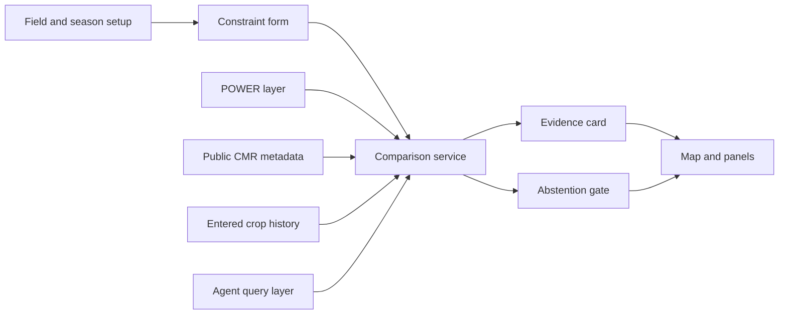

## Shape

## Parts

| Part | Owns | Talks to | Notes |
|---|---|---|---|
| Setup | Field boundary version, season, crop history, entered or unknown | Comparison service | Boundaries are versioned and never overwritten |
| Constraint form | Rent, permission, insurance, credit, water, market outlet | Comparison service | Every field carries a source and a date |
| Comparison service | Three rows, five fields each, evidence accounting | Everything | Read-only, no writes |
| Abstention gate | One named constant, checked before any ranking | Comparison service | Provisional, 80 percent area and two seasons |
| Evidence card | Provenance, exclusions, missing seasons, confidence, ranked reason | Map, agent trace | One object, rendered three ways |
| Agent layer | Parsed intent, allowlisted query, parameter resolution | Comparison service | Select only, never writes |
| Map | Field selection, layer toggles, recovery of state | Everything user facing | Centre stays clear, actions in thumb reach |

## The three boundaries

**Observation versus entry.** A satellite value and a farmer's typed crop history travel in the same row and must never be interchangeable. The card labels every cell observed, retrieved, modelled or entered.

**Read versus write.** The agent reads. Nothing it does is persisted without an on-screen confirmation carrying a label. Voice may initiate, never commit.

**Aggregate versus field.** A 36 km soil-moisture posting can flag a block. It cannot say a field is dry. Layers keep their native support beside them and resampling never upgrades a claim.

## Data sources

Public and credential free: POWER daily point API for temperature and rainfall context, CMR catalogue for granule metadata. Behind a login and not on the demo path: SMAP soil moisture, ECOSTRESS evapotranspiration, HLS surface reflectance, GRACE mascons.

Schema contract lives in the [agent context](/40-reference/agent-context/). Setup and checks are [here](/30-build/setup/) and [here](/30-build/run-and-verify/).
