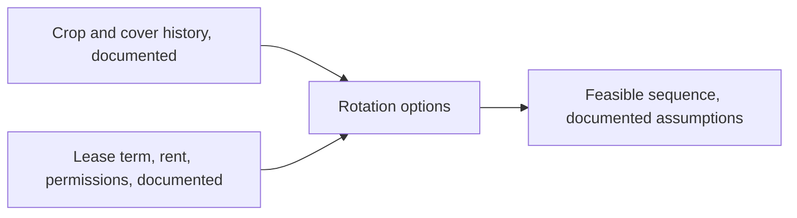

A tenant planning a rotation is deciding not only which crop fits the field, but whether the lease lasts long enough to earn back a soil, forage, or cover-crop investment. Cash rent, tenure, written clauses, and renewal risk set that horizon. They do not establish that the landowner selects the crop, and a high rent does not prove corn is the best choice.

USDA’s [2025 Land Values and Cash Rents, read](https://www.nass.usda.gov/Publications/Highlights/2025/2025LandValuesCashRents_FINAL.pdf) reports average US cropland rent of &#36;161/ac (documented) for 2025 (documented), with irrigated land at &#36;244/ac (documented) and non-irrigated land at &#36;147/ac (documented). The national mean gives context, not a field budget. In the farmdoc [2026 Illinois return comparison, read](https://farmdocdaily.illinois.edu/2026/01/projected-incomes-on-owned-vs-rented-farmland-for-2026.html), a central Illinois high-productivity example uses &#36;327/ac cash rent (documented) and projects a negative &#36;15/ac farmer return (documented) for its stated corn and soybean mix. The same modeled mix under 50/50 crop share projects a positive &#36;18/ac return (documented). Those figures are a local budget projection, not observed national results; the comparison illustrates how a fixed obligation transfers more downside to a tenant than a share arrangement.

The distinction between rented land and rented cropland matters. USDA ERS reports that 39% of all US farmland was rented in 2022 (documented), while more than half of contiguous-US cropland is rented (documented). These are different denominators, not competing estimates. Illinois commercial grain farms in farmdoc’s [tenure analysis, read](https://farmdocdaily.illinois.edu/2026/01/tenure-characteristics-of-illinois-farmland-6.html) had 50% cash-rented acres in 2024 (documented), a sample description rather than a national farm statistic. Cash rent leaves the operator with the crop upside and most yield and price exposure while rent remains due. Crop share divides output and often specified costs, but the agreement determines the split.

Lease length changes what a tenant can rationally undertake. Extension guidance from [Mississippi State, read](https://extension.msstate.edu/sites/default/files/publications/P4091_web.pdf) describes one-year cash leases as common and recommends longer terms for practices whose benefits arrive across seasons. A short renewal horizon can make forage, a small grain, or soil-building sequence risky if the tenant may lose the field before returns accrue. A written lease can restrict crops or practices, permit them, or define compensation. The [Practical Farmers of Iowa account, read](https://practicalfarmers.org/resources/articles/finding-common-ground) describes landowners Paul Thompson and Elena Meyer selecting tenant Josh Nelson to add no-till, cover crops, and a third crop. The account says they offered a significant discount on up to 30 small-grain acres (documented) because of financial risk, while its correction clarifies that the flex lease itself did not include that discount. This case shows negotiated cooperation, not a general landlord veto or a representative estimate of how often owners block rotations.

The app can map observed crop and cover patterns over time, flag likely gaps in the crop sequence, and let the operator compare that history with an intended multiyear plan. It cannot see rent, taxes, renewal promises, written restrictions, who pays for fertility or cover crops, or whether a landlord has consented. It also cannot infer authority from a crop map or a regional rental share. These are private contractual facts, so the app should ask the tenant or owner for lease type, term, renewal date, crop restrictions, compensation, and the relevant decision-maker. It should preserve “unknown” until someone with authority confirms the answer.

Landowners are not necessarily farm managers. USDA-NASS’s [2024 TOTAL survey, read](https://nass.usda.gov/Publications/Highlights/2026/TOTAL24.pdf) found 87% of landlords were non-operating (documented), but that population statistic says nothing about authority in a particular lease. Cash-rent operators may have substantial operating freedom, while crop-share terms can require joint decisions. The tool should present the practical choice as a field-specific agreement, not presume either unilateral landlord control or tenant freedom. A longer contract, explicit soil or crop provisions, or a negotiated payment can change feasibility; only the parties and their written agreement settle which applies.

**Decision boundary (documented)**

|Measure|Value and basis|
|---|---|
|All US farmland rented, 2022|39% (documented)|
|Contiguous-US cropland rented|More than half (documented)|
|Central Illinois modeled farmer return, cash rent / crop share|negative &#36;15/ac / positive &#36;18/ac (documented)|
