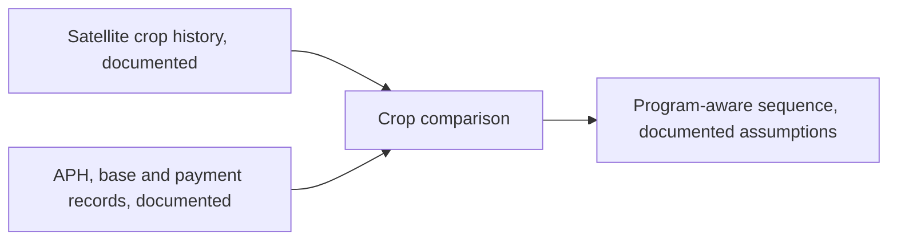

A grower comparing crop sequences faces three distinct kinds of public support: crop insurance, legacy commodity-program base, and temporary planted-acre aid. Keep them separate. Insurance can change downside risk for one crop; historical base generally does not dictate planting; a one-time transfer is not recurring margin.

For 2026, farmdoc’s [projected-price report, read](https://farmdocdaily.illinois.edu/2026/03/projected-prices-and-volatility-factors-for-2026.html) gives crop-insurance projected prices of &#36;4.62/bu for corn (documented) and &#36;11.09/bu for soybeans (documented). These are insurance price inputs, distinct from the later USDA WASDE season-average price estimates; neither is a farm’s guarantee or a comparison of crop profit. Under the [USDA Risk Management Agency’s 2026 Common Crop Insurance Basic Provisions, read](https://rma.usda.gov/sites/default/files/2026-06/Common%20Crop%20Insurance%20Policy%20Basic%20Provisions%2027.1-BR.pdf), Actual Production History, or APH, uses a consecutive crop-year history with a minimum of 4 years and maximum of 10 years when available (documented). The policy’s crop-specific yield history, coverage level, projected and harvest prices, premium, insured unit, and qualifying loss all matter. A corn APH is not a soybean APH, and the projected price by itself is not a per-acre indemnity.

The app can show satellite-observed crop history and field conditions, but cannot see private APH, insured acres, unit structure, coverage, premium, loss adjustment, or indemnity. Imagery cannot establish a policy-qualified loss. The farmer, lender, and insurance agent must confirm contract terms. Display each crop’s guarantee assumptions separately, dated and labeled, and never present a projected price as a guaranteed payment.

Commodity-program base is another distinct record. The [eCFR rule for additional base acres, read](https://www.ecfr.gov/current/title-7/subtitle-B/chapter-XIV/subchapter-B/part-1412/subpart-B/section-1412.27) describes the 2026 base-acre change, and USDA Farm Service Agency’s [allocation announcement, read](https://fsa.usda.gov/news-events/news/09-15-2026/usda-announces-2026-2027-enrollment-key-price-revenue-safety-net) reported completing a national expansion capped at 30 million acres (documented). Eligible acres exceeded the cap, so allocation was reduced pro rata by 3.69% (documented). The additional base calculation used 2019 to 2023 planting and prevented-plant history (documented). This one-time allocation creates a partial link to prior crop history, but it does not impose an ongoing planting mandate. Legacy ARC and PLC payments were generally tied to base rather than current planted crops. Base acres and this year’s planting therefore need not match.

The app can show public rules and accept confirmed base and payment details, but cannot see a farm’s award, crop-specific base, ownership share, or entitlement. Imagery and public allocation figures cannot certify FSA history. Require confirmation from the farmer and FSA before including a payment in a field comparison.

Farmer Bridge Assistance, or FBA, illustrates why year labels matter. USDA’s [2025 FBA payment announcement, read](https://usda.gov/about-usda/news/press-releases/2025/12/31/usda-announces-commodity-payment-rates-farmer-bridge-assistance-program) set rates of &#36;44.36/ac for 2025-planted corn (documented) and &#36;30.88/ac for 2025-planted soybeans (documented). Payment depended on reported planted acres and eligibility. Under share rent, the lease governs how income is divided. This is a crop-year transfer, not a continuing margin advantage for corn or evidence that a farmer should choose corn in a later year. Do not carry it into a future sequence model unless a successor payment is documented and its eligibility confirmed.

The app can present insurance, base, and one-time assistance as separate, dated, user-confirmed fields alongside an agronomic plan. It cannot see farm-level APH, policy choices, FSA enrollment, landlord shares, or entitlement. A public price, allocation rate, or payment schedule is not a guaranteed farm payment. The farmer and relevant lender, FSA office, or insurance agent must settle the private amounts and who receives them. Keep expected crop revenue and insurance protection separate: an insurance floor may cushion a loss, but it does not establish that a crop is profitable.

**Decision boundary (documented)**

|Item|What the public figure establishes|
|---|---|
|2026 projected price, corn|&#36;4.62/bu (documented), price input only|
|2026 projected price, soybeans|&#36;11.09/bu (documented), price input only|
|2026 additional base expansion|30 million acres (documented), national cap|
|2026 pro rata reduction|3.69% (documented), not a farm award|
|2025 FBA corn / soybean rate|&#36;44.36/ac / &#36;30.88/ac (documented), 2025 planted acres|
