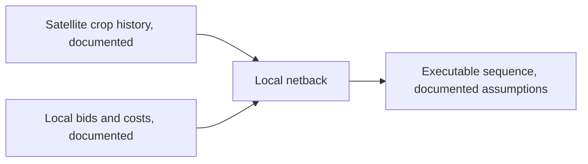

Crop choice is a local netback question across years, not a futures-price comparison. Netback means expected crop revenue after the farm’s available price, delivery costs, input exposure, and sequence effects. A field decision needs the grower’s yield history, current buyer bids, avoidable and sunk costs, and harvest capacity.

A dated basis snapshot shows why. DTN’s [daily basis comments, read](https://dtnpf.com/agriculture/web/ag/news/article/2026/11/04/corn-soybean-basis-stronger) on November 4, 2026 reported corn at Decatur, Illinois, at 10 cents/bu over December futures (documented), versus 40 cents/bu under at Fort Dodge, Iowa (documented). Soybeans were 6 cents/bu over January futures at Decatur (documented) and &#36;1.00/bu under at Grand Island, Nebraska (documented). Those location spreads demonstrate that the local cash bid can depart sharply from a national futures signal. They do not establish a durable ranking: buyer, delivery month, freight, storage, drying, quality, and contract terms can reverse which field option pays. A one-day basis observation is not a forward bid.

The relevant comparison starts with expected yield and delivery bids, then subtracts variable costs and delivery expense. Separate sunk inputs from costs still avoidable. Nitrogen can expose corn to a large bill, and a late switch may strand purchased or applied fertilizer; soybeans still need nutrient management. A grower’s own break-even beats a generic corn-soy price ratio, but depends on yield, price, and cost assumptions.

Indiana farmer Ryan Facemire told [Farm Progress, October 2026](https://www.farmprogress.com/management/tale-of-two-farmers-nitrogen-prices-force-strategy-rewrite) that his late-March 2026 local fall-delivery bids were &#36;4.52/bu for corn and &#36;11/bu for soybeans (documented). He said marginal corn needed 190 bu/ac to break even (documented), compared with 40 bu/ac for soybeans (documented), and he switched all acres to soybeans. Those are Facemire’s operation-specific thresholds and decision, not national break-even yields or a forecast for other farms. His account also describes a large input commitment and a combine purchase to manage harvest after the switch. Do not convert the case into a universal response to high fertilizer prices.

Rotation changes both the current crop’s expected yield and costs in later years. An [Agronomy Journal analysis, read](https://acsess.onlinelibrary.wiley.com/doi/full/10.2134/agronj2016.03.0134) of 748,374 Midwest field records from 2007 to 2012 estimated observational associations (not causal effects) between continuous cropping and rainfed continuous-corn yield penalties of 4.3% (documented), continuous-soybean penalties of 10.3% (documented), and an irrigated continuous-corn penalty of 1.7% (documented). The observational estimates can be confounded by field selection, soil, moisture, weather, irrigation, pest pressure, and management; they are not field forecasts or causal rotation benefits. The app can organize a farmer’s observed field crop and yield history, subject to record quality, and show a multi-year budget under explicit assumptions. Satellite observations can help identify crop and vegetation patterns, but they cannot provide a forward cash bid, invoice, prepaid fertilizer balance, delivered input price, contract premium, or an elevator settlement.

Equipment and harvest logistics can determine whether a profitable sequence is executable. [Iowa State’s 2025 field-day analysis, read](https://extension.iastate.edu/agdm/crops/html/a3-25.html) gives a northwest Iowa example of 12.6 suitable spring field days between April 30 and May 20 (documented); its example says 1,600 corn acres would require 127 acres/day (documented), or 9.1 acres/hour across a 14-hour workday (documented). This is a capacity example, not a prescription for wider equipment; outsourcing and fewer passes are alternatives. Iowa farmer Mike Brelsford, in a [December 2025 Wallace Farmer profile](https://www.qgdigitalpublishing.com/article/Should+you+skinny+down+your+line%3F/5079686/857804/article.html), said a second combine would require eight workers (documented) and hiring that many at harvest was “virtually impossible.” That is one farm account, not a regional labor estimate. Calendars can be mapped, but the app cannot see machine condition, crew availability, storage space, trucking turns, or custom-hire commitments.

For each field, the tool should request the operator’s current bids by delivery point and date, yield assumptions, input invoices and commitments, haul and drying costs, storage and contract terms, and equipment or labor constraints. It can show sensitivity to those entries and keep sequence effects visible. It cannot settle the buyer’s price, a lender’s operating credit, or whether the operator can execute the plan. The comparison stops being reliable when those private inputs are missing or when a dated average is treated as a guaranteed farmgate return.

**Decision boundary (documented)**

|Example|Value and basis|
|---|---|
|Corn basis, Decatur / Fort Dodge, Nov. 4, 2026|+10¢/bu / −40¢/bu (documented)|
|Soy basis, Decatur / Grand Island, Nov. 4, 2026|+6¢/bu / −&#36;1.00/bu (documented)|
|Rainfed continuous-corn / continuous-soy observational association, not causal|4.3% / 10.3% (documented)|
|Iowa spring field-day example|12.6 days (documented)|
