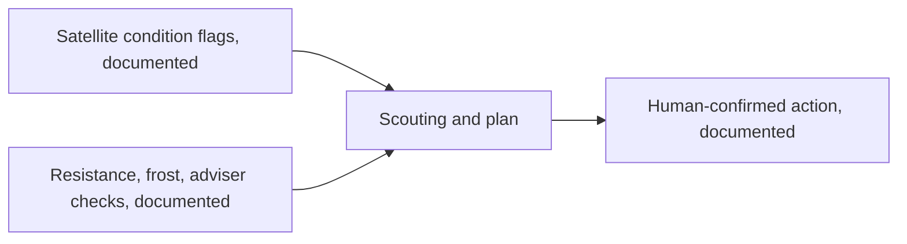

A crop or herbicide sequence can look viable on a map and still fail because of field-specific weed resistance, freeze injury, or unavailable help at the right time. Satellite observations are useful as prompts to scout and review, not as biological diagnoses or automatic prescriptions. The grower and agronomist must check the field evidence before changing a plan.

Resistance varies by field. A [2026 Weed Science study, read](https://doi.org/10.1017/wsc.2026.10111) examined four suspected glufosinate-resistant waterhemp populations in Illinois (documented); 20% survived the labeled rate at one field site (documented). This is not a map of resistance across Illinois. Local weed history, control failures, herbicide mode-of-action history, and, where available, an assay matter more for a field. Rotation can alter weed emergence and control windows, but it cannot replace multi-mode control or prevent seed set by itself.

The app can flag crop-cover anomalies and combine farmer-entered weed history with field boundaries. It cannot identify resistant species, distinguish resistance from application or weather failure, assay a population, or verify the seedbank. Satellite patterns should prompt scouting, not a resistance label or product prescription. The operator and agronomist must confirm species, stage, control history, and tactics.

Kansas State’s [March 2026 wheat freeze assessment, read](https://eupdate.agronomy.ksu.edu/article/wheat-status-injury-symptoms-from-freeze-damage-687-4) reported March 15 to 16 minima from −1°F in northwest Kansas to 17°F in south-central Kansas (documented). Its reference estimates injurious exposure near two hours at 12°F for tillering wheat and 24°F for jointing wheat (documented). It advises waiting 10 to 14 warm days before assessing injury (documented), since stage, variety, moisture, residue, wind, stand density, and field position matter. A regional minimum is not a yield-loss estimate.

The app can combine dated weather with satellite condition anomalies and user-entered crop stage to flag a freeze-risk window. It cannot establish temperature duration at the plant, variety response, stand viability, loss cause, or insurance eligibility from imagery. A grower or agronomist must inspect and document the field; the insurer confirms coverage and procedures before replant or abandonment decisions.

An adviser can connect field diagnosis to scouting, chemical choice, timing, custom application, and available service, but the adviser channel is neither uniform nor always the first source of a new idea. Purdue’s [2025 Large Commercial Producer Survey, read](https://agribusiness.purdue.edu/2025-large-commercial-producer-survey-results/) was based on 1,151 large commercial producers (documented). In the results [reported by AGDAILY](https://www.agdaily.com/news/farmers-trust-ag-media-peers-exploring-new-practices/), agricultural media was the leading source of new ideas for 25.6% of respondents (documented), other farmers for 21% (documented), and dealer or retailer resources for 13.6% (documented). The survey concerns large commercial operations and information sources, not the cause of a particular rotation change or the quality of a recommendation. An adviser’s service availability and commercial relationship should be recorded rather than inferred from a directory listing.

Operational capacity can be just as binding as advice. Iowa farmer Mike Brelsford, described in Wallace Farmer in December 2025, said a second combine would require eight workers and hiring that many at harvest was “virtually impossible.” His farm was described as 6,000 acres (documented), making this one farmer’s experience, not a national labor estimate. It illustrates that a crop’s calendar, combine capacity, labor, storage, and delivery rhythm have to fit the operation. The app can show crop calendars and ask about planting and harvest windows. It cannot see a crew roster, custom applicator schedule, retailer inventory, equipment breakdown, storage capacity, or service agreement. The grower or adviser must confirm those constraints before the map’s suggested timing becomes an operational plan.

The tool should keep a record of who confirmed a biological or service constraint and what evidence they used. It can surface anomalies, organize scouting notes, and compare sequences under human-confirmed assumptions. It cannot diagnose resistance, certify frost injury, guarantee an adviser or labor crew, or replace a grower’s field inspection. A named, dated observation is stronger than a generic risk layer, but the cited study, survey, and individual account each have their own scale and limit.

**Decision boundary (documented)**

|Driver|What the app can flag|What requires field or human confirmation|
|---|---|---|
|Weed resistance|Anomalous crop or cover pattern and entered control history|Species, resistance assay, herbicide failure cause|
|Frost|Dated weather and condition anomaly|Crop stage, injury, insurance cause of loss|
|Adviser and labor|Calendar conflicts and entered service needs|Adviser availability, crew, equipment, storage|
