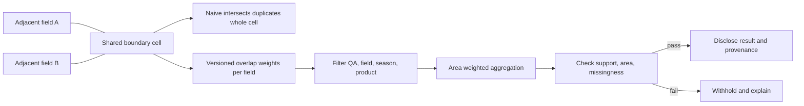

Natural-language SQL can execute and still attach evidence to the wrong field or season. A non-empty result and fluent explanation do not establish correctness. The schema must represent boundaries, crop periods, grid membership, product support, observation time, and quality status. Deterministic constraints and result checks must establish that evidence belongs to the requested field and period.

A proposed schema uses `field(field_id, jurisdiction)` as a stable identity; `field_boundary(field_id, boundary_version, geom, valid_from, valid_to, source, confirmed_by, confirmed_at)` as an immutable, versioned geometry record with a composite key on `(field_id, boundary_version)`; `field_season(season_id, field_id, start_date, end_date, crop_id, history_status)` for crop periods and unknown or unconfirmed history; `grid_cell(cell_id, grid_id, geom, support_geom)` for posted cells and effective product support; `field_cell(field_id, boundary_version, cell_id, grid_id, overlap_area_m2, field_weight)` for versioned membership; `product(product_id, variable, native_support_m, units, processing_version)` for product semantics; and `observation(observation_id, product_id, cell_id, period_start, period_end, temporal_support, value, qa_status, source_uri)` for provenance and the observation's supported time interval. `valid_to` may be null for the current boundary, but no geometry is overwritten. A point observation uses equal `period_start` and `period_end` and declares its temporal support. Foreign keys connect observations to products and cells, memberships to boundary versions and cells, and seasons to fields. Enforce uniqueness for field-season periods and product-cell-period-processing-version records. Define `field_weight` per requested field, boundary version, indicator, and period as that row's valid `overlap_area_m2` divided by the sum of valid overlap area for the same aggregation; then `SUM(value * field_weight) / SUM(field_weight)` is equivalent to the area-weighted mean and uses the defined weight, not a parallel field. Define an `indicator_slot` as one allowlisted variable and unit paired with product/version, QA policy, temporal support, spatial support, and aggregation rule. Resolve the current field only from the selected field ID and explicit boundary version; ask if the selection is absent or ambiguous, never infer the nearest field.

Use a declared equal-area coordinate system or documented geodesic method, explicit units, and distinct null meanings for not observed, failed QA, unknown, or not applicable. Never coerce nulls to zero. Define season boundaries as start-inclusive and end-exclusive in a stated timezone. Keep effective support distinct from posting: a 9 km posting (documented) is not independent at 9 km when the instrument footprint is wider (documented).

A plausible wrong join is:

```sql
SELECT f.field_id, AVG(o.value)
FROM field f JOIN grid_cell c ON ST_Intersects(f.geom, c.geom)
JOIN observation o ON o.cell_id = c.cell_id
WHERE f.field_id = :field AND o.product_id = :product
GROUP BY f.field_id;
```

`ST_Intersects` includes a boundary touch. A cell that touches adjacent fields can join to both; a cell spanning both can be counted as a whole observation for each. This query equally averages matched cells, ignores overlap area, season, and QA, and can assign a neighbor's signal to the requested field. It returns plausible SQL output, but the field attribution is unjustified.

Build a versioned `field_cell` table with polygon-cell overlap area calculated using the declared area method. Select the exact field, boundary version, season set, product, indicator, and processing version, then filter observations through product-specific QA rules. After those filters, normalize valid `overlap_area_m2` within the same field, boundary version, indicator, and period to produce `field_weight`, and aggregate as `SUM(value * field_weight) / SUM(field_weight)`. If product support is broader than a cell, apply a declared method to effective support rather than treating the posting as independent. Report valid covered area and denominator. Apply `PROVISIONAL_ABSTENTION_GATE` to this QA-valid coverage and the requested season set; if it fails, return insufficient coverage as missing, not as a filled estimate.

**Figure S8-F3. A plausible wrong spatial join and its guardrail (basis: proposed schema and join logic, planned and non-evidentiary, not a deployed system).**



Constrain the assistant to SELECT-only tools on an allowlisted schema, explicit join paths, approved spatial functions, and parameterized IDs and dates. Reject writes, DDL, arbitrary functions, unrecognized identifiers, ambiguous fields, and uncontrolled cross joins. Resolve a field name only when unique; ask about multiple matches rather than choosing the nearest. A parser or abstract syntax tree validator should check tables, columns, joins, predicates, spatial operations, and aggregations. A semantic validator should require a field, season set, source, variable, QA policy, and aggregation. Record resolved parameters and schema version.

Try to falsify results with adjacent fields sharing a border cell, a straddling cell, outside cells, duplicate observations, failed QA, missing seasons, overlapping or reversed dates, changed boundaries, and support wider than posting. Assert valid overlap weights, exclusions from numerator and denominator, and persistent missingness. Compare SQL and output with analyst-authored gold queries. Check rows, area totals, units, season membership, allowed tables, and meaning, not execution alone. Withhold results that violate an invariant.

Show the interpreted question, resolved field and boundary version, seasons and crop-history status, product, source, acquisition dates, support, QA exclusions, missingness, weighting rule, covered area, and SQL or a readable query summary. The trace and S8.2 Detail view render the same versioned evidence-card object defined in S8.5, including the ranked reason, confidence, benefit, gap, and risk/local-review fields. Ask the user to correct field or season before accepting. “Which of my last three seasons had the strongest moisture evidence?” must resolve one selected field, map moisture to an explicit indicator slot, state which seasons count, identify QA-valid observations and temporal and spatial support, disclose aggregation, and apply `PROVISIONAL_ABSTENTION_GATE` before returning a ranking.

This design is proposed, not built or evaluated. Correct joins cannot repair wrong boundaries, crop labels, biased products, absent ground truth, or unsupported causal claims. [T1](../research/nasa-data/T1.md) documents product support and quality limits; [T6](../research/site-prior-art/T6.md) distinguishes catalogue search from analysis. [FLINT](https://doi.org/10.48550/arxiv.2610.03524), a 2026 (documented) text-to-SQL benchmark on two proprietary financial schemas with 359 questions (documented), had near-universal execution but strict semantic accuracy of 68.8 and 65.2 percent (documented). The benchmark contains no agriculture or farmer study, so its rates do not estimate this app. It supports semantic validation as a necessary safeguard, not a farm-performance claim.
