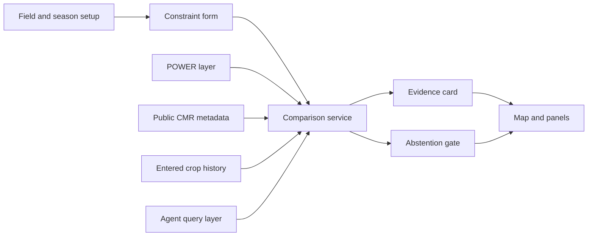

## Forma

## Partes

| Parte | Responsável por | Conversa com | Observações |
|---|---|---|---|
| Configuração | Versão do contorno do campo, temporada, histórico de culturas, inserido ou desconhecido | Serviço de comparação | Os contornos são versionados e nunca sobrescritos |
| Formulário de restrições | Arrendamento, permissão, seguro, crédito, água, canal de comercialização | Serviço de comparação | Todo campo traz uma fonte e uma data |
| Serviço de comparação | Três linhas, cinco campos em cada, contabilização de evidências | Tudo | Somente leitura, sem escritas |
| Regra de abstenção | Uma constante nomeada, verificada antes de qualquer ranking | Serviço de comparação | Provisória, 80 por cento da área e duas temporadas |
| Cartão de evidência | Proveniência, exclusões, temporadas ausentes, confiança, motivo do ranking | Mapa, rastro do agente | Um único objeto, renderizado de três formas |
| Camada do agente | Intenção interpretada, consulta da lista de permissões, resolução de parâmetros | Serviço de comparação | Somente seleção, nunca escreve |
| Mapa | Seleção de campo, alternância de camadas, recuperação de estado | Tudo que é voltado ao usuário | Centro livre, ações ao alcance do polegar |

## As três fronteiras

**Observação versus inserção.** Um valor de satélite e o histórico de culturas digitado pelo agricultor viajam na mesma linha e nunca podem ser intercambiáveis. O cartão rotula cada célula como observado, recuperado, modelado ou inserido.

**Leitura versus escrita.** O agente lê. Nada do que ele faz persiste sem uma confirmação na tela, com um rótulo. A voz pode iniciar uma ação, mas nunca efetivá-la.

**Agregado versus campo.** Uma grade de publicação de umidade do solo de 36 km pode sinalizar um bloco. Ela não pode dizer que um campo está seco. As camadas mantêm ao lado delas o seu suporte nativo, e a reamostragem nunca fortalece uma afirmação.

## Fontes de dados

Públicas e sem necessidade de credenciais: API diária de ponto do POWER para contexto de temperatura e chuva, catálogo CMR para metadados de granules. Atrás de um login e fora do caminho da demonstração: umidade do solo SMAP, evapotranspiração ECOSTRESS, reflectância de superfície HLS, mascons GRACE.

O contrato de esquema está na [página de contexto do agente](/pt-br/40-reference/agent-context/). A configuração e as verificações estão [aqui](/pt-br/30-build/setup/) e [aqui](/pt-br/30-build/run-and-verify/).
