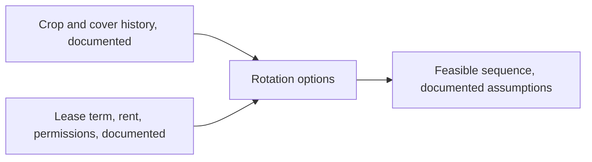

Um arrendatário que planeja uma rotação decide não apenas qual cultura se adapta ao campo, mas se o contrato dura o bastante para recuperar um investimento em solo, forragem ou planta de cobertura. O arrendamento em dinheiro, a posse, as cláusulas escritas e o risco de renovação definem esse horizonte. Eles não estabelecem que o proprietário escolha a cultura, e um aluguel alto não prova que o milho seja a melhor escolha.

O [Valores da terra e arrendamentos em dinheiro de 2025, lido](https://www.nass.usda.gov/Publications/Highlights/2025/2025LandValuesCashRents_FINAL.pdf) do USDA informa que o aluguel médio de terra agrícola nos EUA foi de &#36;161/ac (documentado) em 2025 (documentado), com terra irrigada a &#36;244/ac (documentado) e terra não irrigada a &#36;147/ac (documentado). A média nacional dá contexto, não um orçamento de campo. No [retorno de Illinois de 2026 da farmdoc, lido](https://farmdocdaily.illinois.edu/2026/01/projected-incomes-on-owned-vs-rented-farmland-for-2026.html), um exemplo de alta produtividade no centro de Illinois usa &#36;327/ac de arrendamento em dinheiro (documentado) e projeta um retorno negativo de &#36;15/ac para o agricultor (documentado) na mistura declarada de milho e soja. A mesma mistura modelada sob parceria agrícola de 50/50 projeta um retorno positivo de &#36;18/ac (documentado). Essas cifras são uma projeção orçamentária local, não resultados nacionais observados. A comparação ilustra como uma obrigação fixa transfere mais risco de queda ao arrendatário do que um arranjo de partilha.

A distinção entre terra arrendada e cultivo arrendado importa. O USDA ERS informa que 39% de toda a terra agrícola dos EUA foi arrendada em 2022 (documentado), enquanto mais da metade do cultivo no CONUS foi arrendada (documentado). São denominadores diferentes, não estimativas concorrentes. As fazendas comerciais de grãos de Illinois na [análise de posse da farmdoc, lido](https://farmdocdaily.illinois.edu/2026/01/tenure-characteristics-of-illinois-farmland-6.html) tinham 50% das áreas arrendadas em dinheiro em 2024 (documentado), uma descrição de amostra, não uma estatística nacional de fazendas. No arrendamento em dinheiro, o operador fica com o potencial de receita da cultura e com a maior parte da exposição à produtividade e ao preço, enquanto o aluguel continua devido. A parceria agrícola (crop share) divide a produção e, muitas vezes, custos especificados, mas o acordo determina a divisão.

A duração do arrendamento muda o que um arrendatário pode racionalmente assumir. A orientação de extensão da [Mississippi State, lido](https://extension.msstate.edu/sites/default/files/publications/P4091_web.pdf) descreve arrendamentos em dinheiro de um ano como comuns e recomenda prazos mais longos para práticas cujos benefícios se acumulam ao longo de várias safras. Um horizonte curto de renovação pode tornar arriscados a forragem, um pequeno cereal ou uma sequência de construção de solo, se o arrendatário puder perder o campo antes que os retornos apareçam. Um contrato escrito pode restringir culturas ou práticas, permiti-las ou definir compensação. O [relato da Practical Farmers of Iowa, lido](https://practicalfarmers.org/resources/articles/finding-common-ground) descreve os proprietários Paul Thompson e Elena Meyer escolhendo o arrendatário Josh Nelson para acrescentar plantio direto, plantas de cobertura e uma terceira cultura. O relato diz que eles ofereceram um desconto significativo para até 30 acres de cereais de pequeno porte (small grain) (documentado) por causa do risco financeiro. Sua correção esclarece que o próprio contrato flexível não incluía esse desconto. Este caso mostra cooperação negociada, não um veto geral do proprietário nem uma estimativa representativa de com que frequência os donos bloqueiam rotações.

O app pode mapear padrões observados de cultura e de cobertura ao longo do tempo, sinalizar prováveis lacunas na sequência de culturas e permitir que o operador compare esse histórico com um plano plurianual pretendido. Ele não consegue ver aluguel, impostos, promessas de renovação, restrições escritas, quem paga pela fertilidade ou pelas plantas de cobertura, nem se um proprietário consentiu. Também não consegue inferir autoridade a partir de um mapa de culturas ou de uma parcela regional de arrendamento. São fatos contratuais privados, por isso o app deve pedir ao arrendatário ou ao proprietário o tipo de arrendamento, o prazo, a data de renovação, as restrições de cultura, a compensação e o responsável pela decisão relevante. Ele deve manter “desconhecido” até que alguém com autoridade confirme a resposta.

Proprietários de terra não são necessariamente gestores agrícolas. A [pesquisa TOTAL 2024 da USDA-NASS, lido](https://nass.usda.gov/Publications/Highlights/2026/TOTAL24.pdf) constatou que 87% dos proprietários não operavam a terra (documentado), mas essa estatística populacional não diz nada sobre a autoridade em um arrendamento específico. Operadores de arrendamento em dinheiro podem ter liberdade operacional substancial, enquanto termos de parceria agrícola podem exigir decisões conjuntas. A ferramenta deve apresentar a escolha prática como um acordo específico do campo, sem presumir nem um controle unilateral do proprietário nem a liberdade do arrendatário. Um contrato mais longo, disposições explícitas sobre solo ou culturas, ou um pagamento negociado podem mudar a viabilidade. Só as partes e o acordo escrito delas definem qual se aplica.

**Limite de decisão (documentado)**

|Medida|Valor e base|
|---|---|
|Toda a terra agrícola dos EUA arrendada, 2022|39% (documentado)|
|Cultivo arrendado no CONUS|Mais da metade (documentado)|
|Retorno modelado do agricultor no centro de Illinois, arrendamento em dinheiro / parceria agrícola|negativo &#36;15/ac / positivo &#36;18/ac (documentado)|
