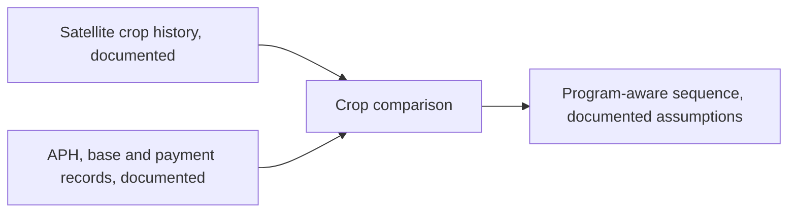

Um produtor que compara sequências de culturas enfrenta três tipos distintos de apoio público: seguro agrícola, base histórica de programas de commodities e auxílio temporário por área plantada. Mantenha-os separados. O seguro pode mudar o risco de queda de uma cultura. A base histórica geralmente não determina o plantio. Uma transferência única não é margem recorrente.

Para 2026, o [relatório de preços projetados da farmdoc, lido](https://farmdocdaily.illinois.edu/2026/03/projected-prices-and-volatility-factors-for-2026.html) apresenta preços projetados para seguro agrícola de &#36;4.62/bu para milho (documentado) e &#36;11.09/bu para soja (documentado). Esses são insumos de preço para seguro, distintos das estimativas posteriores de preço médio da safra do WASDE do USDA. Nenhum deles é garantia para uma fazenda nem uma comparação de lucro de cultura. Segundo as [Disposições básicas do seguro agrícola comum de 2026 da USDA Risk Management Agency, lido](https://rma.usda.gov/sites/default/files/2026-06/Common%20Crop%20Insurance%20Policy%20Basic%20Provisions%2027.1-BR.pdf), o Histórico Real de Produção (Actual Production History, APH) usa uma série consecutiva de anos-safra, com mínimo de 4 anos e máximo de 10 anos quando disponível (documentado). Importam o histórico de produtividade específico de cada cultura, o nível de cobertura, os preços projetados e de colheita, o prêmio, a unidade segurada e o sinistro coberto. Um APH de milho não é um APH de soja, e o preço projetado, sozinho, não é uma indenização por acre.

O app pode mostrar o histórico de culturas observado por satélite e as condições de campo, mas não consegue ver o APH privado, os acres segurados, a estrutura de unidades, a cobertura, o prêmio, o ajuste de perdas nem a indenização. Imagens não podem estabelecer uma perda elegível para a apólice. O agricultor, o credor e o agente de seguros devem confirmar os termos do contrato. Exiba as premissas de garantia de cada cultura separadamente, com data e rótulo, e nunca apresente um preço projetado como pagamento garantido.

A base de programa de commodities é outro registro distinto. A [regra do eCFR sobre áreas-base adicionais, lido](https://www.ecfr.gov/current/title-7/subtitle-B/chapter-XIV/subchapter-B/part-1412/subpart-B/section-1412.27) descreve a mudança de áreas-base de 2026. O [comunicado de alocação da Farm Service Agency do USDA, lido](https://fsa.usda.gov/news-events/news/09-15-2026/usda-announces-2026-2027-enrollment-key-price-revenue-safety-net) informou a conclusão de uma expansão nacional limitada a 30 milhões de acres (documentado). As áreas elegíveis excederam o limite, por isso a alocação foi reduzida proporcionalmente em 3.69% (documentado). O cálculo adicional de base usou o histórico de plantio e de plantio impedido de 2019 a 2023 (documentado). Essa alocação única cria um vínculo parcial com o histórico de culturas anterior, mas não impõe um mandato de plantio contínuo. Os pagamentos legados de ARC e PLC estavam geralmente vinculados à base, e não às culturas plantadas no período. As áreas-base e o plantio deste ano, portanto, não precisam coincidir.

O app pode mostrar as regras públicas e aceitar a base confirmada e os dados de pagamento, mas não consegue ver o APH de uma fazenda, a base específica por cultura, a participação na propriedade nem o direito. Imagens e cifras públicas de alocação não podem certificar o histórico da FSA. Exija a confirmação do agricultor e da FSA antes de incluir um pagamento em uma comparação de campo.

A Farmer Bridge Assistance (FBA) mostra por que os rótulos de ano importam. O [anúncio de pagamento da FBA de 2025 do USDA, lido](https://usda.gov/about-usda/news/press-releases/2025/12/31/usda-announces-commodity-payment-rates-farmer-bridge-assistance-program) fixou taxas de &#36;44.36/ac para milho plantado em 2025 (documentado) e &#36;30.88/ac para soja plantada em 2025 (documentado). O pagamento dependia das áreas plantadas declaradas e da elegibilidade. Sob arrendamento em parceria, o contrato determina como a renda é dividida. Trata-se de uma transferência de um ano-safra, não de uma vantagem contínua de margem para o milho, nem de evidência de que o agricultor deva escolher milho em um ano posterior. Não a leve para um modelo futuro de sequência, a menos que um pagamento sucessor esteja documentado e sua elegibilidade confirmada.

O app pode apresentar seguro, base e assistência pontual como campos separados, datados e confirmados pelo usuário, junto de um plano agronômico. Ele não consegue ver o APH em nível de fazenda, as escolhas de apólice, a inscrição na FSA, as parcelas do proprietário ou o direito. Um preço público, uma taxa de alocação ou um cronograma de pagamento não é um pagamento garantido à fazenda. O agricultor e o credor, o escritório da FSA ou o agente de seguros relevante devem resolver os valores privados e quem os recebe. Mantenha separadas a receita esperada da cultura e a proteção do seguro: um piso de seguro pode amortecer uma perda, mas não estabelece que a cultura seja lucrativa.

**Limite de decisão (documentado)**

|Item|O que o número público estabelece|
|---|---|
|Preço projetado de 2026, milho|&#36;4.62/bu (documentado), apenas insumo de preço|
|Preço projetado de 2026, soja|&#36;11.09/bu (documentado), apenas insumo de preço|
|Expansão adicional de áreas-base de 2026|30 milhões de acres (documentado), limite nacional|
|Redução proporcional de 2026|3.69% (documentado), não uma concessão à fazenda|
|Taxa da FBA de 2025, milho / soja|&#36;44.36/ac / &#36;30.88/ac (documentado), áreas plantadas em 2025|
