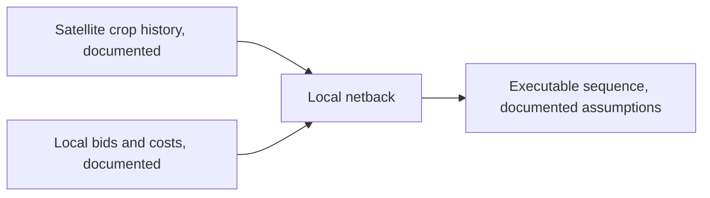

A escolha de cultura é uma questão local de netback ao longo dos anos, não uma comparação de preços de futuros. Netback é a receita esperada da cultura após o preço recebido na porteira, os custos de entrega, a exposição a insumos e os efeitos da sequência. Uma decisão de campo precisa do histórico de produtividade do produtor, das ofertas atuais dos compradores, dos custos evitáveis e afundados e da capacidade de colheita.

Um instantâneo datado de basis mostra o motivo. Os [comentários diários de basis da DTN, lido](https://dtnpf.com/agriculture/web/ag/news/article/2026/11/04/corn-soybean-basis-stronger) de 4 de novembro de 2026 informaram milho em Decatur, Illinois, a 10 centavos/bu acima dos futuros de dezembro (documentado), contra 40 centavos/bu abaixo em Fort Dodge, Iowa (documentado). A soja estava a 6 centavos/bu acima dos futuros de janeiro em Decatur (documentado) e a &#36;1.00/bu abaixo em Grand Island, Nebraska (documentado). Essas diferenças de localização mostram que a oferta local em dinheiro pode se afastar bruscamente de um sinal nacional de futuros. Elas não estabelecem um ranking duradouro: comprador, mês de entrega, frete, armazenagem, secagem, qualidade e termos de contrato podem inverter qual opção de campo paga. Uma observação de basis de um dia não é uma oferta futura.

A comparação relevante começa com a produtividade esperada e os lances de entrega, e então subtrai os custos variáveis e a despesa de entrega. Separe os insumos afundados dos custos ainda evitáveis. O nitrogênio pode expor o milho a uma conta grande, e uma troca tardia pode deixar fertilizante comprado ou aplicado sem uso. A soja ainda exige manejo de nutrientes. O ponto de equilíbrio próprio do produtor supera uma razão genérica de preço milho-soja, mas depende das premissas de produtividade, preço e custo.

O agricultor de Indiana Ryan Facemire disse à [Farm Progress, outubro de 2026](https://www.farmprogress.com/management/tale-of-two-farmers-nitrogen-prices-force-strategy-rewrite) que seus lances locais de entrega de outono, feitos no fim de março de 2026, eram &#36;4.52/bu para milho e &#36;11/bu para soja (documentado). Ele afirmou que o milho marginal precisava de 190 bu/ac para empatar (documentado), contra 40 bu/ac para a soja (documentado), e trocou todos os acres para soja. Esses são os limiares e a decisão específicos da operação de Facemire, não produtividades de equilíbrio nacionais nem uma previsão para outras fazendas. O relato também descreve um grande comprometimento de insumos e a compra de uma colheitadeira para administrar a colheita após a troca. Não transforme o caso em uma resposta universal a preços altos de fertilizantes.

A rotação altera a produtividade esperada da cultura atual e os custos dos anos seguintes. Uma [análise do Agronomy Journal, lido](https://acsess.onlinelibrary.wiley.com/doi/full/10.2134/agronj2016.03.0134) de 748,374 registros de campo do Meio-Oeste, de 2007 a 2012, estimou associações observacionais (não efeitos causais) entre cultivo contínuo e penalidades de produtividade: 4.3% (documentado) para o milho contínuo de sequeiro, 10.3% (documentado) para a soja contínua e 1.7% (documentado) para o milho contínuo irrigado. As estimativas observacionais podem ser confundidas pela seleção de campos, solo, umidade, clima, irrigação, pressão de pragas e manejo. Elas não são previsões de campo nem benefícios causais de rotação. O app pode organizar o histórico observado de culturas e produtividade do campo do agricultor, sujeito à qualidade dos registros, e mostrar um orçamento de vários anos sob premissas explícitas. Observações de satélite podem ajudar a identificar padrões de cultura e vegetação, mas não fornecem uma oferta futura em dinheiro, uma nota fiscal, um saldo de fertilizante pré-pago, um preço de insumo entregue, um prêmio de contrato nem um acerto de contas com o silo.

Equipamentos e logística de colheita podem determinar se uma sequência lucrativa é executável. A [análise do dia de campo de 2025 da Iowa State, lido](https://extension.iastate.edu/agdm/crops/html/a3-25.html) apresenta um exemplo do noroeste de Iowa com 12.6 dias de campo primaveris adequados entre 30 de abril e 20 de maio (documentado). O exemplo afirma que 1,600 acres de milho exigiriam 127 acres/dia (documentado), ou 9.1 acres/hora em uma jornada de 14 horas (documentado). Trata-se de um exemplo de capacidade, não de uma prescrição para equipamentos mais largos. Terceirização e menos passadas são alternativas. O agricultor de Iowa Mike Brelsford, em um [perfil do Wallace Farmer de dezembro de 2025, lido](https://www.qgdigitalpublishing.com/article/Should+you+skinny+down+your+line%3F/5079686/857804/article.html), disse que uma segunda colheitadeira exigiria oito trabalhadores (documentado) e que contratar esse número na colheita era “virtualmente impossível”. É o relato de uma fazenda, não uma estimativa regional de mão de obra. Os calendários podem ser mapeados, mas o app não consegue ver a condição das máquinas, a disponibilidade de equipes, o espaço de armazenagem, os turnos de caminhão nem os compromissos de serviço terceirizado.

Para cada campo, a ferramenta deve solicitar ao operador as ofertas atuais por ponto de entrega e data, as premissas de produtividade, as notas e compromissos de insumos, os custos de transporte e secagem, os termos de armazenagem e de contrato, e as restrições de equipamento ou de mão de obra. Ela pode mostrar a sensibilidade a essas entradas e manter visíveis os efeitos da sequência. Não consegue definir o preço do comprador, o crédito operacional de um credor nem se o operador consegue executar o plano. A comparação deixa de ser confiável quando esses insumos privados estão ausentes, ou quando uma média datada é tratada como retorno garantido na porteira.

**Limite de decisão (documentado)**

|Exemplo|Valor e base|
|---|---|
|Basis de milho, Decatur / Fort Dodge, 4 nov. 2026|+10¢/bu / −40¢/bu (documentado)|
|Basis de soja, Decatur / Grand Island, 4 nov. 2026|+6¢/bu / −&#36;1.00/bu (documentado)|
|Associação observacional de milho contínuo de sequeiro / soja contínua, não causal|4.3% / 10.3% (documentado)|
|Exemplo de dia de campo de primavera da Iowa State|12.6 dias (documentado)|
