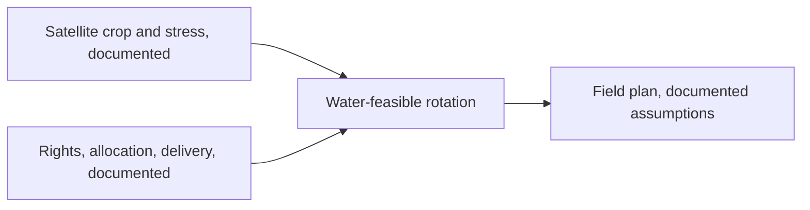

Para um irrigante, a água pode decidir qual sequência de culturas é viável antes dos preços. Uma tendência regional do aquífero ou um estresse de vegetação derivado de satélite pode indicar exposição, mas nenhum dos dois informa ao operador quanta água um poço específico pode bombear, o que um distrito vai entregar ou o que uma alocação legal permite. Essas restrições são locais, datadas e, às vezes, ainda propostas em vez de vinculantes.

No Kansas, o nível geral de água do aquífero High Plains subiu provisoriamente 0.2 ft em 2025 (medido), a primeira alta geral desde 2019, segundo o [relatório de níveis de 2025 da Kansas Geological Survey, lido](https://kgs.ku.edu/news/article/groundwater-levels-in-the-kansas-high-plains-aquifer-see-first-overall-increase-since-2019). A média de 1996 a 2025 foi um declínio de 0.57 ft/ano (medido), e o Groundwater Management District 3 caiu 0.62 ft em 2025 (medido). A chuva local contribuiu para a alta geral, por isso ela não estabelece recuperação em um poço individual. Uma tendência regional de longo prazo ajuda a enquadrar o risco, mas uma média de todo o aquífero não é o abastecimento de água, o custo de bombeamento ou o direito do produtor.

O LEMA Sheridan County 6, no noroeste do Kansas, aplicou uma alocação total de 55 acre-polegadas por acre elegível em cada período de cinco anos: 2013 a 2017, renovado de 2018 a 2022 e aprovado de 2023 a 2027 (documentado). Esses termos já promulgados do Sheridan 6 são separados da proposta de renovação pendente do Greater GMD 4, descrita abaixo. O [estudo da K-State de 2016, lido](https://accc.k-state.edu/research/factsheets/FS7_LEMA.pdf) examinou o Sheridan 6, no noroeste do Kansas, uma LEMA de 99 milhas quadradas com 185 poços de irrigação. Ele comparou os resultados reportados de irrigação e de área de cultivo em 2013 com médias de 2009 a 2012 para uma área de comparação de cinco milhas no entorno. Estimou que a área de milho irrigado caiu 23%, a área de sorgo subiu 68%, a área de soja subiu 8%, e toda a área irrigada caiu 5% (estimativas observacionais documentadas). Um [estudo de 2026 do Journal of Agricultural and Resource Economics, lido](https://ageconsearch.umn.edu/record/358997/files/JARE358997.pdf) analisou dados de painel de medidores de poços de 2003 a 2023 no Sheridan 6, no noroeste do Kansas, e pontos de captação de comparação em uma faixa de três milhas. Sua amostra limpa tinha 7,222 observações de 169 pontos de captação de tratamento e 199 de controle. Ele estimou que a intensidade de uso de água caiu 16% e que os custos de bombeamento caíram &#36;5.48 por acre, sem mudança estatisticamente significativa na área irrigada (estimativas observacionais documentadas). Os resultados não são diretamente comparáveis. O estudo da K-State compara resultados de área de cultivo de 2013 com médias de 2009 a 2012 para uma área de cinco milhas no entorno, enquanto o estudo de 2026 modela registros de medidores de 2003 a 2023 contra uma faixa de três milhas. Amostras e métodos diferem, e os pontos de comparação do estudo posterior também adotaram uma alocação menos restritiva a partir de 2018. Esses resultados observacionais não estabelecem uma resposta universal de cultura. Um limite só muda uma rotação se for restritivo abaixo do uso desejado, e os produtores respondem por meio do mix de culturas, da água aplicada ou de outros ajustes.

A Califórnia tem uma combinação diferente de planos de sustentabilidade de águas subterrâneas, entregas de água superficial de distritos, cobranças de bombeamento e comércio de água. A [análise do San Joaquin Valley do Public Policy Institute of California, lido](https://www.ppic.org/publication/policy-brief-the-future-of-agriculture-in-the-san-joaquin-valley/) estima que entre 500,000 e 900,000 acres poderiam precisar entrar em pousio até 2040 (calculado), dependendo dos suprimentos de água e do comércio. Trata-se de um cenário, não de acres em pousio observados e causados pelo Sustainable Groundwater Management Act, ou SGMA. A [atualização de 2026 da PPIC sobre superexploração, lido](https://ppic.org/blog/california-is-finally-addressing-groundwater-overdraft-how-is-it-going) estima a superexploração do Vale Central em cerca de 1.1 milhão de acre-pés/ano em 2021 a 2025 (documentado), contra 1.9 milhão de acre-pés/ano em 2003 a 2010 (documentado). A alocação superficial de um distrito de água pode aliviar ou intensificar a restrição de água subterrânea de um campo. Um pomar perene também tem um investimento afundado e custos de remoção fundamentalmente diferentes de um grão anual. Uma camada simples de pousio versus cultivo deixaria essa diferença de fora.

O app pode mapear tipo de cultura, condição do dossel, estresse da vegetação e mudança de cobertura do solo de uma temporada para outra, na resolução do produto, e depois anexar datas e incerteza a essas observações. Não consegue identificar o direito legal de água de uma parcela, leituras reais de medidor, a cobrança de bombeamento, a alocação de água subterrânea, a promessa de entrega de um distrito, a troca de água nem o motivo de um agricultor para deixar um campo em pousio. Sinais regionais de satélite ou de aquífero não podem resolver esses fatos privados ou específicos de jurisdição. A ferramenta deve pedir o direito de água ou a regra LEMA/GSA aplicável, o período de alocação, o bombeamento medido, a entrega do distrito, a taxa, a necessidade hídrica da cultura e a área pretendida. O produtor ou a autoridade de água deve confirmar os termos antes que um app os trate como restrição vinculante.

Até 10 de novembro de 2026, a proposta pendente de renovação do LEMA Greater GMD 4 do Kansas, para 2028 a 2032, previa uma redução de 15% nas alocações quinquenais existentes, segundo o [testemunho da audiência do GMD 4 de 13 de outubro de 2026](https://agriculture.ks.gov/home/showpublisheddocument/17804/639268979873281769) (documentado). O engenheiro-chefe (Chief Engineer) ainda não tinha emitido uma decisão final. A proposta do Greater GMD 4 deve, portanto, ser exibida como pendente, não como limite de campo promulgado. Na Califórnia, o cenário futuro de pousio da PPIC deve igualmente permanecer distinto do pousio medido. Camadas de água podem ajudar a identificar onde fazer perguntas mais difíceis. Somente direitos locais e registros de entrega e de bombeamento estabelecem a água disponível para esta operação.

**Limite de decisão (documentado)**

|Evidência|Valor e base|O que não resolve|
|---|---|---|
|Kansas High Plains, 2025|+0.2 ft no nível geral (medido)|O abastecimento de um poço específico|
|LEMA Sheridan County 6|55 acre-polegadas por acre elegível em cada período de cinco anos: 2013 a 2017, 2018 a 2022 e aprovado de 2023 a 2027 (documentado)|Um direito fora desta LEMA|
|Vale San Joaquin, até 2040|500,000 a 900,000 acres em pousio (calculado)|Pousio observado causado pelo SGMA|
