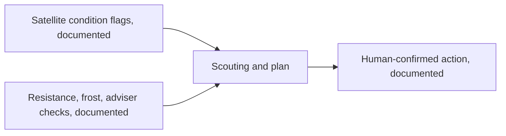

Uma sequência de culturas ou de herbicidas pode parecer viável no mapa e ainda falhar por causa de resistência de plantas daninhas específica do campo, dano por geada ou ajuda indisponível no momento certo. Observações de satélite são úteis como alertas para monitorar e revisar, não como diagnósticos biológicos nem prescrições automáticas. O produtor e o agrônomo devem checar as evidências de campo antes de mudar um plano.

A resistência varia de campo para campo. Um [estudo de 2026 publicado em Weed Science, lido](https://doi.org/10.1017/wsc.2026.10111) examinou quatro populações suspeitas de waterhemp resistentes ao glufosinato em Illinois (documentado). Em um local de campo, 20% sobreviveram à dose de rótulo (documentado). Isso não é um mapa de resistência em Illinois. O histórico local de plantas daninhas, as falhas de controle, o histórico de modo de ação dos herbicidas e, quando disponível, um ensaio importam mais para um campo. A rotação pode alterar a emergência de plantas daninhas e as janelas de controle, mas não pode substituir o controle com múltiplos modos de ação nem impedir a produção de sementes por si só.

O app pode sinalizar anomalias de cobertura de cultura e de cobertura do solo, e combinar o histórico de plantas daninhas inserido pelo agricultor com os limites de campo. Não consegue identificar espécies resistentes, distinguir resistência de falha de aplicação ou de clima, fazer ensaio de uma população nem verificar o banco de sementes. Padrões de satélite devem motivar monitoramento, não um rótulo de resistência nem uma prescrição de produto. O operador e o agrônomo devem confirmar espécie, estádio, histórico de controle e táticas.

O [relatório de março de 2026 sobre geada no trigo da Kansas State, lido](https://eupdate.agronomy.ksu.edu/article/wheat-status-injury-symptoms-from-freeze-damage-687-4) informou mínimas de 15 a 16 de março que variaram de −1°F no noroeste do Kansas a 17°F no centro-sul do Kansas (documentado). Sua referência estima que a exposição lesiva seja de cerca de duas horas a 12°F para trigo em perfilhamento e a 24°F para trigo em emborrachamento (documentado). Ela recomenda aguardar de 10 a 14 dias quentes antes de avaliar a lesão (documentado), já que estádio, variedade, umidade, palhada, vento, densidade de plantas e posição no campo importam. Uma mínima regional não é uma estimativa de perda de produtividade.

O app pode combinar clima datado com anomalias de condição de satélite e com o estádio da cultura informado pelo usuário, para sinalizar uma janela de risco de geada. Não consegue estabelecer, a partir de imagens, a duração da temperatura na planta, a resposta da variedade, a viabilidade do estande, a causa da perda ou a elegibilidade para seguro. Um produtor ou agrônomo deve inspecionar e documentar o campo. A seguradora confirma a cobertura e os procedimentos antes de decisões de replantio ou abandono.

Um consultor pode conectar o diagnóstico de campo a monitoramento, escolha de químicos, época, aplicação terceirizada e serviços disponíveis. Mas o canal de consultoria não é uniforme nem é sempre a primeira fonte de uma ideia nova. A [Pesquisa com Grandes Produtores Comerciais 2025 da Purdue, lido](https://agribusiness.purdue.edu/2025-large-commercial-producer-survey-results/) foi baseada em 1,151 grandes produtores comerciais (documentado). Nos resultados [relatados pela AGDAILY](https://www.agdaily.com/news/farmers-trust-ag-media-peers-exploring-new-practices/), a mídia agrícola foi a principal fonte de novas ideias para 25.6% dos respondentes (documentado), outros agricultores para 21% (documentado) e recursos de revendas ou varejistas para 13.6% (documentado). A pesquisa trata de grandes operações comerciais e de fontes de informação. Ela não trata da causa de uma mudança de rotação específica nem da qualidade de uma recomendação. A disponibilidade de serviço e o relacionamento comercial de um consultor devem ser registrados, e não inferidos a partir de uma listagem de diretório.

A capacidade operacional pode ser tão restritiva quanto a orientação técnica. O agricultor de Iowa Mike Brelsford, descrito no Wallace Farmer em dezembro de 2025, disse que uma segunda colheitadeira exigiria oito trabalhadores, e que contratar esse número na colheita era “virtualmente impossível”. Sua fazenda foi descrita como tendo 6,000 acres (documentado), o que torna isso a experiência de um produtor, não uma estimativa nacional de mão de obra. Isso ilustra que o calendário da cultura, a capacidade da colheitadeira, a mão de obra, a armazenagem e o ritmo de entrega precisam se ajustar à operação. O app pode mostrar calendários de cultura e perguntar sobre as janelas de plantio e colheita. Não consegue ver a escala de equipes, a agenda de aplicadores terceirizados, o estoque de revendas, a quebra de equipamentos, a capacidade de armazenagem ou o contrato de serviço. O produtor ou o consultor deve confirmar essas restrições antes que o calendário sugerido pelo mapa se torne um plano operacional.

A ferramenta deve manter um registro de quem confirmou uma restrição biológica ou de serviço e de quais evidências usou. Ela pode revelar anomalias, organizar anotações de monitoramento e comparar sequências sob premissas confirmadas por humanos. Não pode diagnosticar resistência, certificar dano por geada, garantir um consultor ou uma equipe de mão de obra, nem substituir a inspeção de campo do produtor. Uma observação nomeada e datada é mais forte do que uma camada genérica de risco. Mas o estudo, a pesquisa e o relato individual citados têm cada um sua própria escala e seu próprio limite.

**Limite de decisão (documentado)**

|Fator|O que o app pode sinalizar|O que exige confirmação de campo ou humana|
|---|---|---|
|Resistência de plantas daninhas|Padrão anômalo de cultura ou de cobertura e histórico de controle inserido|Espécie, ensaio de resistência, causa da falha do herbicida|
|Geada|Clima datado e anomalia de condição|Estádio da cultura, lesão, causa de perda para o seguro|
|Consultor e mão de obra|Conflitos de calendário e necessidades de serviço inseridas|Disponibilidade do consultor, equipe, equipamento, armazenagem|
