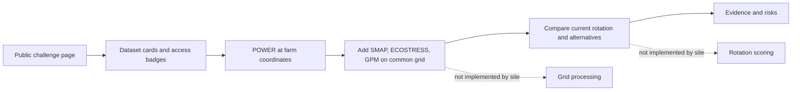

A [página inicial do Space Data Atlas sem login (lida)](https://spacedata.swapniltamse.com/) organiza o material público em torno de desafios, conjuntos de dados, código inicial, preparação, vencedores anteriores e uma conexão com IA. O mapa do site inclui 22 URLs públicas (documentado), incluindo a página inicial, o índice de desafios, 14 páginas de desafios e seis páginas de apoio. As páginas deste mapa carregaram sem conta durante a revisão. Trata-se de um guia de pesquisa e integração que começa pelos desafios, e não do catálogo de dados da NASA nem do portal de submissão do evento.

A [página do desafio Field Shift (lida)](https://spacedata.swapniltamse.com/challenges/field-shift-adapting-farms/) reúne em uma única rota seu briefing parafraseado, os conjuntos de dados sugeridos, os selos de acesso, uma receita da primeira hora, exemplos de código inicial, um widget de busca ao vivo no catálogo e projetos anteriores de tema semelhante. Os cartões de conjuntos de dados ordenam seis sugestões (documentado): SMAP, ECOSTRESS, GPM IMERG, HLS, POWER e GRACE/GRACE-FO. A página chama essa ordem de “provavelmente útil”, não de lista oficial de recursos. A [página Sobre (lida)](https://spacedata.swapniltamse.com/about/) descreve o projeto como independente e diz que os resumos dos desafios são parafraseados e que as sugestões de conjuntos de dados são curadas. Suas recomendações são hipóteses iniciais úteis; a equipe deve conferir os requisitos vinculantes no material oficial do desafio. Revisado em 2026-11-10 (documentado), com nova verificação do Atlas em 2026-11-13 (data esperada documentada para o recurso). Se a lista oficial aparecer ou mudar, revisar a ordenação dos conjuntos de dados e o caminho de demonstração sem conta antes do congelamento do build.

Os selos distinguem o acesso por conta de uma busca que qualquer pessoa pode fazer. O POWER tem os selos “No login” e “Works in browser”. As outras cinco sugestões mostram Earthdata Login e acesso pelo navegador. A busca no catálogo desses produtos é aberta, mas o download exige uma conta Earthdata gratuita. O [guia Get Ready (lido)](https://spacedata.swapniltamse.com/get-ready/) trata da configuração da conta, da autorização, dos testes de execução e da preparação de uma demonstração offline. Essas notas de acesso descrevem atrito de configuração, não assinaturas pagas nem prova de que um download funcionará para um usuário específico.

A receita de primeira hora da página começa com o POWER nas coordenadas da fazenda, para chuva, temperatura e luz solar; em seguida acrescenta a umidade do SMAP, o estresse térmico do ECOSTRESS e a chuva do GPM em uma grade comum; depois compara pelo menos três rotações (documentado), incluindo a atual, com evidências e riscos. **Inferência:** essa sequência aponta para uma comparação de decisão no nível do campo, e não para um visualizador de satélite. Ela não fornece limites de campo, código de harmonização, históricos de rotação nem uma pontuação validada. Suas instruções dizem a um construtor o que tentar, não se cada produto resolve a cultura, o campo ou a decisão local relevantes.

O Atlas também expõe trechos copiáveis de Python e JavaScript, instruções de configuração, uma página somente leitura de IA/MCP para consulta de desafios e conjuntos de dados, e uma busca CMR ao vivo. Essas rotas permitem explorar as orientações e fazer uma consulta pública ao catálogo sem entrar na conta. O widget CMR lista identificadores de granules e datas; não é um leitor de arquivos científicos. O site relaciona projetos de 2025 de tema semelhante, mas essas correspondências são julgamento do autor, não requisitos da NASA.

Uma revisão sem login não encontrou rubrica de pontuação, formulário de inscrição, contagem regressiva, acompanhamento nem placar no Atlas (lido). Essa ausência sustenta chamar o site de um companheiro de pesquisa, e não de um fluxo de evento. O limite é importante: a inspeção pública não exclui sistemas privados de evento que apareçam depois do registro. Tampouco uma receita sugerida com conjuntos de dados estabelece a adequação agronômica para um campo, cultura ou região específicos. Trate a receita como uma hipótese inicial reproduzível, preserve os avisos de acesso e de proveniência, e verifique os requisitos e a adequação local separadamente.

**Figura S7-F1. Rota do site complementar e fluxo da primeira hora (documentado).**

