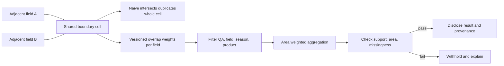

SQL em linguagem natural pode executar e ainda assim anexar evidência ao campo ou à safra errados. Um resultado não vazio e uma explicação fluente não estabelecem a correção. O esquema precisa representar limites, períodos de cultivo, pertinência à grade, suporte do produto, tempo de observação e status de qualidade. Restrições determinísticas e verificações de resultado precisam estabelecer que a evidência pertence ao campo e ao período solicitados.

Um esquema proposto usa `field(field_id, jurisdiction)` como identidade estável; `field_boundary(field_id, boundary_version, geom, valid_from, valid_to, source, confirmed_by, confirmed_at)` como registro de geometria imutável e versionado, com chave composta em `(field_id, boundary_version)`; `field_season(season_id, field_id, start_date, end_date, crop_id, history_status)` para períodos de cultivo e histórico desconhecido ou não confirmado; `grid_cell(cell_id, grid_id, geom, support_geom)` para células publicadas e suporte efetivo do produto; `field_cell(field_id, boundary_version, cell_id, grid_id, overlap_area_m2, field_weight)` para pertinência versionada; `product(product_id, variable, native_support_m, units, processing_version)` para a semântica do produto; e `observation(observation_id, product_id, cell_id, period_start, period_end, temporal_support, value, qa_status, source_uri)` para proveniência e para o intervalo de tempo suportado pela observação. `valid_to` pode ser nulo para o limite atual, mas nenhuma geometria é sobrescrita. Uma observação pontual usa `period_start` e `period_end` iguais e declara seu suporte temporal. Chaves estrangeiras conectam observações a produtos e células, pertinências a versões de limite e células, e safras a campos. Imponha unicidade para períodos de safra por campo e para registros de produto, célula, período e versão de processamento. Defina `field_weight` por campo solicitado, versão de limite, indicador e período como a `overlap_area_m2` válida daquela linha dividida pela soma das áreas de sobreposição válidas na mesma agregação. Assim, `SUM(value * field_weight) / SUM(field_weight)` equivale à média ponderada por área e usa o peso definido, não um campo paralelo. Defina um `indicator_slot` como uma variável e unidade de uma lista permitida, pareadas com produto e versão, política de QA, suporte temporal, suporte espacial e regra de agregação. Resolva o campo atual apenas a partir do ID de campo selecionado e de uma versão de limite explícita. Peça esclarecimento se a seleção estiver ausente ou for ambígua; nunca infira o campo mais próximo.

Use um sistema de coordenadas de área igual declarado ou um método geodésico documentado, unidades explícitas e significados distintos para nulos: não observado, falha no QA, desconhecido ou não aplicável. Nunca converta nulos em zero. Defina os limites de safra como inclusivos no início e exclusivos no fim, em um fuso horário declarado. Mantenha o suporte efetivo separado da grade de publicação: uma grade de publicação de 9 km (documentado) não é independente em 9 km quando a pegada do sensor é mais ampla (documentado).

Um join errado plausível é:

```sql
SELECT f.field_id, AVG(o.value)
FROM field f JOIN grid_cell c ON ST_Intersects(f.geom, c.geom)
JOIN observation o ON o.cell_id = c.cell_id
WHERE f.field_id = :field AND o.product_id = :product
GROUP BY f.field_id;
```

`ST_Intersects` inclui um toque de borda. Uma célula que toca campos vizinhos pode se juntar a ambos; uma célula que atravessa os dois pode ser contada como uma observação inteira para cada um. Essa consulta calcula a média de células pareadas com o mesmo peso, ignora a área de sobreposição, a safra e o QA, e pode atribuir o sinal de um vizinho ao campo solicitado. Ela devolve uma saída de SQL plausível, mas a atribuição ao campo não é justificada.

Crie uma tabela `field_cell` versionada, com área de sobreposição polígono-célula calculada pelo método de área declarado. Selecione o campo exato, a versão do limite, o conjunto de safras, o produto, o indicador e a versão de processamento, e depois filtre as observações pelas regras de QA específicas de cada produto. Após esses filtros, normalize a `overlap_area_m2` válida dentro do mesmo campo, versão de limite, indicador e período para produzir `field_weight`, e agregue como `SUM(value * field_weight) / SUM(field_weight)`. Se o suporte do produto for mais amplo que uma célula, aplique um método declarado ao suporte efetivo, em vez de tratar a publicação como independente. Informe a área coberta válida e o denominador. Aplique `PROVISIONAL_ABSTENTION_GATE` a essa cobertura válida de QA e ao conjunto de safras solicitado. Se ela falhar, retorne cobertura insuficiente como ausente, não como uma estimativa preenchida.

**Figura S8-F3. Um join espacial errado plausível e sua salvaguarda (base: esquema e lógica de join propostos, planejados e não evidenciais, não um sistema implantado).**



Restrinja o assistente a ferramentas somente SELECT sobre um esquema de lista permitida, com caminhos de join explícitos, funções espaciais aprovadas e IDs e datas parametrizados. Rejeite escritas, DDL, funções arbitrárias, identificadores não reconhecidos, campos ambíguos e cross joins descontrolados. Resolva um nome de campo apenas quando ele for único; pergunte sobre múltiplas correspondências em vez de escolher o mais próximo. Um validador de parser ou de árvore de sintaxe abstrata deve verificar tabelas, colunas, joins, predicados, operações espaciais e agregações. Um validador semântico deve exigir campo, conjunto de safras, fonte, variável, política de QA e agregação. Registre os parâmetros resolvidos e a versão do esquema.

Tente refutar os resultados com campos vizinhos que compartilham uma célula de borda, uma célula que atravessa limites, células externas, observações duplicadas, QA reprovado, safras ausentes, datas sobrepostas ou invertidas, limites alterados e suporte mais amplo que a publicação. Afirme pesos de sobreposição válidos, exclusões do numerador e do denominador, e ausência persistente de dados. Compare o SQL e a saída com consultas de referência (gold) escritas por analistas. Verifique linhas, totais de área, unidades, pertinência às safras, tabelas permitidas e significado, não apenas a execução. Retenha resultados que violem qualquer invariante.

Mostre a pergunta interpretada, o campo e a versão do limite resolvidos, as safras e o status do histórico de cultivo, o produto, a fonte, as datas de aquisição, o suporte, as exclusões de QA, a ausência de dados, a regra de ponderação, a área coberta e o SQL ou um resumo legível da consulta. O rastro e a visão Detalhe da S8.2 renderizam o mesmo objeto versionado de cartão de evidência definido em S8.5, incluindo o motivo classificado, a confiança, o benefício, a lacuna e os campos de risco/revisão local. Peça ao usuário que corrija o campo ou a safra antes de aceitar. A pergunta “Qual das minhas últimas três safras teve a evidência de umidade mais forte?” deve resolver um campo selecionado, mapear umidade para um `indicator_slot` explícito, declarar quais safras contam, identificar as observações válidas pelo QA e seu suporte temporal e espacial, divulgar a agregação e aplicar `PROVISIONAL_ABSTENTION_GATE` antes de devolver um ranking.

Este desenho é proposto, não construído nem avaliado. Joins corretos não corrigem limites errados, rótulos de cultura, produtos enviesados, ausência de verdade de campo ou afirmações causais sem suporte. [T1](../research/nasa-data/T1.md) documenta os limites de suporte e qualidade dos produtos; [T6](../research/site-prior-art/T6.md) distingue busca em catálogo de análise. O [FLINT](https://doi.org/10.48550/arxiv.2610.03524), um benchmark de text-to-SQL de 2026 (documentado) sobre dois esquemas financeiros proprietários com 359 perguntas (documentado), teve execução quase universal, mas precisão semântica estrita de 68.8 e 65.2 por cento (documentado). O benchmark não contém estudo de agricultura nem com agricultores, então suas taxas não estimam este aplicativo. Ele apoia a validação semântica como salvaguarda necessária, não como alegação de desempenho em fazendas.
