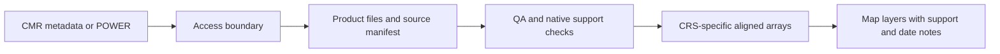

## Status

Executado em 2026-11-10 (registro de execução documentado): um ambiente virtual Python 3.12 descartável instalou `earthaccess==0.19.0`, `requests` e `rasterio==1.4.4`; as importações funcionaram, e o Rasterio reportou o GDAL 3.10.3 empacotado (documentado). A API de reprojeção em Python do Rasterio transformou um raster sintético de 2 por 2 em EPSG:4326 em uma grade de 4 por 4 em EPSG:4326, com valores finitos (registro de execução documentado). Uma [consulta ao catálogo SMAP](https://nsidc.org/data/spl3smp_e/versions/6) pública também retornou registros (resultado de execução documentado). Essas verificações exercitam apenas a configuração de pacotes, a descoberta no catálogo e a mecânica da API.

Planejado: não há nenhum granule científico da NASA baixado ou inspecionado, nenhum polígono de fazenda selecionado, nenhuma projeção, nenhum subconjunto de produto nem grade do app. O QA com arquivos reais e a reamostragem não foram testados. A transformação sintética não valida um produto da NASA nem estabelece precisão em escala de fazenda.

## Ordem de construção por prioridade e piso de demonstração pública

Construa nesta ordem, mantendo o fixture público útil antes de adicionar serviços de dados opcionais.

| Ordem | Entregável | Limite de aceitação |
|---|---|---|
| 1 | Fixture de demonstração sem conta | Entregue um fixture estático, datado pela fonte e rotulado, com a geometria do campo selecionada, a versão do limite, linhas de temporada de cultivo com estados desconhecidos e um formulário de restrições. Este é o piso de demonstração sem conta nomeado; ele deve funcionar sem Earthdata Login nem endpoint de satélite ativo. |
| 2 | Esquema de evidências e abstenção | Adicione limites versionados, temporadas de campo, restrições, períodos de observação, suporte, QA, proveniência e o `PROVISIONAL_ABSTENTION_GATE` compartilhado; mostre as lacunas e abstenha-se quando a regra falhar. |
| 3 | Contexto público e ingestão | Consulte o POWER e os metadados do catálogo, depois adicione apenas arquivos de produto opcionais que tenham verificações de acesso, QA, suporte e licença. |
| 4 | Comparação e validador do agente | Construa a requisição tipada, o rastro de consulta, a validação determinística e os cartões de evidência do mesmo objeto; teste junções erradas e casos de reversão. |
| 5 | Teste de UX de campo e interação direta | Implemente controles rotulados, visões de campo e de detalhe, e teste o tamanho provisório do alvo, a visão geral e a divulgação em `FIELD_UX_TEST_01`. |
| 6 | Voz, por último | Adicione voz somente depois de `FIELD_VOICE_TEST_01`, com alternativa pela tela e confirmação rotulada na tela para cada escrita. Remova-a quando o teste ou as condições de visualização falharem. |

O fixture público é um apoio à demonstração, não uma análise de dados ao vivo nem uma comparação validada em campo. Um avaliador sem conta na Earthdata ainda deve conseguir inspecionar a versão do limite, a proveniência das temporadas e das restrições, os limites de suporte e a abstenção neste fixture. Mantenha as camadas ao vivo ou com credenciais separadas do conteúdo do fixture.

Para cada fonte, escreva um manifesto com a versão do produto e da coleção, o identificador do granule, as datas de aquisição e de processamento, a URL da fonte, a pegada espacial e a grade de publicação, o sistema de referência de coordenadas, as unidades, os nomes das bandas, as flags de qualidade, a convenção de nodata, o status de acesso e o histórico de transformações. Preserve os valores da fonte e o QA junto às camadas derivadas. Distinga observações diretas de saídas de modelo e de informações inseridas pelo usuário. Um valor ausente ou rejeitado deve permanecer ausente, com o motivo registrado, em vez de virar um zero plausível.

Escolha a extensão do estudo e o sistema de referência de coordenadas projetado a partir da geometria real do campo e da análise pretendida. Essas escolhas ainda não foram feitas. Construa explicitamente uma transformação de destino, as dimensões e a política de nodata. O caminho em Python usa `rasterio==1.4.4` e `rasterio.warp.reproject`, passando os sistemas de referência de origem e destino, as transformações, as dimensões dos arrays, os valores de nodata e o método de reamostragem. Use vizinho mais próximo para QA categórico, para que as flags não sejam misturadas. Selecione um método contínuo para cada variável de acordo com seu significado e a agregação pretendida, e documente essa escolha. Uma build de CLI do GDAL 3.x poderia usar `gdalwarp` com `-t_srs`, `-tr`, `-tap`, `-r`, `-srcnodata` e `-dstnodata`; o binário `gdalwarp` do sistema estava ausente, então essa rota não foi exercitada.

Exemplo mínimo executável usando a API Python do Rasterio instalada:

```sh
# Binários/builds: Bash 5.x; .venv/bin/python, CPython 3.12 com rasterio 1.4.4 e GDAL 3.10.3 empacotado.
cd "&#36;HOME/earthdata-s9-demo" || exit 1
.venv/bin/python - <<'PY'
import numpy as np
import rasterio
from rasterio.transform import from_origin
from rasterio.warp import calculate_default_transform, reproject, Resampling
from rasterio.transform import array_bounds

assert rasterio.__version__ == "1.4.4"
assert rasterio.__gdal_version__ == "3.10.3"
src = np.array([[1, 2], [3, 4]], dtype=np.float32)
src_transform = from_origin(0, 2, 1, 1)
bounds = array_bounds(2, 2, src_transform)
dst_crs = "EPSG:4326"
dst_transform, width, height = calculate_default_transform(
    dst_crs, dst_crs, 2, 2, *bounds, resolution=0.5
)
assert (width, height) == (4, 4), (width, height)
dst = np.full((height, width), -9999, dtype=np.float32)
reproject(
    source=src,
    destination=dst,
    src_transform=src_transform,
    src_crs=dst_crs,
    src_nodata=None,
    dst_transform=dst_transform,
    dst_crs=dst_crs,
    dst_nodata=-9999,
    resampling=Resampling.bilinear,
)
assert np.isfinite(dst).all() and (dst != -9999).any()
print(f"Python Rasterio {rasterio.__version__}, GDAL {rasterio.__gdal_version__}: {src.shape} to {dst.shape}")
PY
```

Degrau de recuperação: se o interpretador, a importação do Rasterio ou a asserção de versão falhar, ative o `.venv` do projeto, verifique `python --version` e `python -m pip show rasterio` e reinstale o wheel fixado `rasterio==1.4.4` nesse ambiente. Se a asserção de dimensões falhar, inspecione os limites da origem e a resolução do destino antes de mudar qualquer um dos dois. Se a saída contiver apenas nodata, inspecione o CRS, as transformações, o nodata e os limites. Não substitua por `gdalwarp` a menos que o binário esteja instalado e seu build tenha sido verificado.

## Mantenha o suporte visível

Uma grade comum alinha os arrays; ela não melhora a informação nativa nem torna observações diferentes independentes. A [reflectância de superfície HLS](https://doi.org/10.5067/HLS/HLSL30.002) é um produto de 30 m (documentado). A grade de publicação de 9 km do SMAP (documentado) vem de uma pegada de radiômetro de cerca de 36 km (documentado), então células vizinhas da grade não são observações independentes em escala de campo. A [grade de publicação de 0.5 grau do GRACE](https://podaac.jpl.nasa.gov/dataset/TELLUS_GRAC-GRFO_MASCON_CRI_GRID_RL06.3_V4) (documentado) representa mascons com suporte nativo em torno de 300 a 330 km (documentado). O POWER é um contexto de reanálise grosseiro, com documentação conflitante sobre as dimensões da grade de hidrologia. Mantenha essas declarações de suporte no manifesto e na legenda de cada camada. Não faça upsampling de camadas grosseiras ou modeladas nem apresente seus pixels como detalhe novo.

Antes de renderizar, teste a validade da geometria, a consistência do CRS, os limites, o alinhamento de pixels, a propagação de nodata, as flags de QA esperadas e faixas de valores plausíveis com regras específicas de cada produto. Registre as contagens de células rejeitadas e a cobertura ausente. Preserve as datas da fonte e o suporte efetivo nas dicas de ferramenta e nas exportações. Uma camada cujo QA ou cobertura falhe deve ficar indisponível, não interpolada em uma superfície convincente.

**Figura S9-F1. Pipeline planejado de ingestão e proveniência (projeto calculado; não é uma execução de processamento observada).**


