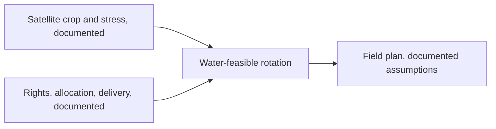

## S4.4 Water: the Ogallala, Kansas LEMAs and SGMA fallowing

For an irrigator, water may decide which crop sequence is feasible before prices do. A regional aquifer trend or satellite-derived vegetation stress can indicate exposure, but neither tells an operator how much water a specific well can pump, what a district will deliver, or what a legal allocation allows. Those constraints are local, dated, and sometimes still proposed rather than binding.

In Kansas, the High Plains aquifer’s overall water level rose a provisional 0.2 ft in 2025 (measured), the first overall rise since 2019, according to the Kansas Geological Survey’s [2025 levels report, read](https://kgs.ku.edu/news/article/groundwater-levels-in-the-kansas-high-plains-aquifer-see-first-overall-increase-since-2019). The 1996 to 2025 mean was a decline of 0.57 ft/year (measured), and Groundwater Management District 3 fell 0.62 ft in 2025 (measured). Local rainfall contributed to the overall rise, so it does not establish recovery at an individual well. A long-run regional trend helps frame risk, but an aquifer-wide average is not the grower’s water supply, pumping cost, or right.

Kansas's Sheridan County 6 LEMA in northwestern Kansas applied a total allocation of 55 acre-inches per eligible acre over each five-year term: 2013-2017, renewed 2018-2022, and approved 2023-2027 (documented). Those enacted Sheridan 6 terms are separate from the pending Greater GMD 4 renewal proposal described below. The [2016 K-State study](https://accc.k-state.edu/research/factsheets/FS7_LEMA.pdf) examined Sheridan 6 in northwestern Kansas, a 99-square-mile LEMA with 185 irrigation wells, comparing reported irrigation and crop-acreage outcomes in 2013 with 2009-2012 averages for the five-mile surrounding comparison area. It estimated irrigated corn area fell 23%, sorghum area rose 68%, soybean area rose 8%, and all irrigated crop acreage fell 5% (documented observational estimates). A separate [2026 Journal of Agricultural and Resource Economics study](https://ageconsearch.umn.edu/record/358997/files/JARE358997.pdf) analyzed 2003-2023 well-meter panel data in Sheridan 6, northwestern Kansas, and comparison points of diversion in a three-mile buffer; its cleaned sample contained 7,222 observations from 169 treatment and 199 control points of diversion. It estimated water-use intensity declined 16% and pumping costs fell $5.48 per acre, with no statistically significant change in irrigated acreage (documented observational estimates). The results are not directly comparable: the K-State study compares 2013 crop-area outcomes with 2009-2012 averages for a five-mile surrounding area, while the 2026 study models 2003-2023 meter records against a three-mile buffer. Samples and methods differ, and the later study's comparison points also adopted a less restrictive allocation beginning in 2018. These observational results do not establish a universal crop response. A cap changes a rotation only if it binds below desired use, and growers respond through crop mix, applied water, or other adjustments.

California has a different mix of groundwater sustainability plans, district surface-water deliveries, pumping charges, and trading. The [Public Policy Institute of California’s San Joaquin Valley analysis, read](https://www.ppic.org/publication/policy-brief-the-future-of-agriculture-in-the-san-joaquin-valley/) estimates that 500,000 to 900,000 acres could need to be fallowed by 2040 (computed), depending on water supplies and trading. That is a scenario, not observed acres caused by the Sustainable Groundwater Management Act, or SGMA. PPIC’s [2026 overdraft update, read](https://ppic.org/blog/california-is-finally-addressing-groundwater-overdraft-how-is-it-going) estimates Central Valley overdraft at about 1.1 million acre-feet/year in 2021 to 2025 (documented), compared with 1.9 million acre-feet/year in 2003 to 2010 (documented). A water district’s surface allocation may ease or intensify a field’s groundwater constraint. A perennial orchard’s sunk investment and removal costs also differ fundamentally from an annual grain crop; a simple fallow-versus-crop layer would miss that difference.

The app can map crop type, canopy condition, vegetation stress, and season-to-season land-cover change at the product’s resolution, then attach dates and uncertainty to those observations. It cannot identify a parcel’s legal water right, actual meter readings, pumping charge, groundwater allocation, district delivery promise, water trade, or a farmer’s reason for fallowing. Regional satellite or aquifer signals cannot settle those private or jurisdiction-specific facts. The tool should ask for the water right or applicable LEMA/GSA rule, allocation period, measured pumping, district delivery, fee, crop water need, and intended acreage. The grower or water authority must confirm the terms before an app treats them as a binding constraint.

By November 10, 2026, the pending Kansas Greater GMD 4 LEMA renewal proposal for 2028-2032 called for a 15% reduction to existing five-year allocations, according to the [October 13, 2026 GMD 4 hearing testimony](https://agriculture.ks.gov/home/showpublisheddocument/17804/639268979873281769) (documented); the Chief Engineer had not issued a final order. The Greater GMD 4 proposal should therefore be displayed as pending, not an enacted field limit. In California, PPIC’s future fallowing scenario must likewise remain distinct from measured fallow. Water layers can help identify where to ask harder questions; only local rights, delivery and pumping records establish the water available to this operation.

**Decision boundary (documented)**

|Evidence|Value and basis|What it does not settle|
|---|---|---|
|Kansas High Plains, 2025|+0.2 ft overall level (measured)|A specific well’s supply|
|Sheridan County 6 LEMA|55 acre-inches per eligible acre over each five-year term: 2013-2017, 2018-2022, and approved 2023-2027 (documented)|A right outside this LEMA|
|San Joaquin Valley, by 2040|500,000 to 900,000 acres fallowing (computed)|Observed SGMA-caused fallow|
