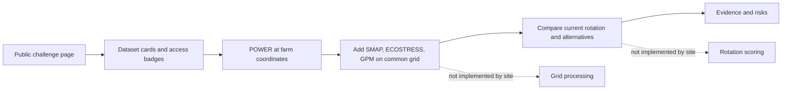

## S7.1 What the companion site exposes to a stranger

The logged-out [Space Data Atlas home (read)](https://spacedata.swapniltamse.com/) organizes public material around challenges, datasets, starter code, preparation, prior winners, and an AI connection. The site map includes 22 public URLs (documented), including the home page, challenge index, 14 challenge pages, and six supporting pages. The pages in this map loaded without an account in the review. This is a challenge-first research and onboarding guide, not NASA's data catalogue or the event submission portal.

The [Field Shift challenge page (read)](https://spacedata.swapniltamse.com/challenges/field-shift-adapting-farms/) brings its paraphrased brief, suggested datasets, access badges, a first-hour recipe, starter examples, a live catalogue-search widget, and theme-matched prior projects into one route. The dataset cards rank six suggestions (documented): SMAP, ECOSTRESS, GPM IMERG, HLS, POWER, and GRACE/GRACE-FO. The page calls this order “likely useful,” not an official resource list. The site's [About page (read)](https://spacedata.swapniltamse.com/about/) describes the project as independent and says challenge summaries are paraphrased and dataset suggestions curated. Its recommendations are useful starting hypotheses; the team must check binding requirements against official challenge material. Reviewed on 2026-11-10 (documented), recheck the Atlas on 2026-11-13 (documented expected-resource date); if the official list appears or changes, revisit the dataset ranking and no-account demo path before build freeze.

The badges distinguish account access from a search that anyone can make. POWER has “No login” and “Works in browser” badges. The other five suggestions show Earthdata Login and browser access. Catalogue search for those products is open, but downloading requires a free Earthdata account. The [Get Ready guide (read)](https://spacedata.swapniltamse.com/get-ready/) covers account setup, authorization, test runs, and offline-demo preparation. These access notes describe setup friction, not paid subscriptions or proof that a download will work for a particular user.

The page's first-hour instructions start with POWER at farm coordinates for rainfall, temperature, and sunlight; next add SMAP moisture, ECOSTRESS heat stress, and GPM rainfall on a common grid; then compare at least three rotations (documented), including the current one, with evidence and risks. **Inference:** this sequence points toward a field-level decision comparison rather than a satellite viewer. It does not supply field boundaries, harmonization code, rotation histories, or a validated score. Its directions tell a builder what to try, not whether each product resolves the relevant crop, field, or local decision.

The Atlas also exposes copyable Python and JavaScript starters, setup instructions, a read-only AI/MCP page for challenge and dataset lookup, and a live CMR search. These routes make it possible to explore guidance and issue a public catalogue query without signing in. The CMR widget lists granule identifiers and dates; it is not a science-file reader. The site links theme-matched 2025 projects, but those matches are the author's judgment rather than NASA requirements.

A logged-out review found no scoring rubric, entry form, countdown, tracker, or scoreboard on the Atlas (read). That absence supports calling the site a research companion, not an event workflow. The limit is important: public inspection cannot rule out private event systems that appear after registration. Nor can a suggested dataset recipe establish agronomic suitability for a specific field, crop, or region. Treat the recipe as a reproducible starting hypothesis, preserve access and provenance warnings, and verify requirements and local fitness separately.

**Figure S7-F1. Companion route and first-hour flow (documented).**

