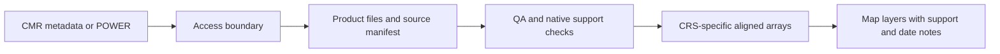

## S9.1 Ingestion and the common grid

#### Status

Executed on 2026-11-10 (documented execution record): a scratch Python 3.12 virtual environment installed `earthaccess==0.19.0`, `requests`, and `rasterio==1.4.4`; imports succeeded, and Rasterio reported bundled GDAL 3.10.3 (documented). Rasterio's Python reprojection API transformed a synthetic 2 by 2 EPSG:4326 raster to a 4 by 4 EPSG:4326 grid with finite values (documented execution record). A public [SMAP catalogue query](https://nsidc.org/data/spl3smp_e/versions/6) also returned records (documented execution result). These checks exercise package setup, catalogue discovery, and API mechanics only.

Planned: there is no downloaded or inspected NASA science granule, selected farm polygon or projection, product subset, or app grid. Real-file QA and resampling remain untested. The synthetic transform does not validate a NASA product or establish farm-scale accuracy.

#### Ranked build order and public demo floor

Build in this order, keeping the public fixture useful before optional data services are added.

| Rank | Deliverable | Acceptance boundary |
|---|---|---|
| 1 | No-account demo fixture | Ship a source-dated, labelled static fixture with selected field geometry, boundary version, crop-season rows including unknown states, and a constraint form. This is the named no-account demo floor; it must work without Earthdata Login or a live satellite endpoint. |
| 2 | Evidence schema and abstention | Add versioned boundaries, field seasons, constraints, observation periods, support, QA, provenance, and the shared `PROVISIONAL_ABSTENTION_GATE`; show gaps and abstain when it fails. |
| 3 | Public context and ingestion | Query POWER and catalogue metadata, then add only optional product files that have access, QA, support, and licence checks. |
| 4 | Comparison and agent validator | Build the typed request, query trace, deterministic validation, and same-object evidence cards; test wrong joins and reversal cases. |
| 5 | Field UX test and direct interaction | Implement labelled controls, field/detail views, and test provisional target size, overview, and disclosure in `FIELD_UX_TEST_01`. |
| 6 | Voice, last | Add voice only after `FIELD_VOICE_TEST_01`, with screen fallback and labelled on-screen confirmation for every write. Drop it when the test or viewing conditions fail. |

The public fixture is a demo aid, not a live data analysis or field-validated comparison. A judge without an Earthdata account should still be able to inspect boundary version, season and constraint provenance, support limits, and abstention on this fixture. Keep live or credential-gated layers clearly separate from fixture contents.

For each source, write a manifest with product and collection version, granule identifier, acquisition and processing dates, source URL, spatial footprint and grid posting, coordinate reference system, units, band names, quality flags, nodata convention, access status, and transformation history. Preserve source values and QA alongside derived layers. Distinguish direct observations from model output and user-entered information. A missing or rejected value must remain missing, with its reason recorded, rather than becoming a plausible zero.

Choose a study extent and projected coordinate reference system from the actual field geometry and intended analysis. Those choices are not yet made. Build a destination transform, dimensions, and nodata policy explicitly. The Python path uses `rasterio==1.4.4` and `rasterio.warp.reproject`, passing source and destination CRS, transforms, array dimensions, nodata values, and resampling method. Use nearest neighbor for categorical QA so flags are not blended. Select a continuous method for each variable according to its meaning and intended aggregation, and document that choice. A GDAL 3.x CLI build could instead use `gdalwarp` with `-t_srs`, `-tr`, `-tap`, `-r`, `-srcnodata`, and `-dstnodata`; the system `gdalwarp` binary was absent, so that route was not exercised.

Minimal executable example using the installed Rasterio Python API:

```sh
# Binaries/builds: Bash 5.x; .venv/bin/python, CPython 3.12 with rasterio 1.4.4 and bundled GDAL 3.10.3.
cd "$HOME/earthdata-s9-demo" || exit 1
.venv/bin/python - <<'PY'
import numpy as np
import rasterio
from rasterio.transform import from_origin
from rasterio.warp import calculate_default_transform, reproject, Resampling
from rasterio.transform import array_bounds

assert rasterio.__version__ == "1.4.4"
assert rasterio.__gdal_version__ == "3.10.3"
src = np.array([[1, 2], [3, 4]], dtype=np.float32)
src_transform = from_origin(0, 2, 1, 1)
bounds = array_bounds(2, 2, src_transform)
dst_crs = "EPSG:4326"
dst_transform, width, height = calculate_default_transform(
    dst_crs, dst_crs, 2, 2, *bounds, resolution=0.5
)
assert (width, height) == (4, 4), (width, height)
dst = np.full((height, width), -9999, dtype=np.float32)
reproject(
    source=src,
    destination=dst,
    src_transform=src_transform,
    src_crs=dst_crs,
    src_nodata=None,
    dst_transform=dst_transform,
    dst_crs=dst_crs,
    dst_nodata=-9999,
    resampling=Resampling.bilinear,
)
assert np.isfinite(dst).all() and (dst != -9999).any()
print(f"Python Rasterio {rasterio.__version__}, GDAL {rasterio.__gdal_version__}: {src.shape} to {dst.shape}")
PY
```

Recovery rung: if the interpreter, Rasterio import, or version assertion fails, activate the project `.venv`, verify `python --version` and `python -m pip show rasterio`, then reinstall the pinned `rasterio==1.4.4` wheel in that environment. If the dimension assertion fails, inspect source bounds and destination resolution before changing either. If output contains only nodata, inspect CRS, transforms, nodata, and bounds. Do not substitute `gdalwarp` unless its binary is installed and its build is checked.

#### Keep support visible

A common grid makes arrays align; it does not improve native information or make unlike observations independent. [HLS surface reflectance](https://doi.org/10.5067/HLS/HLSL30.002) is a 30 m product (documented). SMAP's 9 km posting (documented) comes from a radiometer footprint of roughly 36 km (documented), so neighboring grid cells are not field-scale independent observations. [GRACE's 0.5 degree posting](https://podaac.jpl.nasa.gov/dataset/TELLUS_GRAC-GRFO_MASCON_CRI_GRID_RL06.3_V4) (documented) represents mascons with native support around 300 to 330 km (documented). POWER is coarse reanalysis context, with conflicting documentation on the hydrology grid dimensions. Keep these support statements in each layer's manifest and legend. Do not upsample coarse or modeled layers and present their pixels as new detail.

Before rendering, test geometry validity, CRS consistency, bounds, pixel alignment, nodata propagation, expected QA flags, and plausible value ranges with product-specific rules. Record rejected-cell counts and missing coverage. Preserve source dates and effective support in map tooltips and exports. A layer whose QA or coverage fails should be unavailable, not interpolated into a convincing surface.

**Figure S9-F1. Planned ingestion and provenance pipeline (computed design; not an observed processing run).**


